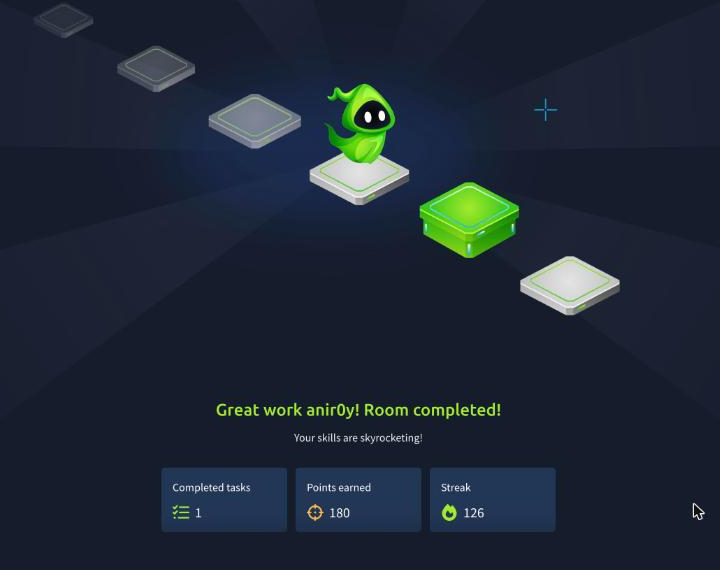

| <script src="https://tryhackme.com/badge/434937"></script>| <a class="twitter-follow-button" href="https://twitter.com/anir0y" data-size="large"> Follow @anir0y<a>|
|---|---|
|Block ||

Block is a medium standalone DFIR challenge with a one-line tagline that tells you everything: "Encryption? What encryption?". There is no box to exploit. You get two pieces of evidence, a small `traffic.pcapng` network capture and a 171 MB `lsass.DMP` memory dump, and you have to prove that two ex-employees read private files off an SMB server. The catch is that the SMB3 traffic is encrypted end to end, so the filenames and the file contents are not sitting in the capture as plaintext. The whole room is a lesson in how SMB3 session encryption is only as strong as the credentials behind it: once you recover a user's NT hash from the LSASS dump, you can rebuild the exact session key the client used and decrypt everything it sent. If you like this kind of protocol-level forensics, it pairs well with my [Directory walkthrough](/post/thm-room-directory/), where the same idea cracks open NTLM-sealed WinRM traffic.

Everything below runs on my Mac with `tshark`, `pypykatz`, `hashcat`, and a short Python helper. No VM, no AttackBox.

## Setup: one capture, one memory dump

The evidence zip (md5 `286c133a1b67c068f86cef06785e104d`) holds just two files. The capture is tiny, about 148 frames, but a quick protocol look shows what matters: a handful of plaintext SMB2 setup messages and a wall of encrypted SMB3 transform records.

```text
  frame    148
    smb         2   (SMB1 negotiate)
    smb2       98   (SMB2/3)
  Two hosts:
  10.0.2.64  <- attacker workstation
  10.0.2.70  <- the file server / domain controller
```

The NTLMSSP exchange is not encrypted, so the usernames are in the clear. Two accounts authenticate over the capture:

```bash
  tshark -r traffic.pcapng -Y 'ntlmssp.auth.username' -T fields \
    -e frame.number -e ntlmssp.auth.domain -e ntlmssp.auth.username
```

```text
  11   WORKGROUP   mrealman      <- first login
  82   WORKGROUP   eshellstrop   <- second login
```

That already answers two questions. The first person who touched the server is **`mrealman`** and the second is **`eshellstrop`**.

## Task 1 Q1 and Q4: the two users

Frame 11 carries the first `NTLMSSP_AUTH` (session id `0x0000100000000041`), frame 82 the second (`0x0000100000000045`). Both come from `10.0.2.64`. So the usernames are **`mrealman`** (Q1) and **`eshellstrop`** (Q4).

## Task 1 Q5: the second user's NT hash

The LSASS dump is where the credentials live. `pypykatz` parses a minidump offline, no Windows needed:

```bash
  pypykatz lsa minidump lsass.DMP > pypykatz_out.txt
```

The MSV provider gives the NT hashes directly. For `eshellstrop`:

```text
  Username: eshellstrop
  Domain: BLOCK
  NT: 3f29138a04aadc19214e9c04028bf381
  SHA1: 91374e6e58d7b523376e3b1eb04ae5440e678717
```

The hash of the second user is **`3f29138a04aadc19214e9c04028bf381`** (Q5). The same dump gives `mrealman`'s NT hash, `1f9175a516211660c7a8143b0f36ab44`, which we need next.

## Task 1 Q2: crack the first user's password

LSASS held the NT hash but no cleartext for the user accounts (only the machine account had a long derived secret), so the password has to be cracked. NTLM is hashcat mode 1000:

```bash
  echo 1f9175a516211660c7a8143b0f36ab44 > mreal.nt
  hashcat -m 1000 -a 0 mreal.nt rockyou.txt
```

```text
  1f9175a516211660c7a8143b0f36ab44:Blockbuster1
```

`mrealman`'s password is **`Blockbuster1`**. That is a satisfying touch for a room called Block, and it is the key to the rest of the evidence.



## Task 1 Q3 and Q6: decrypt the SMB3 traffic for the flags

Here is the real work. The file reads are inside SMB3 transform records (`0xfdSMB`), encrypted with AES-128-GCM. To read them you need each session's encryption keys, and in SMB 3.1.1 those keys derive from the SMB session key through an SP800-108 key-derivation function seeded by the connection's preauth integrity hash.

The SMB session key itself is the NTLM `ExportedSessionKey`. You can rebuild it from the NT hash and the fields already in the capture: the server challenge, the NTLMv2 response, and the encrypted random session key from the `AUTH` message. The chain is the standard NTLMv2 one:

```python
  # NTLMv2 session key, per user, from the NT hash + captured NTLM fields
  ntlmv2 = HMAC_MD5(nthash, upper(user).utf16le + domain.utf16le)
  ntproof = ntresponse[:16]                       # from the capture
  sessionbasekey = HMAC_MD5(ntlmv2, ntproof)      # == KeyExchangeKey
  exported = RC4(sessionbasekey, encrypted_session_key)   # the SMB session key
```

Recomputing the first 16 bytes of the NTLMv2 response confirms the hash and domain casing are right (the NTProofStr matches), which means the session keys are correct:

```text
  mrealman     sesid 0x0000100000000041   seskey 20a642c086ef74eee26277bf1d0cff8c
  eshellstrop  sesid 0x0000100000000045   seskey facfbdf010d00aa2574c7c41201099e8
```

Wireshark can take it from there. It knows how to run the SMB 3.1.1 KDF against the preauth hash it already tracked, so you only have to hand it the session id and the session key. The catch that cost me a few minutes: `tshark` wants the session id in on-the-wire byte order, unquoted, as a four-column UAT record (the two empty columns let Wireshark derive the directional keys itself):

```text
  # ~/.config/wireshark/smb2_seskey_list
  4100000000100000,20a642c086ef74eee26277bf1d0cff8c,,
  4500000000100000,facfbdf010d00aa2574c7c41201099e8,,
```

With that in place the encrypted traffic opens up. Both users mounted the same `clients` share and each opened one CSV:

```bash
  tshark -r traffic.pcapng -Y 'smb2.cmd==5 && smb2.filename' \
    -T fields -e smb2.sesid -e smb2.filename
```

```text
  0x0000100000000041   clients156.csv   (mrealman)
  0x0000100000000045   clients978.csv   (eshellstrop)
```

Dumping the decrypted read responses prints the files in full. Each is a list of customer passwords with a flag hidden in one row:

```text
  # clients156.csv  (mrealman)
  Farris,Busst,THM{SmB_DeCrypTing_who_Could_Have_Th0ughT}

  # clients978.csv  (eshellstrop)
  Tonye,Risebrow,THM{No_PasSw0Rd?_No_Pr0bl3m}
```

The first user's flag is **`THM{SmB_DeCrypTing_who_Could_Have_Th0ughT}`** (Q3) and the second user's flag is **`THM{No_PasSw0Rd?_No_Pr0bl3m}`** (Q6).



## Takeaways

Two durable lessons from this capture:

- SMB3 encryption protects data on the wire, not from anyone who can recover the account's secret. The transform records use AES-128-GCM, but the keys trace straight back to the user's NT hash. An LSASS dump (or a cracked password) collapses the whole protection: rebuild the `ExportedSessionKey`, let the SMB 3.1.1 KDF turn it into directional keys, and every "encrypted" file read becomes plaintext. Encryption without credential hygiene buys you very little.
- Know the difference between a tool deriving a key and a tool decrypting the payload. Wireshark will happily run the SMB3 key schedule for you, but only once you feed its `smb2_seskey_list` the session id in wire byte order and leave the directional-key columns blank so it derives them. Getting the format wrong reads like a broken key, not a formatting error, so keep a verification step (the NTProofStr check) that proves the session key is right before you blame the decryptor.

Room solved 100%: 1 task, 6 answers.
