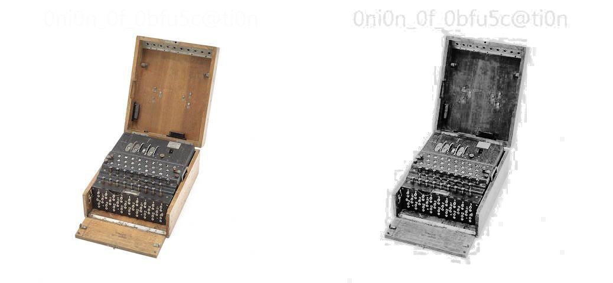

| <script src="https://tryhackme.com/badge/434937"></script>| <a class="twitter-follow-button" href="https://twitter.com/anir0y" data-size="large"> Follow @anir0y<a>|
|---|---|
|CCT2019 ||

CCT2019 packages four legacy challenges from the US Navy Cyber Competition Team 2019 assessment, sponsored by US TENTH Fleet, and THM rates it insane. There is no lab machine. Every task is a downloadable file: a pcap, a Windows .NET binary, a JPEG and a crypto zip, each a chain of three or four steps where every step hands you the key to the next. If you liked the known-plaintext trick in my [W1seGuy](/post/thm-room-w1seguy/) writeup, crypto1 is the same kind of thinking, and pcap1 is a bigger cousin of the carving in [Extracted](/post/thm-room-extractedroom/).

All four files came from the room's Download Task Files buttons (presigned S3 links, valid for 120 seconds), and everything was solved on a Mac. Anything that had to run, like cryptcat and the final pcap binary, ran inside a throwaway Kali container.

I went in order of difficulty, easiest first, which is the reverse of the task order.

## Task 4: crypto1, three ciphers in nested zips

### crypto1a: a keyboard layout, not a Caesar shift

`crypto1.zip` holds `crypto1a.txt` and a password-protected `crypto1a.zip`. The text looks like a substitution cipher, but the punctuation is wrong in a telling way: `yd.` shows up again and again where you would expect "the", and `.` sits inside words. That is what QWERTY text looks like when you type it on a Dvorak layout. Mapping each Dvorak character back to the QWERTY key in the same position decodes it:

```python
  q = "-=qwertyuiop[]asdfghjkl;'zxcvbnm,./_+QWERTYUIOP{}ASDFGHJKL:\"ZXCVBNM<>?"
  d = "[]',.pyfgcrl/=aoeuidhtns-;qjkxbmwvz{}\"<>PYFGCRL?+AOEUIDHTNS_:QJKXBMWVZ"
  print(open("crypto1a.txt").read().translate(str.maketrans(d, q)))
  # An easy technique for solving Caesar substitution ciphers will only get you so far
  # ... the key which happens to be the name of the "layout" which created this.
  # Actually, you had better enter it thrice just to be safe (all lower-case if you please).
```

The zip password is `dvorakdvorakdvorak`, and the flag inside is **CCT{Actu411y_a_w@rmup}**.

### crypto1b: a five-rail fence read from the bottom

Inside are `crypto1b.txt` and another zip. The hint line says "Don't straddle the fence or you'll end up riding a rail or five. It'll hurt from the bottom up." So it is a rail fence with 5 rails, with the zigzag starting on the bottom rail instead of the top. I tried all 8 starting offsets in both directions. The bottom-up decode (the same as a top-down decode with offset 4) gives clean English:

```text
  # rails=5, start on the bottom rail
  Moving right along through a different challenge. ... How about this for a key.
  The way the goose spells terrific from the 1973 animated movie of Charlotte's web.
  ... At the very least it's four Cs, but it's probably six. All lower case ...
```

Rather than rewatch the film, I brute forced the spelling: every letter of "terrific" repeated 1 to 3 times, and the final `c` 1 to 8 times. That is about 17,000 candidates, checked locally against the zip. The hit was `teerrrriiffiicccccc`, so the goose doubles every letter and the doubled `rr` becomes four. The flag is **CCT{th@t_w4s_th4_ea5y_bu770n!}**.

### crypto1c: run-length encoded bits

The last file is one long string of digits from 1 to 6, and the room's hint says to "start with 0 not 1". That is run-length encoding of a bitstream: the first digit is a run of zeros, the next a run of ones, and so on. Expanding it gives 2,008 bits, exactly divisible by 8:

```python
  bits, cur = "", "0"
  for d in s:
      bits += cur * int(d)
      cur = "1" if cur == "0" else "0"
  print(bytes(int(bits[i:i+8], 2) for i in range(0, len(bits), 8)).decode())
  # ... At any rate, well done and here is your flag: CCT{I_see_dead_ciphers_all_the_time}
```

That is **CCT{I_see_dead_ciphers_all_the_time}**, and crypto1 was 3/3 on the first submission.

## Task 2: re3, the slider lock

`re3.exe` is a .NET WinForms app with four horizontal sliders and a Check button. I have no Windows box handy, and you do not need one: .NET compiles to IL, and ILSpy turns it back into C#. `ilspycmd` installs as a dotnet tool. On a Mac with only the .NET 10 SDK it also needs `DOTNET_ROLL_FORWARD=Major` before it will start.

```csharp
  // RE3.exe, decompiled with ilspycmd (Dotfuscator only renamed symbols)
  if (v1 + v2 + v3 + v4 == 711 && v1 * v2 * v3 * v4 == 711000000
      && v1 > v2 && v2 > v3 && v3 > v4)
      MessageBox.Show(goodBoy(v1, v2, v3, v4, byteA.Clone()));   // byteA[i] ^= (c ^ v2), c = 177
  else
      MessageBox.Show(badBoy(...));                               // byteB ^ 51
```

The badBoy branch just decodes to "None shall pass! Again? Give up?". The goodBoy constraints are the old 7-Eleven puzzle: four prices that add up to $7.11 and also multiply to $7.11. In cents, a four-level loop over divisors of 711,000,000 finds exactly one strictly descending answer: **316, 150, 125, 120**. The key only depends on the second slider, XORing each of the 32 stored bytes with `177 ^ 150`:

```text
  # sliders 316 > 150 > 125 > 120, sum 711, product 711000000
  key: 31C02DCFDE2FCF727016E2A7054B6DA5
```

The answer is **31C02DCFDE2FCF727016E2A7054B6DA5**, the 32-character hex blob the task promised. I never ran the binary.



## Task 3: for1, Ed's Enigma photo

The file is a JPEG of an Enigma machine with three layers of hiding.

**Layer 1, metadata and an appended zip.** The XMP `dc:description` is Morse code, and a zip sits after the JPEG end-of-image marker at offset 29,202:

```text
  # XMP description
  .--- ..- ... - .- .-- .- .-. -- ..- .--. .-. .. --. .... - ..--..
  # = JUSTAWARMUPRIGHT?   (hint 1: try lower case)
  unzip -P 'justawarmupright?' tail.zip   ->  fakeflag.txt
  # "Peer into the Matrix. See what others cannot ..."  - Morpheus
  # PW: Z10N0101
```

**Layer 2, steghide.** `Z10N0101` is a steghide passphrase. `steghide extract -sf for1.jpg -p Z10N0101` writes `archive.zip`, which is password protected again. "See what others cannot" is the clue: there is near-white text painted on the near-white background. Equalising the blue channel makes it jump out:



`0ni0n_0f_0bfu5c@ti0n` opens `archive.zip`, which holds `cipher.txt`, `config.txt` and `flag.zip`.

**Layer 3, Enigma M4.** The config line reads like a cryptii key sheet:

```text
  C G. VI. VII. VIII. AMTU RING AM BY CH DR EL FX GO IV JN KU PS QT WZ
  # reflector C-thin, Greek wheel Gamma, rotors VI VII VIII
  # positions AMTU, ring settings R I N G, 13 plugboard pairs (AM ... WZ)
```

This is where I lost the most time on this task. I first read "RING AM" as a label plus the ring setting `AM`, which left 12 plug pairs. That produced garbage, and so did a full brute force of ring settings. The breakthrough was reading `RING` itself as the four ring letters, which makes `AM` the first of 13 plugboard pairs. The `py-enigma` library caps the plugboard at 10 pairs, so I raised its `MAX_PAIRS` constant. The room also warns that a cryptii bug broke the original ciphertext, so I used the corrected text from the task description (`JHSL PGLW ...`):

```text
  rotors=Gamma VI VII VIII, reflector=C-Thin, rings=RING, display=AMTU
  JHSLPGLWYSQODQVLPFAOTPCYKPUDTF  ->  CTFFORENSICSISNOTREALFORENSICS
```

The lower-case version `ctfforensicsisnotrealforensics` opens `flag.zip`, which gives **CCT{Well_that_wasn't_such_a_chore_now_was_it?}**. As a check, the original ciphertext does not decrypt under the same settings, so the room's warning is real.

## Task 1: pcap1, a pcap inside a USB capture inside an encrypted channel

### Step 1: carve the MTP object from the USB capture

`pcap2.pcapng` holds only 20 frames, all USB bulk transfers. The first host-to-device frame is a 16-byte PTP container with operation `0x1009`, which is GetObject. The device answers with one data container whose 12-byte header gives a length of 2,308,195 bytes, split over 18 frames. Concatenating the `usb.capdata` of frames 2 to 19 and stripping the header gives a zip holding `pcap_chal.pcap`, with 4,588 packets. That matches the room's hint, which is how you know you recovered it in full:

```python
  fr = [bytes.fromhex(l.strip()) for l in open("cap.hex")]   # tshark -e usb.capdata
  d = fr[1] + b"".join(fr[2:19])
  L = int.from_bytes(d[:4], "little")                         # 2308195
  open("obj.zip", "wb").write(d[12:L])
```

### Step 2: the conversation hidden in ping

The inner capture is mostly browsing over TLS, plus a lot of ICMP. Nearly all of the echo requests carry the standard 40-byte payload, but about 20 are odd sizes, and decoding those shows a chat between `.187` and `.203`. The key lines are in the screenshot below: they agree to use cryptcat instead, pick a key that "Angela Bennett uses to log into the Bethesda Naval Hospital", listen on "the metasploit port" (4444), and confirm an MD5 afterwards. TCP stream 49 is that transfer: 14,552 bytes from `.187` to port 4444.

### Step 3: the key, and the false start

Angela Bennett is Sandra Bullock's character in *The Net* (1995). My first guess, `natoar23ae`, is the password that famously appears on screen in that film, and it is wrong. To prove the replay method was not the problem, I captured a known cryptcat session with plain `nc`, replayed it into a cryptcat listener, and got the plaintext back. A wrong key, by contrast, gives zero output bytes. I also ruled out an arm64 versus amd64 build mismatch by repeating the test in an amd64 container. A trivia search pointed me to `BER5348833`, the login shown for the Bethesda hospital scene; I found it through another CCT2019 writeup that had made the same `natoar23ae` mistake. What makes that key trustworthy is the hash: the decrypted output's MD5 matches the one sent over ICMP, and the reply to that was "hash is good".

### Step 4: run the payload somewhere it cannot phone home

The decrypted file is a stripped x86-64 ELF. Its strings show it resolving `irc.cct`, joining `#flag` and sending a `PRIVMSG`. The flag is stored obfuscated, so `strings` alone does not give it. I ran it in the amd64 Kali container after disconnecting that container from all networks, with `irc.cct` pointed at 127.0.0.1 and an `nc -l -p 6667` listener catching what it sent:


The flag is **CCT{h3's_a_pc@p_w1z@rd_th3re_h4s_g0t_to_6e_a_7w1st}**. The room's third hint says the binary was built for amd64 Kali, and that turned out to be a hint about running it, not about any further reversing.

## Two takeaways

First, decide what counts as proof before you trust a guessed key. Both pcap1 and crypto1b came down to "which secret did the author have in mind", and each time the challenge itself provided a way to check: an MD5 in the chat, and a zip with a CRC. A local oracle like that turns guessing into brute force, and if you also test your method against a known-good case (like the cryptcat replay round trip), a wrong guess cannot be confused with a broken tool.

Second, when a config line will not parse, change how you split it before you change the algorithm. For1's `AMTU RING AM BY ...` looked like positions, a label and a ring setting, and a full ring-setting brute force could never fix that misreading. Re-tokenising the same line as "positions, rings, 13 pairs" solved it at once. That is the same lesson as THM's answer masks: the shape of the data usually tells you how to read it.

Room solved 100%: 4 tasks, 6 answers.
