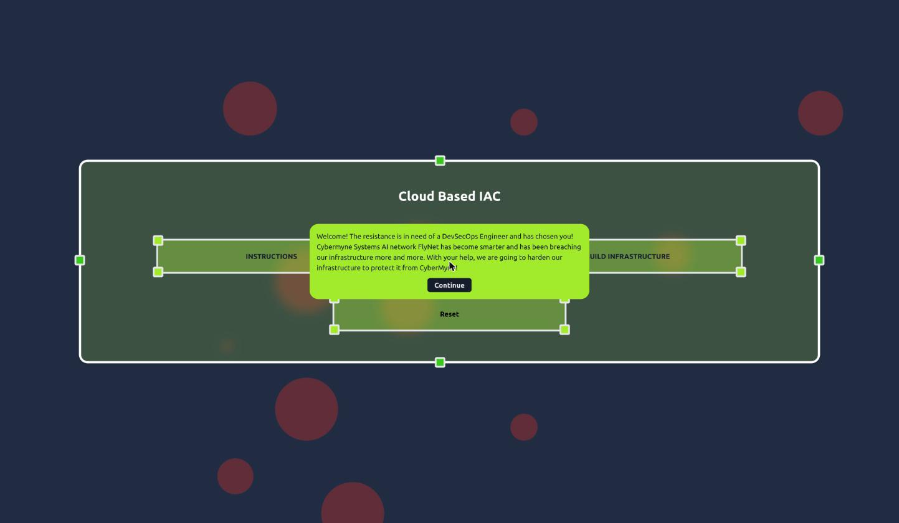
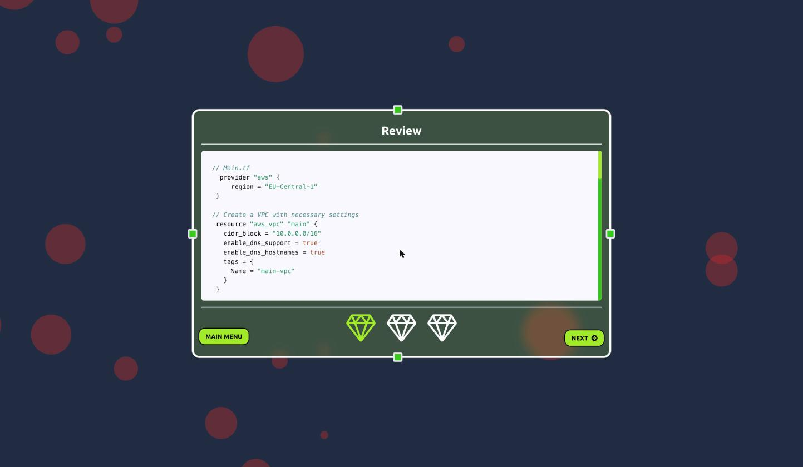

| <script src="https://tryhackme.com/badge/434937"></script>| <a class="twitter-follow-button" href="https://twitter.com/anir0y" data-size="large"> Follow @anir0y<a>|
|---|---|
|Cloud-based IaC ||

Cloud-based IaC closes out the Infrastructure as Code module of the DevSecOps path. After [Intro to IaC](/post/thm-room-introtoiac/) set the vocabulary and [On-Premises IaC](/post/thm-room-onpremisesiac/) showed what attacking a Vagrant and Ansible pipeline looks like, this room moves the same ideas to the cloud with the two tools you will actually meet in a job: HashiCorp Terraform and AWS CloudFormation. It is a theory room, eight tasks of concepts and tool characteristics plus one Practical at the end, a static-site game with a single flag.

I will go through the concept answers quickly, then show how I pulled the Practical flag out of the game's JavaScript instead of playing through, because that is the one reusable trick in the room.

## Task 2: Terraform 101

Terraform Core takes its input from two sources. The source that tracks what the infrastructure currently looks like is the **State** (the `terraform.tfstate` file). The source that defines what you want the infrastructure to look like is the **Terraform Config Files** (the HCL you write). When the two differ, Terraform plans the change and executes it through a **provider**, the plugin that talks to AWS, Azure, Kubernetes and so on.

## Task 3: Terraform Configuration

Config is written in HCL. In the room's first VPC example, the thing defined before the resource block is the **provider** (the `provider "aws"` block with its region). When you modularise your infrastructure, the central configuration file is **main.tf**, and instead of repeating values across modules you collect them in **variables.tf** and reference them. That split (resources in `main.tf`, inputs in `variables.tf`) is the standard Terraform layout.

## Task 4: Terraform Workflow

Three commands, in the order you actually run them. To prepare your workspace (download providers, set up the backend) you run **terraform init**. To preview the actions that would move your infrastructure from its current state to the desired state you run **terraform plan**. To actually carry those actions out you run **terraform apply**. Plan before apply is the habit worth keeping: it is the moment to read exactly what will change.

## Task 5: CloudFormation 101

CloudFormation is AWS's own IaC tool, declarative, with templates in JSON or YAML that form a stack when deployed. It runs on an event-driven model, so what is generated during stack creation are **Events** (which you monitor to track progress or spot failures). You can define rollback triggers in a template, so the answer there is **yay**. And to refer to resources defined in another stack you use **Cross-Stack References**.

## Task 6: CloudFormation Configuration and Use Cases

CloudFormation does support intrinsic functions (helpers like `!Ref` and `!GetAtt`), so that answer is **yay**. The feature that lets you understand the impact of a modification before it is applied is **Change Sets**, which is CloudFormation's equivalent of reading a `terraform plan` before you commit to it.



## Task 7: Terraform vs CloudFormation

The comparison comes down to lock-in and reach. CloudFormation is not cloud agnostic (it is AWS only), so that answer is **nay**. The tool with deep AWS integration is **CloudFormation**, since it is a first-party AWS service. The tool with accessible community-driven modules is **Terraform**, whose public registry is a large part of why teams pick it. In short: CloudFormation for an all-AWS shop that wants native integration, Terraform for multi-cloud and reuse.

## Task 8: Secure IaC

The best-practice task maps straight to the kind of findings you look for when reviewing IaC. Instead of hardcoding secrets in the code, you **Parameterise Sensitive Data** (and pull the real values from a vault or the cloud's secret manager at runtime). The collaborative process that catches security issues early is **Code Reviews**. And in CloudFormation specifically, the policies you implement to control updates to a stack's resources are **Stack Policies**. Version control, least privilege and audit trails round out the list, and they are the same controls that would have closed the holes in the on-prem pipeline from the previous room.

## Task 9: The Practical, and reading the flag from the bundle

The Practical is a static-site game. You play a DevSecOps engineer hardening "The Resistance" infrastructure against a sentient AI, choosing resource blocks and variable changes to secure an initially bare Terraform config. Secure it fully and the flag is yours.



Clicking into Build Infrastructure shows the starting config, an insecure `main.tf` with a VPC and little else, and a set of levels to work through (the three diamonds track progress).



Rather than play through, I did what the whole module has been teaching: a front-end only app cannot keep a secret from the browser, so the flag is in the files the page downloads. The index points at one bundle:

```text
  curl -s https://static-labs.tryhackme.cloud/apps/cloud-based-iac/ | grep -oE 'src="[^"]+"'
  # src="/apps/cloud-based-iac/assets/index-5ecf2a74.js"
```

A search for `THM{` in the bundle found nothing, which usually means the flag is base64-encoded. I decoded every base64-looking string literal and kept the one that produced a readable flag:

```text
  # decode every "...=="-style literal, keep the one containing THM
  "VEhNe2MxMHVELWJAejNkLTFAU2VFfQ==" -> THM{c10uD-b@z3d-1@SeE}
```

To be sure this was the real win value and not a decoy, I read the code around it. The literal is decoded with `atob` inside the component that only renders when the game state is `SUCCESS`, next to a "Click to copy" handler:

```text
  const t = e.guide === SUCCESS, n = atob("VEhNe2MxMHVELWJAejNkLTFAU2VFfQ==")
  // rendered on the success screen with a copy-to-clipboard button
```

So the flag is **`THM{c10uD-b@z3d-1@SeE}`** ("cloud based is easy" in leet), gated only by the game in front of it. It fits the `***{*****************}` mask (the hyphens and the `@` in the leet-speak render literally inside the braces).

## Two takeaways

First, the Terraform and CloudFormation split is the practical decision this room is really teaching. Both are declarative and both compare a desired state to an actual state, but CloudFormation is AWS-native with deep integration and no portability, while Terraform is multi-cloud with a large community module registry and its own state file to manage. When you review either, the risk lives in the same place: read the plan or the change set before it is applied, because that is where a one-line variable change becomes a public S3 bucket or an open security group.

Second, this is the third room in a row where the flag was sitting in a client-side bundle. Intro to IaC, On-Premises IaC and now this one all hid the win value in JavaScript the browser downloads, one base64 string protected by a game. The same is true of real single-page apps: feature flags, admin routes, API keys and unlock logic shipped in a client bundle are readable by anyone who opens it. If a value needs to stay secret, it has to come from a server after a server-side check, never from the front end.

Room solved 100%: 9 tasks, 22 answers.
