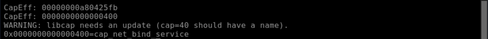
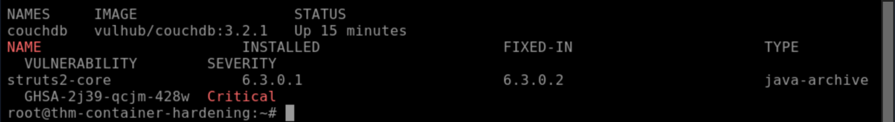
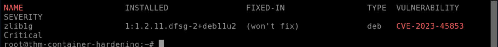

| <script src="https://tryhackme.com/badge/434937"></script>| <a class="twitter-follow-button" href="https://twitter.com/anir0y" data-size="large"> Follow @anir0y<a>|
|---|---|
|Container Hardening ||

Container Hardening is the defensive half of the Container Security module in the DevSecOps path. [Container Vulnerabilities](/post/thm-room-containervulnerabilitiesDG/) showed four ways a badly configured container hands you root on the host; this room is the fix list for exactly those mistakes. If you have not done [Intro to Docker](/post/thm-room-introtodockerk8pdqk/) yet, start there, because this room assumes you already know what a daemon, an image and a container are.

Most of the room is reading with short questions that come straight out of the task text. Task 8 is the hands-on part: a lab machine with Docker, a vulnerable image, an exported container filesystem and the Grype scanner. I answered the reading tasks first while the machine booted, then went back and checked the controls on the real box rather than just quoting the text, because "set this flag" is much more convincing when you can see the kernel enforce it.

## Task 1: What the room covers

Five learning objectives: protect the Docker daemon from unauthorised access, assign capabilities correctly, stop a container from eating all host resources, use Seccomp and AppArmor to limit what a container can do, and review images for vulnerabilities. No answer, just a Check click.

## Task 2: Protecting the Docker daemon

The daemon is the real attack surface. Anyone who can talk to it can start a privileged container and own the host, which is why an exposed TCP 2375 was the scariest finding in the previous room. The room gives two safe ways to manage a daemon remotely.

The first is SSH via Docker contexts. A context is a named connection profile, so a developer can keep one for the dev box and one for production and switch between them:

```text
  docker context create --docker host=ssh://myuser@remotehost --description="Development Environment" development-environment-host
  docker context use development-environment-host
```

That gives the two answers: creating a profile is **`docker context create`** and switching to one is **`docker context use`**. On the lab box only the default context exists, pointed at the local socket:

```text
  docker context ls
  # NAME        DESCRIPTION                               DOCKER ENDPOINT
  # default *   Current DOCKER_HOST based configuration   unix:///var/run/docker.sock
```

The second option is TLS on port 2376, where the daemon only accepts clients presenting a certificate signed by your CA:

```text
  dockerd --tlsverify --tlscacert=myca.pem --tlscert=myserver-cert.pem --tlskey=myserver-key.pem -H=0.0.0.0:2376
  docker --tlsverify --tlscacert=myca.pem --tlscert=client-cert.pem --tlskey=client-key.pem -H=SERVERIP:2376 info
```

## Task 3: Control groups as resource limits

By default a container can use as much CPU and RAM as the host will give it. One runaway (or deliberately abusive) container can starve everything else on the box. Cgroups fix that, and Docker exposes them as plain `docker run` flags:

```text
  docker run -it --cpus="1" mycontainer
  docker run -it --memory="20m" mycontainer
```

The CPU core argument is **`--cpus`**, and the limits are visible afterwards with **`docker inspect Apache`** (the question's container name). I checked that the limits actually land in the container config on the lab machine:

```text
  docker run -d --name hardened --cpus 0.5 --memory 256m --cap-drop ALL --cap-add NET_BIND_SERVICE --security-opt no-new-privileges openjdk:17-jdk-alpine sleep 120
  docker inspect hardened --format "NanoCpus={{.HostConfig.NanoCpus}} Memory={{.HostConfig.Memory}}"
  # NanoCpus=500000000 Memory=268435456
  docker stats --no-stream --format "{{.Name}} cpu={{.CPUPerc}} mem={{.MemUsage}}" hardened
  # hardened cpu=0.00% mem=352KiB / 256MiB
```

Half a core is stored as 500,000,000 nano-CPUs, and `docker stats` reports the 256 MiB ceiling. Compare that with the room's running `couchdb` container, which was started with `NanoCpus=0 Memory=0`, meaning no limit at all. That is the default, and it is what you will find on most hosts nobody hardened.

## Task 4: Dropping Linux capabilities

Root inside a container is not one permission, it is a bundle of about forty capabilities. Privileged mode hands all of them over, which is how the previous room escaped. The right move is to drop everything and add back only what the service needs. A web server that wants port 80 needs exactly one: **`CAP_NET_BIND_SERVICE`**, the capability that lets a process bind ports under 1024. You add capabilities with **`--cap-add`**:

```text
  docker run -it --rm --cap-drop=ALL --cap-add=NET_BIND_SERVICE mywebserver
```

To see what a process holds, the room uses **`capsh --print`**. I wanted proof the drop actually works, so I compared the effective capability set of a default container against a hardened one on the lab machine:

```text
  docker run --rm openjdk:17-jdk-alpine grep CapEff /proc/self/status
  # CapEff: 00000000a80425fb
  docker run --rm --cpus 0.5 --memory 256m --cap-drop ALL --cap-add NET_BIND_SERVICE openjdk:17-jdk-alpine grep CapEff /proc/self/status
  # CapEff: 0000000000000400
  capsh --decode=0000000000000400
  # 0x0000000000000400=cap_net_bind_service
```



The default mask `0xa80425fb` decodes to fourteen capabilities (chown, dac_override, setuid, setgid, net_raw, mknod and friends). After `--cap-drop ALL --cap-add NET_BIND_SERVICE` the mask is a single bit, `0x400`, bit 10. That is the whole lesson in one hex number. The `libcap needs an update` warning is the host's old libcap not knowing the name of capability 40; it is harmless.



## Task 5: Seccomp versus AppArmor

Both restrict a container, at different layers, and the room's questions test that you know which is which.

- **Seccomp** filters system calls. If you want to stop a container calling `clock_adjtime`, `mount` or `ptrace`, that is a Seccomp profile, loaded with `--security-opt seccomp=profile.json`.
- **AppArmor** is mandatory access control on resources: files, paths, network, capabilities. If you want a container to only read files under `/home/tryhackme`, that is an AppArmor profile.

So the answers are **AppArmor** for the file-path restriction and **Seccomp** for blocking a syscall. The command to list AppArmor's state is **`aa-status`**, which on the lab box shows the module loaded and the `docker-default` profile applied to the running container:

```text
  aa-status | head -3
  # apparmor module is loaded.
  # 34 profiles are loaded.
  # 32 profiles are in enforce mode.
  docker inspect couchdb --format "AppArmor={{.AppArmorProfile}}"
  # AppArmor=docker-default
```

One honest nit about the task text: its AppArmor example passes a file path (`--security-opt apparmor=/home/cmnatic/.../profile.json`). Docker actually expects the name of a profile already loaded into the kernel with `apparmor_parser -r -W <file>`, so in real life you load the file first and then reference the profile by name, for example `--security-opt apparmor=my-profile`.

## Task 6: Reviewing images before you run them

A short reading task on reviewing Dockerfiles and images: use trusted, minimal base images, do not run as root, do not bake secrets into layers, and look inside an image's layers with a tool like Dive before trusting it. No answer, just Complete.

## Task 7: Compliance and benchmarking

Two frameworks get named here, the CIS Docker Benchmark and the one the question wants: the NIST publication on application container security, **`NIST SP 800-190`**. The mask is `**** ** *******`, and the hyphen in `800-190` renders as a star, so the full designation with the hyphen is what it accepts. Docker's own analysis tool is **`Docker Scout`**, used like `docker scout cves local://nginx:latest`.

## Task 8: Scanning images with Grype

The practical. The lab machine boots into a root terminal in split view. I dropped an ephemeral SSH key from that terminal so I could drive the box from my Mac with clean output, then started with the running containers:

```text
  docker ps --format "table {{.Names}}\t{{.Image}}\t{{.Status}}"
  # NAMES     IMAGE                  STATUS
  # couchdb   vulhub/couchdb:3.2.1   Up 15 minutes
```

The only running container is **`couchdb`**.

Next, Grype on the `struts2` image. Here I hit the one real snag of the room. Grype refused to run at all:

```text
  grype struts2 --scope all-layers
  # 1 error occurred:
  #   * db could not be loaded: the vulnerability database was built 2 years ago (max allowed age is 5 days)
```

The room tells you to ignore the "unable to check for database update" warning, but that was written when the bundled database was fresh. Grype 0.74.4 refuses any database older than five days, and the lab has no internet to fetch a new one. The fix for an offline box is to tell Grype to trust the database it has:

```text
  export GRYPE_DB_VALIDATE_AGE=false GRYPE_DB_AUTO_UPDATE=false
  grype struts2 --scope all-layers 2>/dev/null | grep -E "NAME|Critical"
  # NAME           INSTALLED  FIXED-IN  TYPE          VULNERABILITY        SEVERITY
  # struts2-core   6.3.0.1    6.3.0.2   java-archive  GHSA-2j39-qcjm-428w  Critical
```



Out of 91 findings on that image, exactly one is Critical: the library **`struts2-core`** 6.3.0.1. That advisory is the Struts file upload path traversal (CVE-2023-50164), fixed in 6.3.0.2. The `--scope all-layers` flag matters here: it scans every layer, including files deleted in a later layer, which still ship inside the image.

Last, the exported filesystem at `/root/container.tar` (the output of `docker image save`). Grype scans a tarball the same way it scans an image:

```text
  grype /root/container.tar 2>/dev/null | grep -E "NAME|CVE-2023-45853"
  # NAME     INSTALLED                FIXED-IN     TYPE  VULNERABILITY   SEVERITY
  # zlib1g   1:1.2.11.dfsg-2+deb11u2  (won't fix)  deb   CVE-2023-45853  Critical
```



CVE-2023-45853 (the zlib MiniZip integer overflow) is rated **`Critical`**. Note the `(won't fix)` in the FIXED-IN column: Debian decided not to patch it in that release, so no `apt upgrade` will clear it. This tarball is a much older and fatter base than the struts2 image, and the totals show it:

```text
  # severity counts for container.tar
  #  38 Critical
  # 185 High
  # 310 Medium
  #  28 Low
  # 267 Negligible
  #  13 Unknown
```

841 findings, 38 of them Critical. Most of that is the base OS, not the application, which is the strongest argument in the whole room for minimal base images.

On the answer boxes: page script could fill the inputs but the first question of every task would not submit that way, because those fields carry the underscore mask as their value. Typing the answer with real keystrokes after selecting the field worked every time.

## Two takeaways

First, hardening a container is subtraction, and you can verify every step of it. `CapEff` going from `0xa80425fb` to `0x400`, `NanoCpus` going from 0 to 500,000,000, AppArmor showing `docker-default` on the running container: each of those is one command to check. When reviewing a deployment, do not read the compose file and trust it; inspect the running container and decode what the kernel is actually enforcing. Defaults are permissive (no CPU or memory limit, fourteen capabilities), so anything not explicitly set is open.

Second, a scanner is only as good as its database, and offline scanners fail closed. Grype refusing a two-year-old database is the right behaviour in a pipeline, because a stale database silently misses everything disclosed since it was built. In an air-gapped lab, `GRYPE_DB_VALIDATE_AGE=false` is a fair workaround; in CI it is a red flag. Pin the scanner, refresh its database on every run, and fail the build on Critical findings that have a fix available, while tracking the `won't fix` ones as accepted risk rather than letting them drown out the rest.

Room solved 100%: 8 tasks, 17 answers.
