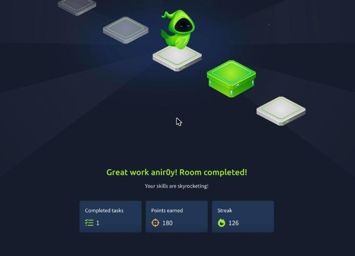

| <script src="https://tryhackme.com/badge/434937"></script>| <a class="twitter-follow-button" href="https://twitter.com/anir0y" data-size="large"> Follow @anir0y<a>|
|---|---|
|Directory ||

Directory is a hard standalone DFIR challenge. There is no box to exploit: you are handed a single `traffic.pcap` and asked to reconstruct the whole intrusion against a Windows domain controller from the wire. The chain is a classic Active Directory one, a port scan, Kerberos username enumeration, an AS-REP roast, a cracked password, and a WinRM shell, but the twist is that the interesting half of the traffic is encrypted. The attacker used Evil-WinRM, so every command rides inside NTLM-sealed SPNEGO blobs. The room is really a test of whether you can derive the session key from the cracked password and decrypt that traffic yourself. If you like this kind of protocol-level forensics, it pairs well with my [Zeek Exercises walkthrough](/post/thm-room-zeekbroexercises/).

Everything below runs on my Mac with `tshark`, `hashcat`, and a short Python decryptor. No VM, no AttackBox.

## Setup: one PCAP, two hosts

The task file is an 85 MB capture (md5 `23393189b3cb22f7ac01ce10427886de`). A quick look at `capinfos` and the endpoint list frames the whole case: roughly five and a half minutes of traffic between two machines.

```text
  Number of packets:   11136
  Capture duration:    328 seconds
  Latest packet time:  2024-01-26 10:17:12

  IPv4 Endpoints
  10.0.2.75   <- the domain controller / victim
  10.0.2.74   <- the threat actor
```

The protocol hierarchy shows HTTP, SMB2, LDAP, Kerberos, and `kpasswd`, the signature of an AD domain controller under attack. The HTTP is almost entirely `multipart/encrypted` on port 5985, which is the WinRM shell we will have to decrypt later.

## Task 1 Q1: What ports did the threat actor initially find open?

The attacker ran a full TCP connect scan. Rather than trust the scanner's own output (which we do not have), I asked the capture directly which ports on the DC answered with a SYN/ACK, that is the ground truth for "open".

```bash
  tshark -r traffic.pcap \
    -Y 'tcp.flags.syn==1 && tcp.flags.ack==1 && ip.src==10.0.2.75 && ip.dst==10.0.2.74' \
    -T fields -e frame.time_relative -e tcp.srcport | sort -n
```

That returns fourteen ports, but the question asks what was found *initially*. Timestamping the first SYN/ACK per port splits them cleanly:

```text
  53 80 88 135 139 389 445 464 593 636 3268 3269 5357   first SYN/ACK @ ~0.1s  (initial scan)
  5985                                                   first SYN/ACK @ 213s   (later, targeted)
```

Port 5985 (WinRM) only responds two hundred seconds later, when the attacker connects a shell, not during the opening scan. So the initial scan found thirteen ports, and the answer format (three two-digit, seven three-digit, three four-digit) matches exactly:

**`53,80,88,135,139,389,445,464,593,636,3268,3269,5357`**

## Task 1 Q2: Which valid username gave the foothold?

Just after the scan there is a burst of Kerberos `AS-REQ` packets at t=127s, all from the attacker, each with a different `CNameString`. That is `kerbrute userenum`. The KDC tells you which names are real by its error code: `6` (`KDC_ERR_C_PRINCIPAL_UNKNOWN`) for a guess that misses, `25` (`KDC_ERR_PREAUTH_REQUIRED`) for a real account.

```bash
  tshark -r traffic.pcap -Y 'kerberos.error_code==25' -T fields -e tcp.stream
  # map each of those streams back to the username in its AS-REQ
```

Three names come back with error 25, and a fourth is even louder: `larry.doe` gets a full `AS-REP` (Kerberos message type 11) instead of an error.

```text
  valid users: john.doe, ranith.kays, joan.ray, larry.doe
  larry.doe -> AS-REP returned (no pre-authentication required)
```

Four valid usernames, as the question says. Only `larry.doe` has pre-authentication disabled, which is what hands over a crackable hash with no password. The realm in the packets is `DIRECTORY.THM`, so the foothold account is:

**`DIRECTORY.THM\larry.doe`**



## Task 1 Q3: The captured hash

Because `larry.doe` does not require pre-auth, the KDC happily sent back an `AS-REP` whose `enc-part` is encrypted with the user's own key. That is an AS-REP roast, and the blob is sitting in the capture in cleartext. The relevant piece is the `KDC-REP` enc-part with etype 23 (RC4-HMAC), the part `hashcat` mode 18200 cracks.

```bash
  tshark -r traffic.pcap -Y 'kerberos.msg_type==11' -T fields \
    -e kerberos.CNameString -e kerberos.etype -e kerberos.encryptedKDCREPData_cipher
```

Reassembled into the standard format, the hash is:

```text
  $krb5asrep$23$larry.doe@DIRECTORY.THM:f8716efbaa984508ddde606756441480$805ab8be...ba469f
```

The question wants the last thirty characters of that hash, which is the tail of the RC4 cipher:

**`55616532b664cd0b50cda8d4ba469f`**

## Task 1 Q4: Crack the password

Straight into `hashcat` with `rockyou`:

```bash
  hashcat -m 18200 -a 0 larry.hash rockyou.txt
```

```text
  $krb5asrep$23$larry.doe@DIRECTORY.THM:...:Password1!
```

The password is **`Password1!`**. This is the pivot point of the whole room: that single string also unlocks the encrypted WinRM traffic, because the NTLM session key is derived from the user's NT hash.

## Task 1 Q5: What commands did the attacker run?

At t=213s the attacker opens WinRM on 5985 and authenticates with NTLM. From there everything is `multipart/encrypted`, SPNEGO session-sealed PowerShell Remoting. Wireshark can derive the session key if you feed it the password:

```text
  ntlmssp.nt_password: Password1!
  -> NTLMSSP SessionKey (a0900936274caa9a36cc3559ede1be3d)   [command stream, tcp.stream 2033]
  -> NTLMSSP SessionKey (463302ada4b2d92f398bde03739135e4)   [setup stream, tcp.stream 2032]
```

Wireshark derives the key but will not actually decrypt the sealed SOAP, so I did it by hand. For NTLMv2 with key exchange, the exported session key gives you the directional sealing keys, and each message is RC4-sealed on a continuous per-connection stream (eight extra keystream bytes per message for the signature checksum). Evil-WinRM uses a fresh TCP connection, and therefore a fresh key, for the command channel, so the two streams must be decrypted independently.

```python
  client_seal = md5(ESK + b"session key to client-to-server sealing key magic constant\x00")
  server_seal = md5(ESK + b"session key to server-to-client sealing key magic constant\x00")
  # per connection: one RC4 stream per direction, process messages in frame order,
  # decrypt the sealed SOAP, then advance 8 bytes for the checksum
```

Once decrypted, the PowerShell Remoting fragments reveal the operator's typed commands in order:

```text
  1. whoami
  2. reg save HKLM\SYSTEM C:\SYSTEM
  3. reg save HKLM\SAM C:\SAM
  4. reg save HKLM\SECURITY C:\SECURITY
```

The attacker dumped the registry hives to extract credentials offline. The second and third commands are the answer:

**`reg save HKLM\SYSTEM C:\SYSTEM,reg save HKLM\SAM C:\SAM`**

## Task 1 Q6: The flag

The scenario opens with Larry finding "a random note on his Desktop". The decrypted WinRM stream shows exactly where it came from, two more commands after the hive dump:

```text
  cd ..\Desktop\
  echo "THM{Ya_G0t_R0aSt3d!}" > note.txt
```

The flag is **`THM{Ya_G0t_R0aSt3d!}`**, a fitting signature given how the foothold was earned.



## Takeaways

Two durable lessons from this capture:

- A cracked password is not just an answer to one question, it can be a decryption key for the rest of the evidence. The moment `Password1!` fell, the entire "encrypted" WinRM channel became readable, because NTLM session sealing is keyed off the user's NT hash. In an investigation, always ask what a recovered secret unlocks downstream, not only what it proves on its own.
- Wireshark deriving an NTLMSSP session key is not the same as Wireshark decrypting the payload. For SPNEGO-sealed WinRM you still have to apply the sealing keys yourself, per direction and per TCP connection, with the continuous RC4 stream kept in order. Knowing that gap exists is the difference between "the traffic is encrypted, dead end" and recovering every command the attacker typed.

Room solved 100%: 1 task, 6 answers.
