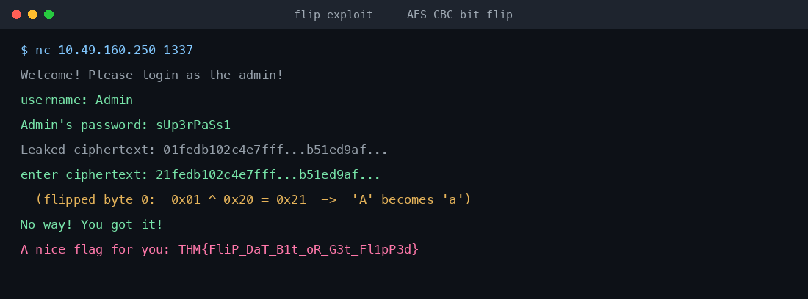

| <script src="https://tryhackme.com/badge/434937"></script>| <a class="twitter-follow-button" href="https://twitter.com/anir0y" data-size="large"> Follow @anir0y<a>|
|---|---|
|Flip ||

Flip is a short, easy cryptography room with one flag, and it is a clean demonstration of why CBC mode without integrity protection is dangerous. You are handed the server's source and a TCP service that wants you to log in as `admin`. You cannot, because it blocks the admin string in your input. The trick is that the same service leaks you the AES-CBC ciphertext of your login and then decrypts whatever ciphertext you send back. That gap, encrypt then separately check the decrypted bytes with no MAC, is the whole room: you flip one byte of the leaked ciphertext and the plaintext the server checks turns into the admin login you were never allowed to type.

The room is two tasks: download the source, then capture the flag.

## Task 1: Read the source

The service listens on TCP 1337. The source is 70 lines of Python, and the important parts are these. The server builds a login string from your input, refuses it if it already contains the admin credentials, and otherwise encrypts it and hands you the ciphertext:

```text
  message = 'access_username=' + username + '&password=' + password

  if "admin&password=sUp3rPaSs1" in message:
      send_message(server, 'Not that easy :)\nGoodbye!\n')
  else:
      setup(server, username, password, key, iv)
```

`setup` leaks the ciphertext and then asks you for a ciphertext to decrypt and check:

```text
  send_message(server, "Leaked ciphertext: " + encrypt_data(message, key, iv) + '\n')
  ...
  if b'admin&password=sUp3rPaSs1' in unpad(paddedParams, 16, style='pkcs7'):
      return 1   # prints the flag
```

The encryption is `AES.new(key, AES.MODE_CBC, iv)` with a random key and IV per connection. Two observations decide the attack. The forbidden string is checked once on your plaintext input (so you must never type it literally), and a second time on the bytes the server decrypts from a ciphertext you control. There is no MAC or signature on the ciphertext, so nothing stops you from handing back a modified version of the leaked blocks.

## Task 2: Flip one byte, forge the admin

CBC decryption XORs each decrypted block with the previous ciphertext block: `P[i] = D(C[i]) XOR C[i-1]`. That means a single byte you change in ciphertext block `i-1` flips the matching byte of plaintext block `i` cleanly (while turning block `i-1` itself into garbage). If the byte you need to change sits at the start of a block, and the block before it is throwaway, you get a free edit.

The login string lines up perfectly for this. `access_username=` is exactly 16 bytes, one full AES block, so the username begins at byte 0 of block 1:

```text
  Block 0:  access_username=
  Block 1:  <username ...>&password=...
```

Target plaintext is `admin&password=sUp3rPaSs1`. I cannot send that, so I send a username of `Admin` (capital A) with password `sUp3rPaSs1`. The plaintext check at login sees `Admin&password=sUp3rPaSs1`, which does not contain the lowercase forbidden string, so it passes and the server leaks me the ciphertext. Now block 1 starts with the byte `A` (0x41), and I want it to decrypt to `a` (0x61). Because `P1[0] = D(C1)[0] XOR C0[0]`, I flip the very first ciphertext byte `C0[0]` by `0x41 XOR 0x61 = 0x20`. Block 0 decrypts to garbage, but the flag check is a substring match, and the substring now reads `admin&password=sUp3rPaSs1`. The real pkcs7 padding on the last block is untouched, so `unpad` still succeeds.

The whole exploit is one socket conversation:

```text
  # connect, send Admin / sUp3rPaSs1 so the plaintext check passes
  # take the leaked ciphertext, XOR its first byte with 0x20, send it back
  ct = bytearray(unhexlify(leaked_hex))
  ct[0] ^= 0x20            # 'A' (0x41) -> 'a' (0x61) in decrypted block 1
  server.sendall(hexlify(ct) + b'\n')
```



The server answers `No way! You got it!` and prints the flag. The flag is **`THM{FliP_DaT_B1t_oR_G3t_Fl1pP3d}`**, which fits the room's `***{****_***_***_**_***_*******}` mask (the underscores stay literal and the letters render as asterisks).



## Two takeaways

First, CBC without integrity is malleable by design, and the fix is authentication, not secrecy. The server never leaked the key, and it did not need to: the attacker edits ciphertext blindly and lets the XOR structure of CBC propagate a controlled change into the plaintext. An encrypt-then-MAC construction (or an authenticated mode like AES-GCM) would have made the tampered ciphertext fail verification before it was ever decrypted and checked. Whenever you see a system that encrypts data, hands it to the client, and later trusts the decrypted result, that round trip is the vulnerability regardless of how strong the cipher is.

Second, block alignment is what makes bit-flipping practical, and attacker-controlled fields are where you look. The attack only worked so neatly because `access_username=` was a clean 16-byte block, which put the username at a block boundary and made the sacrificial garbage land in a block nobody checks. On a real target the same instinct applies to encrypted cookies, signed-but-not-authenticated tokens, and IV-prefixed blobs: map where your controllable input sits relative to the block grid, decide which block you can afford to destroy, and flip the byte that changes `user` into `admin` or `false` into `true`.

Room solved 100%: 2 tasks, 1 flag.
