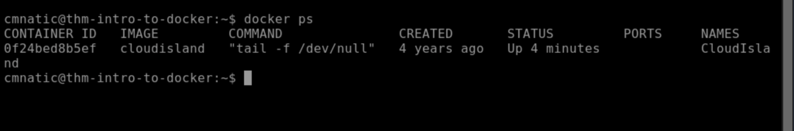
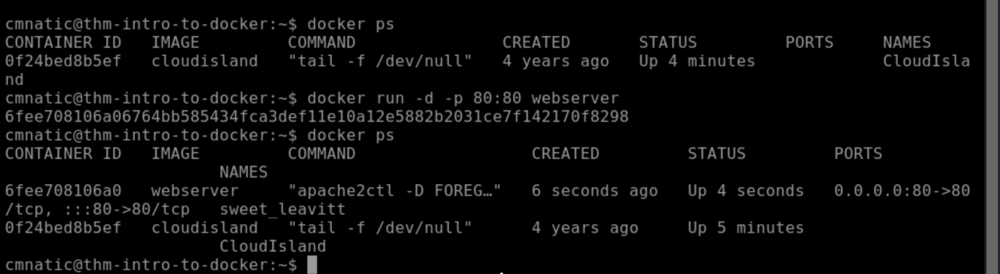

| <script src="https://tryhackme.com/badge/434937"></script>| <a class="twitter-follow-button" href="https://twitter.com/anir0y" data-size="large"> Follow @anir0y<a>|
|---|---|
|Intro to Docker ||

Intro to Docker is the easy opening room of the Container Security module in the DevSecOps path. It sits next to the pipeline rooms I already wrote up, [DevSecOps Basics](/post/thm-room-devsecopsbasics/) and [CI/CD and Build Security](/post/thm-room-cicdandbuildsecurity/), and it is the groundwork for everything that follows in the module: before you can attack or harden a container, you need to know how images, containers, Dockerfiles and Compose fit together.

Six of the seven tasks are reading plus command-syntax questions, answerable straight from the task text. Task 7 gives you a lab machine with Docker installed, where you find a running container and start a webserver container that serves the flag.

## Task 1: Introduction

No answer needed. The room lists what it covers (basic syntax, running containers, building images with a Dockerfile, Docker Compose, and the Docker socket) and recommends some Linux comfort first.

## Task 2: Managing images with pull and image ls

Docker images are the instructions a container is built from, and they live in a registry (Docker Hub by default). You fetch one with `docker pull`, optionally pinned to a tag:

```bash
  # fetch the latest tag of an image
  docker pull tryhackme
  # fetch a specific tag
  docker pull tryhackme:1337
  # list the images on this host
  docker image ls
```

- Pulling an image: **`docker pull`**
- Listing all images: **`docker image ls`**
- Pulling the `tryhackme` image: **`docker pull tryhackme`**
- Pulling `tryhackme` with tag `1337`: **`docker pull tryhackme:1337`**

If you omit the tag, Docker silently assumes `latest`, which is worth remembering when an image behaves differently from the one you tested.

## Task 3: Running containers with -it, -d and -p

`docker run` takes options before the image name. The three the room focuses on:

```bash
  # interactive: attach a TTY and keep stdin open
  docker run -it helloworld /bin/bash
  # detached: run in the background
  docker run -d helloworld
  # publish container port 80 on host port 80
  docker run -p 80:80 webserver
  # running containers, then all containers including stopped ones
  docker ps
  docker ps -a
```

- Run interactively: **`docker run -it`**
- Run detached: **`docker run -d`**
- Bind a webserver on port 80: **`docker run -p 80:80`**
- List running containers: **`docker ps`**
- List all containers, including stopped: **`docker ps -a`**

The `-p` syntax is `host:container`. Mixing those up is the most common reason a container looks healthy but nothing answers on the port you expect.

## Task 4: Dockerfiles with FROM, RUN and build -t

A Dockerfile is a recipe of instructions, executed top to bottom, that produces an image. The room walks through `FROM`, `RUN`, `COPY`, `WORKDIR`, `EXPOSE` and `CMD`; put together, a minimal Apache image looks like this:

```dockerfile
  # base image
  FROM ubuntu:22.04
  # commands executed at build time
  RUN apt-get update -y && apt-get install apache2 -y
  EXPOSE 80
  CMD ["apache2ctl", "-D", "FOREGROUND"]
```

```bash
  # build an image from the Dockerfile in this directory and name it
  docker build -t webserver .
```

- Instruction for the base image: **`FROM`**
- Instruction to run a command: **`RUN`**
- Docker command to build an image: **`build`**
- Argument to name the image: **`-t`**

The room's optimisation section makes the point that every `RUN` creates a new layer, so chaining commands with `&&` keeps images smaller. My own addition, because it matters for the rest of the module: a secret added in one layer and deleted in the next is still recoverable from the image history.

## Task 5: Docker Compose up and down

Compose lets you describe several containers, their networks and ports in one file and manage them as a unit. The example pairs a web app with a database so the two can talk over a shared network.

```bash
  # create and start every service in the file
  docker-compose up
  # stop and remove them again
  docker-compose down
```

- Argument to start the series of containers: **`up`**
- Argument to delete them: **`down`**
- File Compose reads: **`docker-compose.yml`**



## Task 6: The Docker socket and the client/server model

Docker is two programs: the client you type into, and the server (the daemon) that does the work. They talk over a socket, which is a form of **Interprocess Communication** (IPC). The Docker server is effectively an **API**: the client sends requests, the daemon listens and acts on them.

That detail is why this task matters for security. The socket at `/var/run/docker.sock` is a root-equivalent control channel, because anything that can write to it can ask the daemon to start a privileged container with the host filesystem mounted. A container that has the socket mounted into it is one `docker run` away from the host, which is exactly the kind of escape the later rooms in the Container Security module explore.

## Task 7: Practical, finding the running container and serving the flag

Start Lab Machine boots an Ubuntu VM with Docker, shown in split view as the `cmnatic` user. The first question asks for the running container, so `docker ps`:

```text
  cmnatic@thm-intro-to-docker:~$ docker ps
  CONTAINER ID   IMAGE         COMMAND               CREATED       STATUS         PORTS   NAMES
  0f24bed8b5ef   cloudisland   "tail -f /dev/null"   4 years ago   Up 4 minutes           CloudIsland
```



The running container is **CloudIsland**. Note the casing: the image is `cloudisland`, but the question asks for the container name in the `NAMES` column, which is `CloudIsland`.

The second question wants a webserver started from the local `webserver` image, published on port 80. That is the Task 3 command put together:

```text
  cmnatic@thm-intro-to-docker:~$ docker run -d -p 80:80 webserver
  6fee708106a06764bb585434fca3def11e10a12e5882b2031ce7f142170f8298
  cmnatic@thm-intro-to-docker:~$ docker ps
  CONTAINER ID   IMAGE         COMMAND                  CREATED         STATUS         PORTS                               NAMES
  6fee708106a0   webserver     "apache2ctl -D FOREG…"   6 seconds ago   Up 4 seconds   0.0.0.0:80->80/tcp, :::80->80/tcp   sweet_leavitt
  0f24bed8b5ef   cloudisland   "tail -f /dev/null"      4 years ago     Up 5 minutes                                       CloudIsland
```



Docker gave the new container a random name (`sweet_leavitt`) because I did not pass `--name`. With port 80 published, the VM's web root answers. I checked it from my own machine over the THM VPN first (`curl -s http://<lab-ip>/`) and then in the browser through the room's reverse-proxy link:


Flag: **`THM{WEBSERVER_CONTAINER}`**

One honest note on submitting: setting the answer boxes from a script does not register with this room's answer form, so the answers had to be typed in. If a correct answer comes back as not registered, retype it rather than assuming it is wrong.

## Two takeaways

First, `-p host:container` is the whole networking story for a single container. Nothing inside a container is reachable from outside until you publish it, and the left side of the colon is the host. When a service is "up but unreachable", check the `PORTS` column of `docker ps` before anything else.

Second, the Docker socket is the security boundary, not the container. The daemon runs as root and does whatever the socket asks, so access to `/var/run/docker.sock` (or membership of the `docker` group) is effectively root on the host. Treat a mounted socket in any container as a finding in its own right.

Room solved 100%: 7 tasks, 21 answers.
