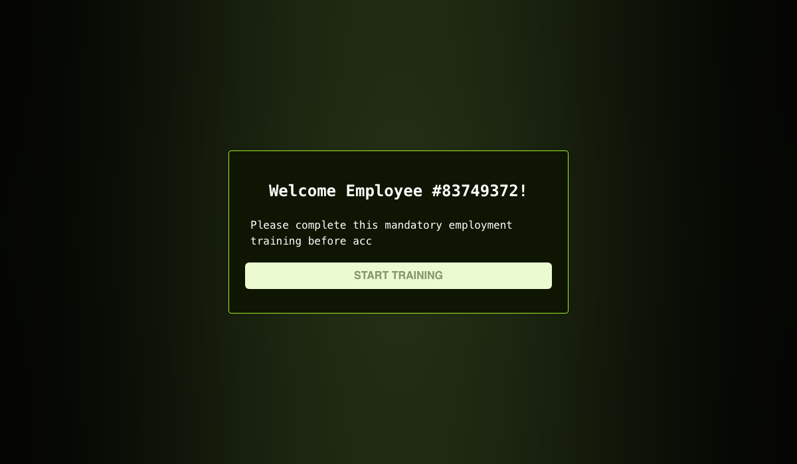
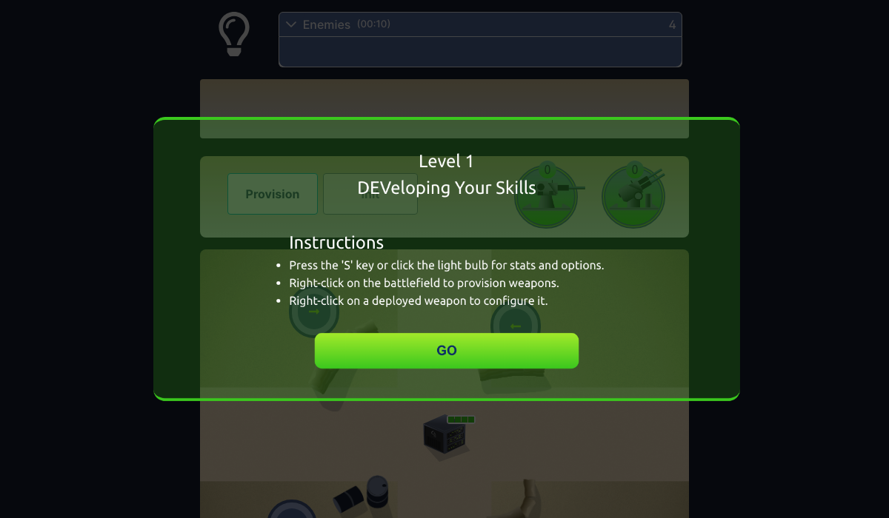

| <script src="https://tryhackme.com/badge/434937"></script>| <a class="twitter-follow-button" href="https://twitter.com/anir0y" data-size="large"> Follow @anir0y<a>|
|---|---|
|Intro to IaC ||

Intro to IaC opens the Infrastructure as Code module of the DevSecOps path. I came to it straight after the Container Security module ([Container Hardening](/post/thm-room-containerhardening/) was the last one I wrote up), and it fits that order well: containers taught what a single workload looks like, and IaC is how you describe and rebuild the whole platform those workloads run on. If you want the earlier context on why pipelines matter, [Intro to Pipeline Automation](/post/thm-room-introtopipelineautomation/) is the closest sibling.

This is a theory room with no lab machine. Fourteen of the sixteen answers come from the task text. The other two are flags from two small browser games ("static sites" in THM terms). I read both flags out of the games' JavaScript bundles instead of playing through, and I will show exactly how, because it is the one transferable trick in the room.

## Task 1: Introduction

The room pitches itself as a paced introduction for DevSecOps newcomers who keep running into IaC terms and tool names without a map: the concept, the tools and their characteristics, the lifecycle, and how virtualisation and cloud fit in. No answer, just a Check.

## Task 2: What makes infrastructure "as code"

The idea is to stop building servers by hand and describe them in files that live in version control. The room frames the benefits around a fictional service launch (FlyNet, which eventually becomes sentient, because of course it does) and asks which characteristic helps at each stage:

- Rebuilding the dev infrastructure identically in staging and production is **Repeatable**.
- The day-before-launch change breaks things and you need the last known working version: **Versionable**. Because the infrastructure is code in Git, rolling back is a redeploy of an older commit.
- Launch day traffic spikes and you need more resources: **Scalable**.

The room also lists the practical wins: infrastructure automation, data backup and recovery, failover automation, configuration consistency, and scaling resources. All of them follow from the same three properties.

## Task 3: Four ways to classify IaC tools

The room sorts tools along two axes.

**Declarative versus imperative.** The room uses a treasure map. An imperative tool hands you a list of directions that only works if you start from the known start point. A declarative tool looks at where you are now and works out the steps to reach X. So the type that "considers where you are on the map" is **Declarative**. Terraform is the classic example: you write the desired end state, and it computes a plan from whatever state actually exists.

**Agent-based versus agentless.** Agent-based tools (Puppet, Chef) run a daemon on every managed node that pulls config from a server. Agentless tools (Ansible) push changes over SSH or WinRM, so there is nothing to install on the target, but also nothing on the target enforcing state between runs.

## Task 4: Mutable versus immutable, and the FlyNet terminal

The second tools task adds a third axis. Mutable infrastructure is changed in place (patch the server). Immutable infrastructure is replaced (build a new server, destroy the old one). The room is honest that neither always wins: a stateless web tier suits immutable, but a business-critical database that needs regular patching is risky to rebuild from scratch, so mutable makes sense there.

Then it splits tools by job:

- **Provisioning, immutable-leaning:** Terraform, AWS CloudFormation, Google Cloud Deployment Manager, Pulumi.
- **Configuration management, mutable:** Ansible (agentless, YAML playbooks), Chef (imperative, agent-based, "recipes" grouped into "cookbooks"), Puppet (declarative, agent-based, its own DSL).

The task ends with a static site: a FlyNet employee terminal where you have to "bypass the employee training" to find where the time travel tech is held.



The training turns out to be a small shooter game. Before playing, I looked at how the site was built. Static labs on THM are front-end only apps, so anything the page can show you on a win has to be in the files your browser downloads. The index points at one bundle:

```text
  curl -s https://static-labs.tryhackme.cloud/apps/iac-wave-survival/ | grep -oE 'src="[^"]+"'
  # src="/apps/iac-wave-survival/assets/index-6b67aba2.js"
```

The bundle is about 940 KB of minified React. Searching for `THM{` found nothing, so I decoded every base64-looking string literal and kept the ones that produced readable text:

```text
  # decode every "...=="-style literal, keep the ones containing THM
  "VEhNe2w0Yl9DMG1wbDN4X2NvMHJkc30=" -> THM{l4b_C0mpl3x_co0rds}
```

To make sure this was the real win condition and not a decoy, I read the code around it. The literal is assigned to `const result`, and the win screen renders `"Here is your flag: ", atob(result)`. So the flag is **`THM{l4b_C0mpl3x_co0rds}`**, the coordinates of the lab complex, which fits the `***{***_*******_******}` mask.



## Task 5: The IaC lifecycle

The room's IaC lifecycle has two kinds of phase:

- **Continual (best practice) phases** run the whole time: Version Control, Collaboration, Monitoring/Maintenance, Rollback, Review + Change.
- **Repeatable (infra creation and config) phases** run for each new build or config change: Design, Define, Test, Provision, Configure.

So the phases that guide development and configuration are **Repeatable**, the ones that keep best practice going throughout are **Continual**, and Monitoring/Maintenance can trigger **Rollback** when it spots a problem. Continual phases can also kick off a new round of repeatable ones, for example a review that leads to a config change.

## Task 6: Virtualisation and IaC

Two levels of virtualisation:

- Hypervisor-level virtualisation runs full virtual machines, each with its own OS, which can differ from the host. The model that needs several operating systems on one machine needs **Hypervisor** virtualisation.
- Containerisation virtualises at the operating system level and shares the host kernel, which makes containers lightweight and fast to deploy. The model that wants lightweight, rapid deployment needs **Containerisation** (British spelling, 16 characters, which the mask confirms).

The room then lists six ways IaC uses virtualisation: scalability, resource isolation, testing/snapshots/rollbacks, templates, multi-tenancy and portability. A resource-hungry feature that must not starve other components calls for **Resource Isolation**, and automatically scaling containers is the job of **Kubernetes**.

## Task 7: On-prem versus cloud IaC

The room compares the two across five categories: location, tech, resources, scalability and cost. In the cloud, the **Cloud Service Provider** (AWS, Azure, GCP) owns the underlying infrastructure and you work with virtual resources billed pay-as-you-go. On-prem gives you full control (useful for strict data residency), but you buy hardware for peak load, which is why on-prem struggles with **Scalability**.

## Task 8: The Final Push

The last task is a tower defence style game called "Infrastructure at a Click": you spend provision points to deploy weapons and configure points to upgrade them, and the machines must not take down your server. It has three levels, each named after an environment (DEVeloping Your Skills, STAGEing A fight, PRODucing a victory), which is a nice touch given the room's dev, staging and production theme.



Same approach as Task 4. This app has its own bundle:

```text
  curl -s https://static-labs.tryhackme.cloud/apps/iac/ | grep -oE 'src="[^"]+\.js"'
  # src="/apps/iac/assets/index-5706bdc1.js"
```

This time the base64 sweep came up empty, so I searched for the win UI instead. The level-to-level dialog (`SuccessModal`) only says "Let's move on to the next level." The final dialog, `FinalSuccessModal`, holds the flag as a plain string:

```text
  # FinalSuccessModal (trimmed)
  c="thm{1Nfr4StrUctUr3_Pr0}"
  # rendered under: "Victory is ours! The Lab Complex has been captured..."
```

The flag is **`thm{1Nfr4StrUctUr3_Pr0}`**, with lowercase `thm`, and the room accepted it in exactly that case. It also explains why my `THM{` search missed it: the prefix is lowercase.

On submitting: as on the last few DevSecOps rooms, filling the answer boxes from page script worked for every question except the first one in each task, whose input holds the underscore mask as its value. Those seven had to be typed with real keystrokes.

## Two takeaways

First, the declarative versus imperative split is the one idea from this room worth keeping. A declarative tool compares desired state with actual state and closes the gap, so running it twice is safe. An imperative script assumes a starting point and replays steps, so running it on a server that has drifted can do the wrong thing. When you review IaC, this tells you where the risk is: in Terraform the risk is the plan (read `terraform plan` before `apply`), and in imperative scripts the risk is the assumption about where you are starting from.

Second, a front-end only app cannot keep a secret from the browser. Both flags here were in the JavaScript the browser downloaded, one base64 encoded and one in plain text, protected only by the game in front of them. The same applies to real single-page apps: feature flags, admin routes, API keys and "unlock" logic in a client bundle are readable by anyone who opens it. If a value matters, it has to come from a server after a server-side check.

Room solved 100%: 8 tasks, 16 answers.
