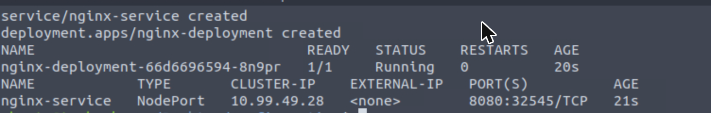
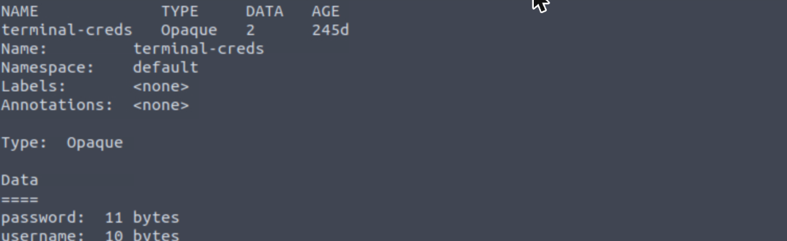
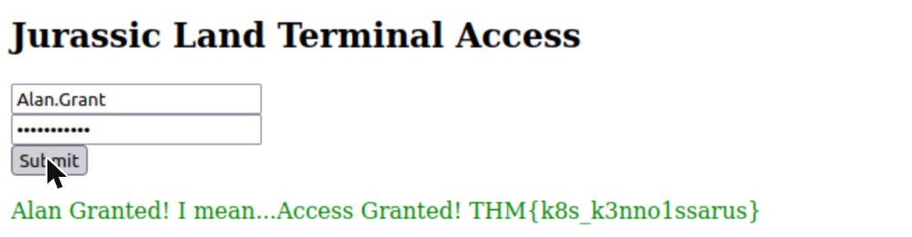
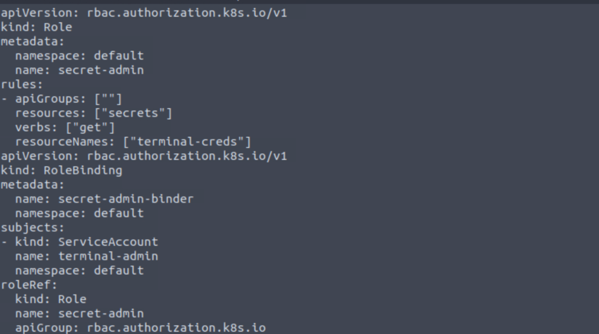

| <script src="https://tryhackme.com/badge/434937"></script>| <a class="twitter-follow-button" href="https://twitter.com/anir0y" data-size="large"> Follow @anir0y<a>|
|---|---|
|Intro to Kubernetes ||

Intro to Kubernetes is the next step in the Container Security module of the DevSecOps path, straight after [Intro to Docker](/post/thm-room-introtodockerk8pdqk/). Docker taught how a single container is built and run; this room is about what happens when you have hundreds of them and need something to schedule, heal and expose them. It also builds on the pipeline rooms I already wrote up, [DevSecOps Basics](/post/thm-room-devsecopsbasics/) and [CI/CD and Build Security](/post/thm-room-cicdandbuildsecurity/).

Seven of the eight tasks are reading plus short answers taken straight from the task text. Task 8 hands you an Ubuntu VM with Minikube, where you deploy an nginx app, port-forward to it, pull its login credentials out of a Kubernetes Secret, and then write the RBAC rule that should have protected that Secret in the first place.

## Task 1: Introduction

No answer needed. The room frames Kubernetes as the next layer up from containers and says the end goal is a cluster you can both run and harden.

## Task 2: Why Kubernetes exists

The task tells the monolith to microservices story: once an app is split into many small services, each in its own container, something has to manage those containers at scale. Kubernetes is described as a **container orchestration** system, which is the fill-in-the-blank answer.

The benefits list is availability, scalability and portability. The one that means "it can run anywhere with nearly any type of infrastructure" is **highly portable**.

## Task 3: Cluster architecture, control plane and worker nodes

The core vocabulary of the room:

- A **pod** is the smallest deployable unit you can create in Kubernetes. It holds one or more containers that share storage and network.
- The control plane runs `kube-apiserver`, `kube-scheduler`, `kube-controller-manager`, `cloud-controller-manager`, and **etcd**, the key/value store that holds cluster data and its current state. Every other control plane component reads from etcd.
- Each worker node runs `kubelet` (the agent that makes sure pods are running), a container runtime, and **kube-proxy**, which handles network communication inside the cluster.

## Task 4: The landscape, Services, ReplicaSets and Deployments

- A **Service** exposes a set of pods behind one stable access point, so clients do not care which pod answers.
- A **ReplicaSet** maintains a set of replica pods and can guarantee that X of them are available.
- A **Deployment** defines a desired state. The deployment controller moves the actual state toward it, and it manages the ReplicaSets for you, which is why you rarely define ReplicaSets or pods directly.

The task also covers namespaces, StatefulSets (for stateful apps like databases) and Ingress.

## Task 5: Configuration YAML, the four required fields

Every Kubernetes object file needs `apiVersion`, `kind`, `metadata` and `spec`. The three questions test which field holds what:

- Wanting 4 nginx pods is part of the desired state, so it lives in **spec** (as `replicas: 4`).
- That the file is a Deployment is declared in **kind**.
- If the Service's `targetPort` is 80, the container must listen there, so `containerPort` is **80**. The trap is the Service's own `port` field, which is the port the Service listens on, not the pod.

## Task 6: kubectl essentials

The room matches a task to a kubectl verb:

```text
  # troubleshoot a pod by gathering details about it
  kubectl describe pod example-pod -n example-namespace
  # get a shell inside the container
  kubectl exec -it example-pod -n example-namespace -- sh
  # check the status of running pods
  kubectl get pods -n example-namespace
  # turn a YAML definition into running objects
  kubectl apply -f example-deployment.yaml
```

Answers: **describe**, **exec**, **get**, **apply**.



## Task 7: Kubernetes and DevSecOps

The security side of the room. Access to the cluster and its resources is regulated with **RBAC** (role-based access control). Security policies at three levels (privileged, baseline, restricted) are defined by **Pod Security Standards**, and those policies are enforced by **Pod Security Admission**, the built-in admission controller. Sensitive data such as passwords and tokens belongs in a Kubernetes **Secret**, which must be managed securely because, as Task 8 shows, a Secret is only base64 encoded by default.

## Task 8: Hands-on, from a leaked Secret to the flag

Start Lab Machine boots an Ubuntu desktop in split view. The first step is `minikube start`, and my first attempt failed:

```text
  ubuntu@tryhackme:~$ minikube start
  minikube v1.32.0 on Ubuntu 20.04
  Using the docker driver based on existing profile
  Exiting due to PROVIDER_DOCKER_NOT_RUNNING: deadline exceeded running "docker version ..."
```

Nothing was wrong with the lab. I had run the command seconds after the VM came up and Docker was still starting. Running it again a minute later, after `docker ps` came back clean, brought up Kubernetes v1.28.3. A warning that the container "is having trouble accessing registry.k8s.io" is also expected, since the lab has no internet and the images are already cached.

With the cluster up, `kubectl get pods -A` shows the control plane from Task 3 running as pods in `kube-system`:

```text
  NAMESPACE     NAME                               READY   STATUS
  kube-system   coredns-5dd5756b68-qbss6           1/1     Running
  kube-system   etcd-minikube                      1/1     Running
  kube-system   kube-apiserver-minikube            1/1     Running
  kube-system   kube-controller-manager-minikube   1/1     Running
  kube-system   kube-proxy-pb4vz                   1/1     Running
  kube-system   kube-scheduler-minikube            1/1     Running
  kube-system   storage-provisioner                1/1     Running
```

### Deploying nginx and its Service

`~/Desktop/configuration` holds `nginx-deployment.yaml` (one replica of an nginx container) and `nginx-service.yaml` (a NodePort Service whose selector matches the deployment's `app: nginx` label, port 8080 to targetPort 80). The room says to apply the Service first:

```text
  kubectl apply -f nginx-service.yaml
  kubectl apply -f nginx-deployment.yaml
  kubectl get pods
  kubectl get svc nginx-service
```



To reach the Service from the VM, forward a local port to it. I backgrounded the forward so the same terminal stayed usable:

```text
  (kubectl port-forward service/nginx-service 8090:8080 > /tmp/pf.log 2>&1 &)
  # Forwarding from 127.0.0.1:8090 -> 80
```

`http://localhost:8090/` serves a "Jurassic Land Terminal Access" login page. Reading it with curl first showed the check happens in client-side JavaScript (`validateLogin()` in `jl-login.js`), but the room wants the credentials found the Kubernetes way.

### Reading the Secret

```text
  kubectl get secrets
  kubectl describe secret terminal-creds
```



`describe` only shows key names and sizes. The values are one `jsonpath` query and a base64 decode away:

```text
  kubectl get secret terminal-creds -o jsonpath='{.data.username}' | base64 --decode
  # Alan.Grant
  kubectl get secret terminal-creds -o jsonpath='{.data.password}' | base64 --decode
  # <redacted, 11 characters>
```

Logging in with those in Firefox on the VM gives the flag:



Flag: **`THM{k8s_k3nno1ssarus}`**

### Locking the Secret down with RBAC

The second half of the task fixes what we just abused. `rbac/role.yaml` defines a Role `secret-admin` that allows only `get` on the one secret named `terminal-creds`, and `rbac/role-binding.yaml` binds it to the `terminal-admin` service account:



The RoleBinding's apiVersion is **`rbac.authorization.k8s.io/v1`**. After `kubectl apply -f` on both files, `kubectl auth can-i` confirms the rule does what it says:

```text
  kubectl auth can-i get secret/terminal-creds --as=system:serviceaccount:default:terminal-admin
  # yes
  kubectl auth can-i get secret/terminal-creds --as=system:serviceaccount:default:terminal-user
  # no
```

One honest note on submitting: setting the answer boxes and clicking Check from a script filled the fields but did not register, the same behaviour I hit on Intro to Docker. Real clicks on Check worked every time.

## Two takeaways

First, a Kubernetes Secret is encoded, not encrypted. Anyone who can `get` it reads it in one command, and by default etcd stores it in plaintext too. Treat "who can get secrets in this namespace" as the real question, and turn on encryption at rest (or an external secret store) for anything that matters.

Second, `kubectl auth can-i --as=` is the fastest way to prove an RBAC rule. Writing a Role is easy; knowing that the wrong service account gets a "no" is the part that counts, and `can-i` answers it without deploying a test pod.

Room solved 100%: 8 tasks, 23 answers.
