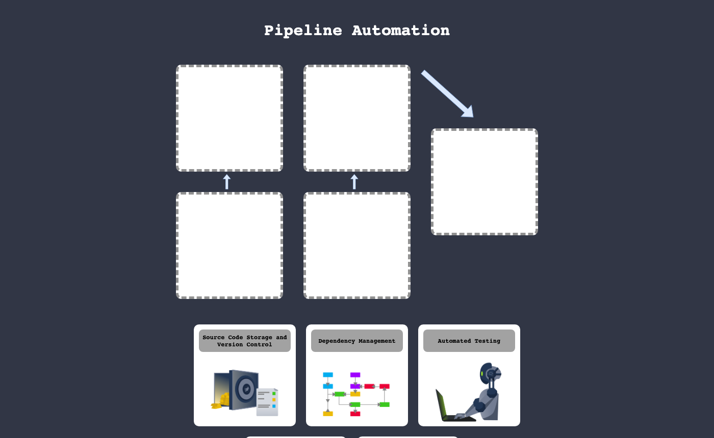
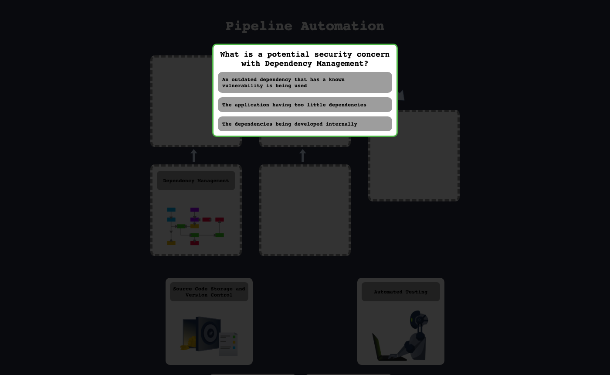

| <script src="https://tryhackme.com/badge/434937"></script>| <a class="twitter-follow-button" href="https://twitter.com/anir0y" data-size="large"> Follow @anir0y<a>|
|---|---|
|Intro to Pipeline Automation ||

Intro to Pipeline Automation is the easy opening room of the DevSecOps path's Security of the Pipeline module. Where the previous module was about the lifecycle on paper, this one follows code through the actual machinery: source control, dependency management, automated testing, CI/CD build infrastructure, and the environments the build lands in. Each stage gets a short explainer plus a case study of how it goes wrong. If you are coming from the same path, my [SDLC](/post/thm-room-sdlc/) and [DevSecOps Basics](/post/thm-room-devsecopsbasics/) walkthroughs cover the groundwork.

Almost every answer is a term from the task text, and the answer masks do most of the disambiguation. The final task is a drag-and-drop pipeline builder on a static site; as with the SDLC room, the flag ships in the page's own JavaScript.

## Task 2: the shape of a DevOps pipeline

The room sketches a pipeline as five boxes: source code storage and version control, dependency management, automated testing, continuous integration, and environments. Code flows from the repo, pulls in dependencies, gets tested, gets built, and ends up deployed. The question asks where the end product is deployed, and the 12-character mask fits **Environments**.

## Task 3: source control and leaked secrets

Git won the version control war, and the room names **GitHub** as by far the largest online Git provider and **GitLab** as the software you would use to host your own Git server. The security angle is that Git never forgets: a password committed and then deleted in the next commit still sits in the history. The tool the room suggests for sweeping a repo's commits for that kind of leftover is **GittyLeaks**.

## Task 4: internal and external dependencies

Dependencies split into two kinds. Code your own organisation wrote and maintains is **Internal**; a third-party library such as JQuery is **External**. External ones come from public package managers, and Python's is **PyPi** (the mask is four characters, and the task text spells it with the lowercase i). The 2021 zero-day that turned dependency management into everyone's emergency was **Log4j**, via the Log4Shell bug in that logging library.

The point the room makes is that you inherit every vulnerability in every package you pull, including the ones your dependencies pull in. Internal dependencies are no safer by default: they tend to be patched less often because nobody outside the team ever looks at them.



## Task 5: SAST, DAST, and what they are not

Automated security testing comes in two flavours. A tool that reads the source code looking for vulnerable patterns is **SAST** (static analysis). A tool that runs the application and throws test cases at it is **DAST** (dynamic analysis). The question then asks whether either can replace a penetration test, with a Yea/Nay toggle, and the answer is **Nay**. Scanners find known patterns at scale; they do not chain findings, reason about business logic, or notice that an "authorised" endpoint should not exist at all.

## Task 6: CI/CD and the build infrastructure

CI/CD expands to **Continuous Integration** and **Continuous Delivery**. The room does mention Continuous Deployment elsewhere, but the mask (`********** ********`, a 10 then an 8) only fits "Delivery". Build infrastructure has two roles: the **Build Orchestrator** directs all builds, and the **Build Agent** actually performs them. The security worry here is shared agents: one agent building both DEV and PROD means anyone who can poison a DEV build has a route into PROD artefacts.

## Task 7: environments and the PROD bypass problem

The room ranks environments by stability and security posture:

```text
  # environment  stability      security posture
  DEV            unstable       weakest
  UAT            semi-stable    second weakest
  PreProd        stable         close to PROD
  PROD           stable         strongest, holds customer data
```

**DEV** has the weakest security configuration, **UAT** (User Acceptance Testing) is where the application gets tested, and **PreProd** mirrors PROD to verify everything before release. The grader echoed that last one back as "PrePROD" after accepting it, so case does not matter here. The case study is the classic: a developer adds a shortcut to make testing easier in DEV, nobody removes it, and it ships. The vulnerability class is **Developer Bypasses**.

## Task 8: building the pipeline (and reading the flag)

The challenge site shows five empty drop zones wired together with arrows and five pipeline component cards underneath. You drag each card to its slot, and each correct placement opens a multiple-choice question about a real security concern at that stage.



Dropping Dependency Management into its slot (bottom left, feeding source control) brings up its question. The right answer is the outdated dependency with a known vulnerability, which is Task 4 in one sentence.



The whole game runs in a single unminified `script.js`, so rather than drag five cards I read it. Each card id is checked against one slot and one correct option, and five correct answers write the flag into the page:

```text
  # static-labs.tryhackme.cloud/sites/pipeline-automation/script.js
  curl -s https://static-labs.tryhackme.cloud/sites/pipeline-automation/script.js \
    | grep -nE "correct_answers === 5|THM\{"
  #  if( correct_answers === 5){
  #      $('div#flag').html('THM{REDACTED.flag.8.10.2.3}');
  #  ...
  #  //         $('div#flag').html('THM{SMASHED_THE_STACK}');
```

Two `THM{` strings come back. The second sits inside a large commented-out block left over from an older stack-building game, and its shape does not match this room's mask (`***{********.**********.**.***}`, four dot-separated words). The live one in the `correct_answers === 5` branch fits exactly and was accepted first try. I have redacted it; the method is the point.

For completeness, the answer key in the script is: source control's concern is secrets committed to source code, dependencies is the outdated vulnerable package, automated testing is using a scanner as a replacement for a pentest, CI is one build agent building both DEV and PROD, and environments is a developer bypass reaching PROD.

## Two takeaways

First, let the mask break ties between near-synonyms. The task text uses both "Continuous Delivery" and "Continuous Deployment", and both read naturally as the CD in CI/CD. The 10-plus-8 mask settles it before you burn a submission. Same with PyPi versus PyPI casing and PreProd: when the room's own text and the mask agree, take that spelling.

Second, when you pull secrets out of client-side code, expect decoys and dead code. The script held two flag-shaped strings, one live and one in a commented-out block copied from another game. Real single-page apps are the same: stale API keys in commented code, test tokens next to production ones. Match each candidate against what you know about the target's format (here the mask; on a real app, the key prefix or the endpoint it is used against) before reporting or using it.

Room solved 100%: 9 tasks, 22 answers.
