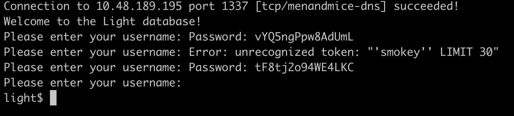
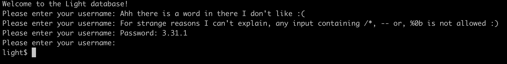
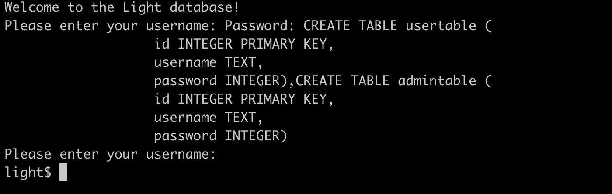
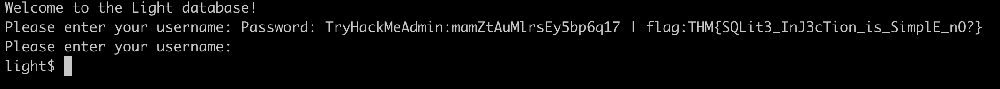

| <script src="https://tryhackme.com/badge/434937"></script>| <a class="twitter-follow-button" href="https://twitter.com/anir0y" data-size="large"> Follow @anir0y<a>|
|---|---|
|Light ||

Light is a short, easy TryHackMe challenge built around a single bug: SQL injection in a "database application" that you talk to over a raw TCP socket instead of a web form. There is no browser, no Burp, and no sqlmap-friendly HTTP endpoint, just `nc` and your own payloads. If you want the theory first, my [SQL Injection Introduction walkthrough](/post/thm-room-sqlinjectionintroduction/) covers the basics, and the [Advanced SQL Injection walkthrough](/post/thm-room-advancedsqlinjection/) goes deeper into filter evasion, which is exactly what this room tests.

The room gives you one hint: log in as `smokey`. Three questions follow: the admin username, the admin password, and the flag.

## Task 1: Talking to the Light database

### Recon: one port, one prompt

The task text tells you the service lives on port 1337, so there is nothing to scan. The THM VPN on my Mac routed straight to the target, so I worked locally rather than from the AttackBox. To keep the evidence reproducible I wrapped `nc` in a tiny shell function that feeds one input per line and then waits for the reply:

```bash
L(){ (for p in "$@"; do printf '%s\n' "$p"; sleep 1; done; sleep 2) | nc 10.48.189.195 1337; echo; }

nc -zv 10.48.189.195 1337
L smokey "smokey'" "' OR '1'='1"
```



Three inputs, three useful answers:

- `smokey` returns a password. The app is a lookup: username in, password out.
- `smokey'` throws `Error: unrecognized token: "'smokey'' LIMIT 30"`. That is raw SQLite error text, and it leaks the tail of the query. Our input lands inside single quotes, followed by ` LIMIT 30`.
- `' OR '1'='1` returns a different user's password. Injection confirmed, and it is a boolean that closes cleanly against the app's own trailing quote.

From the error, the backend query is almost certainly:

```sql
SELECT password FROM <table> WHERE username = '<input>' LIMIT 30
```

One column comes back, and it is printed after `Password:`. That makes this a UNION injection with a single-column payload.

### The two filters

The obvious next step fails twice, and the failures are the whole room.

```bash
L "' UNION SELECT 1 '" "' Union Select 1 --" "' Union Select sqlite_version() '"
```



- `UNION SELECT` in uppercase gets `Ahh there is a word in there I don't like :(`. There is a keyword blocklist.
- Anything with `--`, `/*` or `%0b` gets a separate message. Comments are banned, so you cannot cut off the trailing `' LIMIT 30`.
- `Union Select` in mixed case sails through and returns **3.31.1**, the SQLite version.

So the blocklist is a case-sensitive string match on exact spellings (it caught the uppercase `UNION SELECT`, but not `Union Select`), while SQL keywords are case-insensitive. That gap is the bypass.

For the comment ban, you do not need a comment at all. The app wraps your input in quotes, so end the payload with a lone `'` and let the app's closing quote pair with it. `' Union Select x '` becomes:

```sql
SELECT password FROM <table> WHERE username = '' Union Select x '' LIMIT 30
```

The final `''` is just an empty string literal glued onto the expression, which SQLite accepts. The same quote-balancing trick is what made `' OR '1'='1` work in recon.



### Mapping the schema

SQLite keeps every table's `CREATE` statement in `sqlite_master`, and `group_concat` squeezes many rows into the one column the app will print:

```bash
L "' Union Select group_concat(sql) FROM sqlite_master '"
```



Two tables, `usertable` and `admintable`, both with `id`, `username` and `password`. The app only ever queries `usertable` (eight rows, which a `count(*)` confirmed), so the admin table is invisible unless you UNION into it.

### Dumping the admin table

Concatenate username and password per row with SQLite's `||` operator, then join the rows:

```bash
L "' Union Select group_concat(username||':'||password, ' | ') FROM admintable '"
```



The admin table holds two rows:

- The admin username is **TryHackMeAdmin**.
- Its password is **mamZtAuMlrsEy5bp6q17**.
- The second row is literally named `flag`, and its password column holds the flag: **THM{SQLit3_InJ3cTion_is_SimplE_nO?}**.

All three matched their answer masks (14 characters, 20 characters, and the `***{******_*********_**_******_***}` flag pattern) before I submitted them.

## Takeaways

First, a blocklist that matches exact strings is not a filter, it is a speed bump. SQL keywords are case-insensitive, so any filter that compares raw input against `UNION` or `SELECT` loses to `Union Select`. The fix is parameterised queries, not a longer word list. A filter worth anything normalises input first, and even then it only buys time.

Second, a comment ban rarely matters for string-context injection. When your input sits inside quotes, the application's own closing quote can terminate your payload for you: end it with `'` and let the trailing `''` become a harmless empty string. Reading the error message to learn exactly what wraps your input (here, `'...' LIMIT 30`) is what turns a blocked payload into a working one.

Room solved 100%: 1 task, 3 answers.
