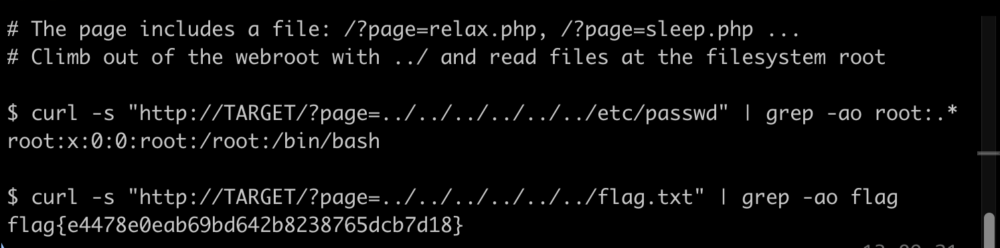

| <script src="https://tryhackme.com/badge/434937"></script>| <a class="twitter-follow-button" href="https://twitter.com/anir0y" data-size="large"> Follow @anir0y<a>|
|---|---|
|Lo-Fi ||

Lo-Fi is a short, easy web room with a single flag. It is a clean demonstration of Local File Inclusion (LFI): a page that pulls in other files based on a URL parameter, with nothing stopping you from pointing that parameter somewhere it was never meant to go. If you want the longer teaching rooms it references, TryHackMe's own LFI Path Traversal and File Inclusion rooms cover the theory; this one is a two-minute practical.

The whole room is one task: climb the filesystem and read the flag at its root.

## Task 1: Find the include parameter

The site is a lo-fi beats page. Looking at its navigation, every link loads a different page through the same query parameter:

```text
  curl -s http://TARGET/ | grep -oiE 'href="[^"]*"'
  # /?page=relax.php
  # /?page=sleep.php
  # /?page=chill.php
  # /?page=coffee.php
  # /?page=vibe.php
  # /?page=game.php
```

That `?page=` pattern is the tell. The back end is doing something like `include($_GET['page'])` in PHP, taking whatever filename you pass and pulling it into the response. If the value is not validated, you are not limited to the `.php` files the menu offers. The server banner (Apache 2.2.22 on Ubuntu, an old stack) fits a deliberately dated LFI lab.

## Task 1: Climb to the root and read the flag

Local File Inclusion means you control the path that gets included, so you can walk up out of the web directory with `../` sequences and read files elsewhere on the disk. The classic proof is `/etc/passwd`, which any user can read and which has an obvious, recognisable format. Six `../` are enough to reach the filesystem root from the webroot (extra ones are harmless, the path just stops at `/`):



```text
  # /etc/passwd proves the traversal works
  curl -s "http://TARGET/?page=../../../../../../etc/passwd"
  # root:x:0:0:root:/root:/bin/bash
```

The root entry confirms I am reading a real file outside the web app. The task says the flag is in the root of the filesystem, so the same traversal pointed at `/flag.txt` returns it:

```text
  curl -s "http://TARGET/?page=../../../../../../flag.txt"
  # flag{e4478e0eab69bd642b8238765dcb7d18}
```

The flag is **`flag{e4478e0eab69bd642b8238765dcb7d18}`** (32 hex characters inside `flag{}`, which is exactly what the room's answer mask asked for). No filter, no PHP wrapper, no log poisoning needed: the include takes the raw path and the traversal walks straight to the root. The included file's contents render inside the page's HTML, so I pulled the values out with a quick `grep` rather than reading the whole styled page.



## Two takeaways

First, the vulnerability here is trust in a user-supplied path, and the fix is the same one that fixes most file-handling bugs: never pass user input straight into an include or a file read. Allowlist the pages that are actually valid (`relax`, `sleep`, `chill` and so on, mapped to known files), strip or reject `../`, and resolve the final path to make sure it stays inside the intended directory. A blocklist of `../` alone is weak, because encodings and nested sequences (`....//`) get around naive filters; an allowlist of known-good values does not.

Second, LFI is rarely the end of the story on a real target. Reading `/etc/passwd` is the harmless proof, but the same primitive reads application source and config files (database credentials, API keys, framework secrets), and on a misconfigured PHP host it can escalate to code execution through log poisoning, the `php://filter` and `php://input` wrappers, or session files. When you find a page parameter that includes files, confirm the read with a known file, then go looking for what is actually sensitive: source code and configuration, not just the demo flag.

Room solved 100%: 1 task, 1 flag.
