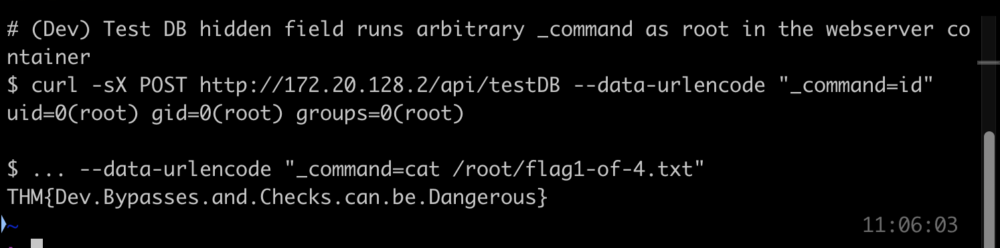
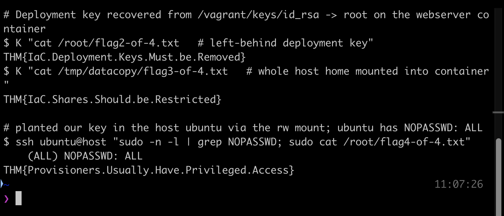

| <script src="https://tryhackme.com/badge/434937"></script>| <a class="twitter-follow-button" href="https://twitter.com/anir0y" data-size="large"> Follow @anir0y<a>|
|---|---|
|On-Premises IaC ||

On-Premises IaC is the second room in the Infrastructure as Code module of the DevSecOps path, and it is the one where the theory finally gets attacked. [Intro to IaC](/post/thm-room-introtoiac/) set up the vocabulary, declarative versus imperative, the lifecycle, virtualisation. This room builds an actual on-prem pipeline with Vagrant and Ansible, then hands you a box and tells you to break the pipeline it deploys. If you came through the container module first, [Container Hardening](/post/thm-room-containerhardening/) is the closest sibling, because the final challenge is really about what a container is allowed to mount and who inside it is root.

The room is eight tasks. Tasks 2, 3 and 4 are read-from-the-text theory. Task 5 is a guided pipeline build with one flag. Task 7 is the real work: a four-flag challenge where you SSH in as a low-privilege user and attack the Vagrant/Ansible deployment. I will move quickly through the theory and spend the time on the attack, because that is where the transferable lessons are.

## Task 2: Why on-prem at all

On-prem IaC means the infrastructure lives in your own data centre instead of a cloud provider. The room frames it as a control-versus-convenience tradeoff, using self-hosted GitLab against GitHub as the example. The three yes/no answers follow from that:

- More control over the whole pipeline: **Yea**, that is the main reason to go on-prem.
- Flexible and easily scalable deployment: **Nay**, elastic scaling is the cloud's strength, not on-prem's.
- Strict data protection regulations: **Yea**, keeping data in your own data centre is exactly why regulated industries choose on-prem.

## Task 3: Vagrant basics

Vagrant builds and maintains portable environments and can drive different providers (Docker, VirtualBox, VMware, AWS). The terms that matter: a provider is the virtualisation backend, provisioning is an action Vagrant performs, a box is the image, and the provisioning file is the **Vagrantfile**. To provision every host you run **vagrant up**, and to provision a single named host you append its name, so the webserver alone is **vagrant up webserver**.

## Task 4: Ansible basics

Ansible does configuration management with version control on the steps, so it only applies what changed. The three terms the task asks for are the file types: the YAML list of steps is a **playbook**, the base file with variable placeholders that gets filled in at runtime is a **template**, and a reusable collection of templates and instructions you assign to a host with one line is a **role**.

## Task 5: Building the pipeline

Task 5 gives you a split-view machine with the pipeline in `/home/ubuntu/iac/`. The Vagrantfile defines two Docker containers: a `mysql` dbserver on 172.20.128.3 and an `ansible` webserver on 172.20.128.2, with the webserver provisioned by an Ansible playbook. The playbook assigns a `webapp` role that sets up the database from templated SQL and deploys a Flask app, injecting variables (db user, password, host, api key) from `defaults/main.yml`.

You start the pipeline with `vagrant up` from the `iac` directory, then launch the app with `vagrant docker-exec -it webserver -- python3 /app/app.py`, and browse to `http://172.20.128.2/`. The flag is shown on the user home page after you sign up and sign in. I confirmed it by reading the deployed `userhome.html`, which renders it directly:

```text
  Welcome Home: THM{IaC.Pipelines.Can.Be.Fun}
```

So the Task 5 flag is **`THM{IaC.Pipelines.Can.Be.Fun}`**.

## Task 6: The four security concerns

This task is the attack map for Task 7, so it is worth reading closely rather than clicking through. It lists four places security breaks in an IaC pipeline: **dependencies** (base images you pull in), **defaults** (credentials and keys the pipeline uses to provision, left in place instead of removed as the last step), **insufficient hardening** (services the pipeline needs, like SSH, left running afterwards), and **access** (secret management plus least privilege, so a compromised pipeline does not hand over everything). No answer needed, but every one of the four flags that follows maps to one of these.



## Task 7: Attacking the pipeline

A separate machine, reached over SSH with the credentials `entry` / `entry`. The `entry` user is deliberately locked down: not in the `docker` or `sudo` group, no readable private keys, no writable pipeline files. The four flags all live on machines the pipeline deployed, and the chain to reach them is the point.

### Flag 1: the developer backdoor (source code review)

The first hint says to review the web app's source, because developers add functions for "certain checks". The three copies of the app in the home directory are plain login apps with no such function, which is a trap: the deployed app is a fourth variant. Fetching the live sign-in page shows a form the source copies do not have:

```text
  $ curl -s http://172.20.128.2/signin | grep testDB
  <input type="hidden" name="_command" value="service mysql status"/>
  <button id="btntestDB" (Dev) Test DB</button>
```

A hidden `(Dev) Test DB` button posts a `_command` field to `/api/testDB`, and the app runs it. The Flask app runs as root inside the container, so this is unauthenticated command execution as root. The hidden value is only the default; I substitute my own:



```text
  $ curl -sX POST http://172.20.128.2/api/testDB --data-urlencode "_command=id"
  uid=0(root) gid=0(root) groups=0(root)
  $ ... --data-urlencode "_command=cat /root/flag1-of-4.txt"
  THM{Dev.Bypasses.and.Checks.can.be.Dangerous}
```

Flag 1 is **`THM{Dev.Bypasses.and.Checks.can.be.Dangerous}`**. One operational note: `/api/testDB` returns the command output inside the `<h1>` of an error page, so I pipe the response through a small `awk` filter to pull out just the text.

### Flag 2: the left-behind deployment key

The second hint points at `/vagrant`. When Vagrant provisions with a synced folder, it mounts the whole project directory into the container at `/vagrant`, and that project directory still holds `keys/id_rsa`, the private key Vagrant uses to SSH into the webserver as root. The `entry` user cannot read that key on the host (it is mode 600, owned by `ubuntu`), but root inside the container can, because a bind mount does not stop uid 0 from reading it. Using the RCE to read the key gives me a real SSH session as root in the container, where flag 2 sits in `/root`:

```text
  $ cat /vagrant/keys/id_rsa   # via the RCE, then saved locally
  $ ssh -i depkey root@172.20.128.2 'cat /root/flag2-of-4.txt'
  THM{IaC.Deployment.Keys.Must.be.Removed}
```

Flag 2 is **`THM{IaC.Deployment.Keys.Must.be.Removed}`**. The key should have been deleted as the final provisioning step. It was not, which is the "defaults" concern from Task 6.

### Flag 3: the over-permissive share

The third hint is about provisioning shares that are never restricted. Checking the container's mounts shows the Vagrantfile bind-mounts the entire host home directory into the container as `/tmp/datacopy`, so a container compromise reads the host's home as root. Flag 3 is a file in the host home that `entry` cannot read directly, but the container can through the mount:



```text
  $ ssh -i depkey root@172.20.128.2 'cat /tmp/datacopy/flag3-of-4.txt'
  THM{IaC.Shares.Should.be.Restricted}
```

Flag 3 is **`THM{IaC.Shares.Should.be.Restricted}`**. Mounting a whole home directory into a deployment container to move a few files is lazy, and it hands an attacker the host's secrets.

### Flag 4: provisioners have too much privilege

The last hint is about privileges being too permissive. That same host-home mount is read-write, so from inside the container I append my own public key to the host `ubuntu` user's `authorized_keys`, then SSH to the host as `ubuntu`. From there, `sudo -l` tells the whole story:

```text
  $ ssh ubuntu@host 'sudo -n -l'
  User ubuntu may run the following commands on tryhackme:
      (ALL : ALL) ALL
      (ALL) NOPASSWD: ALL
  $ sudo cat /root/flag4-of-4.txt
  THM{Provisioners.Usually.Have.Privileged.Access}
```

Flag 4 is **`THM{Provisioners.Usually.Have.Privileged.Access}`**. The account the pipeline provisions with has passwordless root, because working out the exact privileges a provisioner needs is hard and people over-grant. That is the "least privilege" concern, and it closes the chain: web RCE to container root to host user to host root.

A word on the room's own warning: it notes the box runs old software with kernel-exploitable versions, and asks you not to take that shortcut. I did not. Every step above uses an IaC misconfiguration the room is teaching, not a kernel CVE.

## Two takeaways

First, a bind mount is not a security boundary. Three of these four flags come from the same root cause: the container runs as root and the pipeline mounts host paths into it (the project directory with its keys, the whole host home, read-write). Inside the container, uid 0 reads and writes those host files regardless of their owner or mode on the host. When you review an IaC pipeline, the synced-folder and volume lines are where the real blast radius lives, not the application code. On a real engagement this is the same instinct that turns a container escape or an SSRF-to-metadata into full host compromise: find what the workload can reach that it should not.

Second, provisioning secrets are production secrets. The deployment key, the default DB password in `defaults/main.yml`, and the NOPASSWD sudo rule all exist so the pipeline can do its job, and all three were supposed to be removed or tightened as the last step. They were not, and each one is a direct path inward. Secret management and a real "revoke at the end" step are not optional polish on an IaC pipeline; they are the difference between a deploy key and a root shell.

Room solved 100%: 8 tasks, 17 answers.
