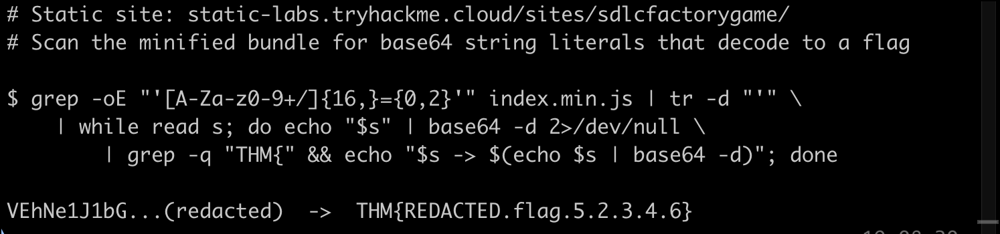

| <script src="https://tryhackme.com/badge/434937"></script>| <a class="twitter-follow-button" href="https://twitter.com/anir0y" data-size="large"> Follow @anir0y<a>|
|---|---|
|SDLC ||

SDLC is an easy, theory-first room in the DevSecOps path's Secure Software Development module. It walks through the Software Development Lifecycle, the set of phases a project moves through, then layers on the DevOps CALMS model and the metrics teams track before you try to bolt security onto any of it. Almost every answer is a term lifted straight from the task text, so the real work is matching each question to the exact wording the grader wants. It pairs with my [DevSecOps Basics](/post/thm-room-devsecopsbasics/) notes on shifting security left and the [AI Threat Modelling](/post/thm-room-ai-threat-modelling/) walkthrough.

The twist is the final task: a Star Wars themed static site, "Production of the Droids", where you run a droid factory and have to double the Empire's seed funding to earn a flag. Rather than play the balancing game, I pulled the flag straight out of the site's JavaScript. Everything below is reading comprehension plus one short bit of client-side inspection.

## Task 2: what the SDLC is and how many phases it has

The lifecycle is a framework that standardises building software by splitting the work into measurable, repeatable phases. The one question here asks how many phases an SDLC can have, and the format hint (`X-Y`, a three character mask) points right at the sentence "SDLC phases are usually divided into 6-8 phases."

```text
  # How many phases can an SDLC have? (Format X-Y)
  6-8
```

The answer is **6-8**. The number is a range because teams merge or split phases depending on their model; Waterfall, Agile, and DevOps all slice the same work differently.



## Task 3: the first SDLC phases

Part 1 covers the front half of the lifecycle, and each question maps to one phase heading in the text:

- "What phase focuses on determining the first idea for a prototype?" is the **Requirements Definition** phase, where you list requirements, evaluate prototype alternatives, and research end-user needs into a software requirement specification (SRS).
- "What stage is also known as the Feasibility Stage?" is the **Planning Stage**. This one is a small trap worth owning: the room text literally reads "the Planning Phase, also known as the Feasibility Stage", so I submitted "Planning Phase" first and it was rejected. The accepted answer is "Planning Stage", matching the word "Stage" in the question and the 8-plus-5 character mask either way. Read the mask, but when two forms fit it, let the question's own noun break the tie.
- "When do you outline the user interfaces and network requirements?" is **Design and Prototyping**, where developers specify interfaces, databases, and architecture.

| Question | Answer |
|---|---|
| First idea for a prototype | `Requirements Definition` |
| Also known as the Feasibility Stage | `Planning Stage` |
| Outline user interfaces and network requirements | `Design and Prototyping` |

## Task 4: the later SDLC phases

Part 2 covers the back half, straight from the headings again:

- "What phase focuses on handling issues or bugs reported by end-users?" is **Operations and Maintenance**.
- "What phase involves releasing new versions of software?" is **Deployment**.
- "What phase ensures software meets the standards defined in the requirements phase?" is **Testing**.

Each masked field here is a controlled React input, which matters for how you answer it (more on that below the metrics task).

## Task 5: Keep CALMS

CALMS is the DevOps culture model, and the task spells each word out under its own heading. Strung together, the five pillars are **Culture, Automation, Lean, Measurement, Sharing**. The mask (`7, 10, 4, 11, 7` characters) confirms the exact words before you submit, which is handy because "Lean" and "Sharing" could otherwise be guessed as longer synonyms.

## Task 6: DevOps metrics

Before you can advise on security, you need to speak the metrics DevOps engineers already track. Three questions, all defined in the text:

- "What 2 metrics are used to measure deployment agility?" The room states agility is measured by combining deployment speed and frequency, so the answer is **Deployment Speed and Frequency**.
- "What is an essential rate for engineers in Production to know if code meets security requirements?" is the **Failure Rate**, the percentage of changes that need a hotfix once in production.
- "What is the measurement for recovery time after a failure?" is **MTTR** (mean time to recovery).

A practical note on these masked answer fields, because it cost me several retries. The inputs are React-controlled with an underscore mask held in the `value` attribute, not the `placeholder`. Setting the value with a scripted DOM setter updates what you see on screen but not React's internal state, so the Check button submits an empty mask and the answer is marked wrong. Real keystrokes are the only thing that registers, and TryHackMe rate-limits rapid submissions with "You are going too fast", so each Check needs a few seconds of breathing room. Type, pause, check, repeat.

## Task 7: pulling the flag out of the droid factory

The last task launches a static site where you allocate developers and sprints across SDLC phases to double a $1,000,000 investment, minding Brooks's law that "adding human resources to a late software project will make it later." You could grind the sliders, but the flag is baked into the page. The site loads a single minified bundle, `index.min.js`, and a quick scan for base64 string literals that decode to a flag finds it without playing a single round:



```text
  # static-labs.tryhackme.cloud/sites/sdlcfactorygame/
  grep -oE "'[A-Za-z0-9+/]{16,}={0,2}'" index.min.js | tr -d "'" \
    | while read s; do echo "$s" | base64 -d 2>/dev/null \
        | grep -q "THM{" && echo "$s -> $(echo $s | base64 -d)"; done
  #  <base64 redacted>  ->  THM{REDACTED.flag.5.2.3.4.6}
```

One base64 literal in the bundle decodes cleanly to the flag, whose answer mask (`THM{5.2.3.4.6}` worth of characters, dot separated) matches the decoded string exactly. I have redacted the value here; the point is the method. The game's "win" logic and the flag string both ship to the client, so the browser already holds the answer before you touch the controls.

## Two takeaways

First, on a knowledge room the answer mask is a spec, and the question's own wording resolves ties. Most answers were a single heading from the text, but "Planning Stage" versus "Planning Phase" both fit the same character mask, and only the noun in the question ("What stage") told me which the grader wanted. When two readings satisfy the mask, stop guessing and re-read the question for the word it is echoing.

Second, anything shipped to the browser is already yours to read. The droid factory is a client-side game, so its scoring and its reward flag live in the JavaScript the site hands you. Scanning a minified bundle for base64 literals that decode to a known prefix (here `THM{`) is faster and more reliable than playing the intended game, and it is the same instinct that finds hardcoded secrets, API keys, and feature flags in real single-page apps: never trust the client to keep a secret it has been given.

Room solved 100%: 7 tasks, 13 answers.
