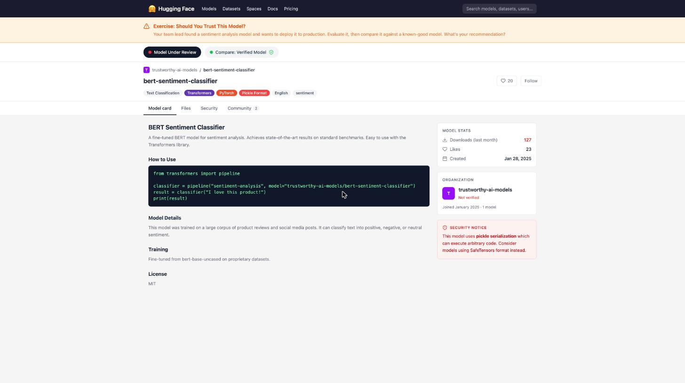
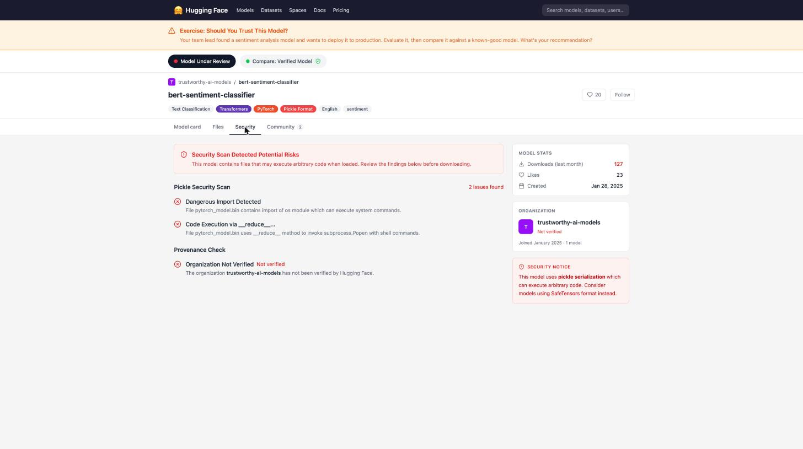

| | <a class="twitter-follow-button" href="https://twitter.com/anir0y" data-size="large"> Follow @anir0y<a>|
|---|---|
|Understanding AI Supply Chains ||

Understanding AI Supply Chains is an easy, concept-heavy room about where machine learning pipelines go wrong. It takes the familiar software supply chain idea (you trust code you did not write) and adds the thing that makes AI different: a trained model is not just code, it is a file you load and run, and loading it can execute whatever the uploader baked in. If you have done the classic software supply chain reading, this is the AI-specific sequel; the practical at the end is a HuggingFace trust exercise rather than a shell.

The room is eight tasks. Most answers come from the text, and the one interactive task is a static HuggingFace clone. I will move through the concepts and spend the detail on the practical.

## Task 2: What is a supply chain

Grounding in the classic incidents. In the 2020 SolarWinds attack, the malicious code was injected into the Orion **build process**, so customers installed a signed, legitimate-looking update that carried a backdoor. The room also makes the dependency point with pip: when you install `torch`, pip also pulls in `filelock`, which you never asked for. That makes `filelock` a **transitive dependency**, a package you depend on only because something else does.

## Task 3: The AI supply chain

AI adds a new kind of artefact. A trained model bundles an architecture, training data, a training process, and serialised weights, and most of that you cannot inspect. The four key components of an AI supply chain, listed alphabetically, are **Datasets, Dependencies, Frameworks, Models**. The dangerous part is the format: unlike normal code that runs as written, pickle-based model files contain **serialised objects** that can execute code the moment you call `model.load()`. Every arrow between these components is a trust relationship, and breaking one breaks the whole system.

## Task 4: Two ways to consume AI

You either download model files and run them yourself, or you call a hosted API. For the self-hosted path, the dominant file format for running local large language models like LLaMA, Mistral and Qwen is **GGUF**. The format matters because, as the next task shows, the file format itself is an attack surface.

## Task 5: The four attack layers

This is the core of the room. The attack surface for the download paradigm splits into four layers:

- **Model Layer**: attacks on the model files themselves. Pickle-based attacks live here, so the answer to where pickle attacks occur is the **Model Layer**.
- **Dependency Layer**: the packages and libraries the project pulls in.
- **Data Layer**: the training and evaluation data. A dataset poisoning attack, where a tiny fraction of a public dataset is swapped for crafted backdoor samples, is a **Data Layer** attack.
- **Infrastructure Layer**: the systems that host and distribute everything.

The model layer itself has three levels. Serialisation-level hides code in the file format and runs it on load, architecture-level embeds malicious logic in the model's layers, and weights-level subtly alters learned values. Converting a model to SafeTensors (which stores only raw weight values, no executable objects) eliminates the **Serialisation-level** attack specifically. It does nothing for a poisoned architecture or weights, which is a useful nuance: SafeTensors fixes the format, not the model.



## Task 6: Real-world incidents

Two incidents map cleanly onto the layers. The **torchtriton** attack in 2022 exploited pip's resolution order to install a malicious public package in place of an internal one (dependency confusion), which is a **Dependency Layer** attack. The **@solana/web3.js** compromise, where an attacker stole a maintainer's credentials and pushed malicious updates to a legitimate, high-trust npm package, is an **Infrastructure Layer** attack: the package was fine, the publishing infrastructure and trust around it were the target.

## Task 7: The HuggingFace trust check

The practical is a static HuggingFace clone. Your team lead wants to deploy a sentiment model to production and asks you to evaluate it against a known-good one. The model under review is `bert-sentiment-classifier`, and the first thing to read is who published it: the organisation is **trustworthy-ai-models**, and despite the reassuring name it carries a "Not verified" badge. It has only **127** downloads last month, was created recently, and is tagged "Pickle Format".

The Security tab makes the risk concrete. The pickle scan flags two issues: `pytorch_model.bin` imports the `os` module (system command execution) and uses the `__reduce__` method to invoke `subprocess.Popen` with shell commands, which is the textbook pickle code-execution pattern. The provenance check adds that the organisation is not verified by HuggingFace.

Comparing against the verified model, `google-bert/bert-base-uncased`, tells the other half of the story. It has tens of millions of downloads, a verified organisation, and its weights ship in **SafeTensors** format, which cannot carry executable objects. The name of the suspicious org was `trustworthy-ai-models`, its download count was 127, and the verified model's weight format is SafeTensors: an unverified, low-download, pickle-format model from an org you cannot vouch for is exactly what you do not deploy.

## Two takeaways

First, "it loaded correctly" is not a security property for a model. A pickle file that produces the right predictions can still run `subprocess.Popen` the instant you load it, and a model that behaves perfectly on your test inputs can carry a backdoor that only triggers on an attacker's chosen input. Treat a downloaded model like untrusted code, because that is what it is: prefer SafeTensors so the format cannot execute, scan pickle files before loading, and check provenance (verified org, download history, who actually uploaded it) rather than trusting a reassuring name.

Second, the four layers are a checklist for any ML project, not just this room. When you bring in an external model, ask at each layer: is the model file a safe format (Model), are the packages and their resolution order trustworthy (Dependency), is the training data from a source you trust (Data), and is the hosting and publishing path hardened against credential theft (Infrastructure). The real incidents, SolarWinds, torchtriton, solana, log4shell, all came down to one broken trust relationship in a chain nobody fully inspected.

Room solved 100%: 8 tasks, 15 answers.
