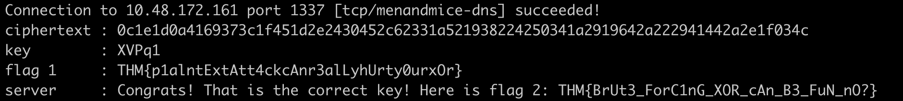

| <script src="https://tryhackme.com/badge/434937"></script>| <a class="twitter-follow-button" href="https://twitter.com/anir0y" data-size="large"> Follow @anir0y<a>|
|---|---|
|W1seGuy ||

W1seGuy is a short, easy crypto challenge: a TCP service on port 1337 hands you a hex blob, says it is the first flag XOR-encrypted, and asks for the key. Get the key right and it gives you the second flag. The room's tagline, "the answer is usually as plain as day", is the whole hint: this is a known-plaintext attack. If you want the theory first, my [Cryptography Concepts](/post/thm-room-cryptography-concepts/) notes cover symmetric basics, and [Breaking Crypto the Simple Way](/post/thm-room-breakingcryptothesimpleway/) is the next step up into real-world cryptographic failures.

## Task 1: reading the server source

The room ships the server as a single Python file behind the Download Task Files button. My first click returned a 503 from the S3 bucket; a second attempt a few seconds later downloaded it fine. The parts that matter:

```python
  # key generation, once per connection
  res = ''.join(random.choices(string.ascii_letters + string.digits, k=5))
  key = str(res)

  # encryption: repeating-key XOR, then hex
  for i in range(0,len(flag)):
      xored += chr(ord(flag[i]) ^ ord(key[i%len(key)]))
  hex_encoded = xored.encode().hex()

  # the reward
  if key_answer == key:
      send_message(server, "Congrats! That is the correct key! Here is flag 2: " + flag + "\n")
```

Three facts fall out of this:

- The key is only **5 characters** long and is repeated across the whole flag (`key[i % 5]`).
- XOR is its own inverse, so `ciphertext ^ plaintext = key`. Any plaintext byte you already know gives you the key byte at that position.
- A new key is generated **per connection**, so you have to recover it and answer on the same socket. You cannot connect, think about it, and come back.

The task itself is a "No answer needed" acknowledgement.

## Task 2: recovering the key from THM{ and }

Every TryHackMe flag starts with `THM{` and ends with `}`. The first four bytes of plaintext give key positions 0 to 3 straight away. That leaves one key byte, position 4, and the closing brace supplies it as long as the flag length minus one lands on position 4 modulo 5. The answer mask for flag 1 is `***{` plus 35 characters plus `}`, 40 bytes in total, and `(40 - 1) % 5 = 4`. So the last byte fills exactly the gap. No brute force needed.



The solver connects, parses the hex, derives the key from those five known bytes, decrypts flag 1 locally, then sends the key back on the same connection:

```python
  import socket, sys

  s = socket.create_connection((sys.argv[1], 1337), timeout=10)
  banner = s.recv(4096).decode()
  ct = bytes.fromhex(banner.split("flag 1: ")[1].split()[0])

  key = [None] * 5
  for i, ch in enumerate(b"THM{"):          # key[0..3]
      key[i % 5] = ct[i] ^ ch
  key[(len(ct) - 1) % 5] = ct[-1] ^ ord("}")  # key[4] from the closing brace
  key = bytes(key).decode()

  flag1 = bytes(c ^ ord(key[i % 5]) for i, c in enumerate(ct)).decode()
  print("key   :", key)
  print("flag 1:", flag1)

  if not banner.rstrip().endswith("key?"):
      s.recv(4096)                           # swallow the prompt if it came separately
  s.sendall((key + "\n").encode())
  print("server:", s.recv(4096).decode().strip())
```

One run against the lab box:



The first flag is **THM{p1alntExtAtt4ckcAnr3alLyhUrty0urxOr}** ("plaintext attack can really hurt your XOR"), and the server answers the correct key with the second and final flag, **THM{BrUt3_ForC1nG_XOR_cAn_B3_FuN_nO?}**. Both matched their masks by length before I submitted, and both were accepted first try.

The key really is fresh on every connection. My first run used `83oMj` and the screenshot run got `XVPq1`; the flags were identical, because only the key changes.

### The detour that cost more time than the crypto

The solve took seconds; getting to the box did not. My Mac was not on the TryHackMe VPN, so the first lab IP routed out over the local network and port 1337 never answered. By the time the VPN was up, that machine had stopped and the room was offering "Start Lab Machine" again. A fresh deploy came up on a new IP inside the VPN's range and answered immediately. If a THM target will not answer, check `route -n get <ip>` for a `utun` interface and the room's running-machines list before blaming the service.

## Two takeaways

First, repeating-key XOR falls over as soon as the attacker can predict any of the plaintext. Here a fixed flag format gave away all 5 key bytes for free. Real protocols leak the same way through file magic bytes (`%PDF`, `PK\x03\x04`, `\x89PNG`), JSON that always opens with `{"`, and HTTP headers. A short key plus a known prefix is a known-plaintext attack, and no key search is needed.

Second, read the mask arithmetic before you reach for brute force. The 40-byte flag length meant the closing brace landed on exactly the one key position the prefix did not cover. With a different length you would need the fifth byte from somewhere else, but even then the search is at most 62 candidates checked against "does the result look like a flag". The room's flag 2 jokes about brute forcing; knowing the format made it unnecessary.

Room solved 100%: 2 tasks, 3 answers.
